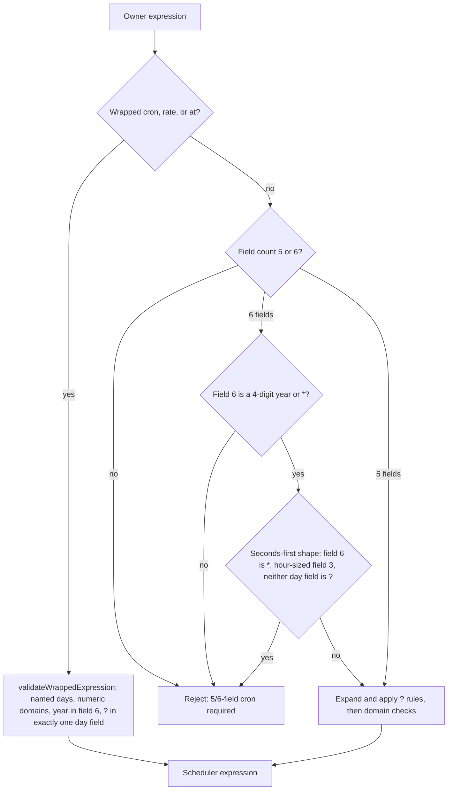
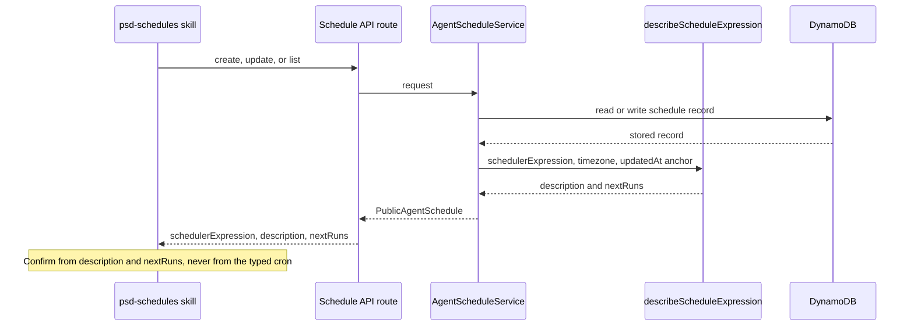
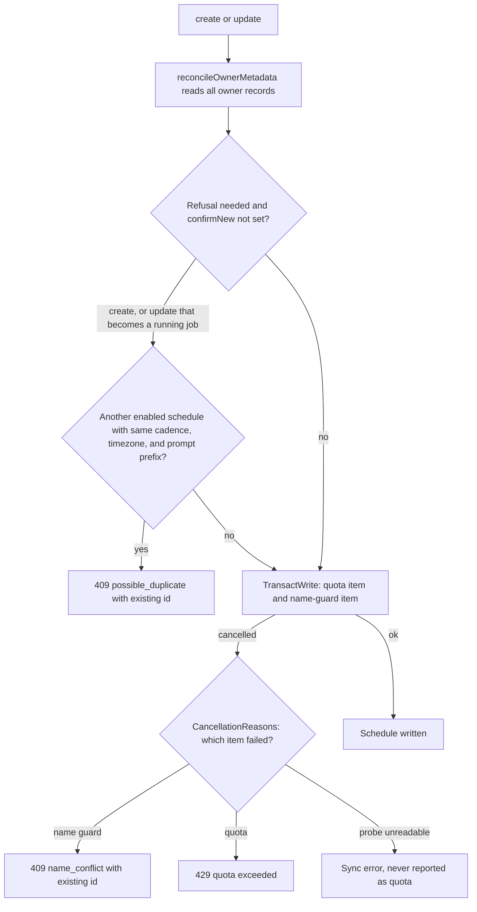

# Agent Schedules

Agent schedules let an owner run a skill-driven agent turn on a timetable (watchers, briefs, digests). The owner describes a time in plain language; the agent writes a cron, rate, or at expression; AWS EventBridge Scheduler fires it. This page covers the part of the stack that decides whether a stored expression means what the owner intended: validation, a read-back of what was saved, the refusals that stop an agent from creating a duplicate schedule, and a read-only audit of schedules already in storage. Schedule management routes and the scheduled-run authoring rules are summarized in [Schedule Management](overview.md#schedule-management) of the agent platform overview. What happens when a schedule keeps failing, and the owner notice, are in [Schedule Failure Streaks and Owner Notices](schedule-failure-notices.md).

## Why this exists

EventBridge Scheduler's cron dialect differs from ordinary cron. It takes `minute hour day-of-month month day-of-week year`, numbers day-of-week with SUN as 1, requires `?` in exactly one day field, and has no seconds field. Two failures motivated the current design (issue #1888, PR #1914):

- A seconds-first expression such as `0 15 18 * * *` ("6:15pm daily") was accepted as a 6-field cron and rewritten into `cron(0 15 18 * ? *)`, which means 3:00pm on the 18th of every month. Nothing downstream caught it.
- The create, update, and list responses echoed only the raw cron string. An agent could "confirm" a wrong schedule by repeating what it had sent.

The fix has three parts: stricter validation, a stored-meaning read-back, and an audit that finds damage in schedules created before the checks existed. A later change (issue #1889) added refusals for creates that duplicate an existing job or reuse its name, because agents had been retrying failed creates under new names.

## Components

| Piece | Owns | Entry points |
|---|---|---|
| Input validation | Turns the owner's expression into the scheduler expression and rejects foreign or ambiguous shapes | `toSchedulerExpression` in `lib/agent-schedules/validation.ts` |
| Read-back | Plain-language description and next fire times for a stored schedule | `describeScheduleExpression` in `lib/agent-schedules/schedule-description.ts`, called from `publicSchedule` and `publicDegradedSchedule` in `lib/agent-schedules/service.ts` |
| Duplicate refusal | Refuses a create or an update that would make a second enabled copy of a job, or reuse a taken name, before any schedule write | `refuseIfLikelyDuplicate`, `findLikelyDuplicate`, `becomesRunningJob`, and `createCancellationError` in `lib/agent-schedules/service.ts`, surfaced by `scheduleErrorResponse` in `app/api/agent/schedules/route.ts` |
| Run health | Failure streak and the `failing` marker on `list` | `consecutiveFailuresBySchedule` in `lib/agent-schedules/run-reader.ts`, merged by `runHealth` in `lib/agent-schedules/service.ts`; see [failure streaks](schedule-failure-notices.md#measuring-a-streak) |
| Audit | Read-only report of stored schedules whose meaning looks wrong, with a suggested correction | `auditSchedule` in `lib/agent-schedules/schedule-audit.ts`, driven by `scripts/audit-agent-schedules.ts` |
| Skill mirror | A second, independent validator inside the agent container | `validateWrappedExpression` and `rejectMisreadSixFieldCron` in `infra/agent-image/skills/psd-schedules/common.js` |

`lib/agent-schedules/validation.ts` must stay free of the AWS SDK so the audit script can import it. That is why `DEFAULT_SCHEDULE_TIMEZONE` lives there rather than in `service.ts`.

## Input Validation

`toSchedulerExpression` tries the wrapped forms first (`cron(...)`, `rate(...)`, `at(...)`) through `normalizeWrappedScheduleExpression`, then falls back to `normalizeUnwrappedCron` for a bare 5- or 6-field cron. A 5-field form is expanded by appending a `*` year, and the error messages steer owners and agents toward that 5-field form.



*Caption: the unwrapped 6-field check in `rejectMisreadSixFieldCron` runs before the `?` expansion, so a seconds-first expression cannot be silently rewritten.*

Rules the validators enforce, with the behavior they protect:

- **Field 6 is a year.** An unwrapped 6-field cron must carry a 4-digit year (or `*`) in field 6. An explicit year can never be seconds-first, so `0 9 1 * * 2027` stays valid.
- **Seconds-first shape.** Only the year-`*` form is ambiguous. The check looks at field 3 and the `?` placement, not at the seconds value, because an earlier guard that required seconds to be `0` let `30 15 18 * * *` through.
- **Named day-of-week.** Numeric day-of-week is rejected because EventBridge reads `1` as Sunday. `1-5` runs Sunday through Thursday, not Monday through Friday. The error names the off-by-one so the owner can see the fix (`MON-FRI`).
- **Numeric domains.** Minute, hour, day-of-month, and month values are range-checked before reaching AWS, so an out-of-range value fails locally rather than only after a broker round trip to EventBridge.
- **`?` in exactly one day field.** Applied to hand-wrapped `cron(...)` as well as the unwrapped form, so a shifted expression with in-range values is caught.
- **Rate floor.** `rate(...)` expressions faster than every 5 minutes are rejected. The validator sets no upper bound on rate, which matters for the read-back (see below).

Tests that pin these behaviors: `tests/unit/agent-schedules-cron-domains.test.ts` (suites `cron field domain validation`, `day-of-week must be named, not numeric`, `an unwrapped 6-field cron must carry a YEAR in field 6`) and, for the skill's copy, `infra/agent-image/skills/psd-schedules/cron-dow.test.js`.

## Read-Back of the Stored Meaning

`publicSchedule` in `lib/agent-schedules/service.ts` adds these fields to every schedule returned by `list`, `create`, and `update`:

| Field | Source | Notes |
|---|---|---|
| `schedulerExpression` | Normalized expression EventBridge holds | What the schedule means; the raw `cronExpression` is only what was typed |
| `description` | `describeScheduleExpression` | Plain language, for example `At 6:30 AM, on Sunday through Thursday` |
| `nextRuns` | `describeScheduleExpression`, three occurrences | ISO 8601 with the schedule timezone's offset; empty when `enabled` is false |
| `consecutiveFailures`, `consecutiveFailuresCapped`, `failing` | `consecutiveFailuresBySchedule` | Run health. Only `list` computes these. `create` and `update` return the zero defaults (`0`, `false`), so an agent must call `list` to learn whether a schedule is failing. Meaning and thresholds are in [Schedule Failure Streaks and Owner Notices](schedule-failure-notices.md). |

`describeScheduleExpression` computes occurrences directly rather than through a general cron library, because the EventBridge dialect is specific. It uses `Intl` for timezone offsets, so a DST transition holds the local wall clock, and it searches at most about five years (`MAX_SEARCH_DAYS`). It never throws: an expression it cannot read returns the raw expression as `description` and no `nextRuns`.

Invariants to preserve:

- **Minute precision.** EventBridge invokes targets with 60-second precision, so the seconds in `nextRuns` are meaningful only for `at(...)` and for `rate(...)` anchors. Cron times land on `:00`.
- **Rate anchoring.** EventBridge restarts a `rate(...)` interval at create and update, so fire times are computed from the record's `updatedAt`, not from now. Without a usable anchor the result has no fire times rather than wrong ones.
- **Representable range.** `rate(...)` has no upper bound, so projected instants can leave the `Date` range. Such occurrences are dropped before `Intl` is called, because `formatToParts` throws on them and would fail the whole list.
- **Disabled schedules.** A disabled schedule is held by EventBridge and reports no upcoming runs, while its description still reads back.
- **Degraded rows.** `publicDegradedSchedule` describes rows that fail normal parsing, using the stored `cronExpression` when no scheduler expression exists.



*Caption: read-back fields are computed on every response, so the agent confirms what the platform will do, not what it sent.*

The skill side is documented in `infra/agent-image/skills/psd-schedules/SKILL.md` under "Read back what was SAVED, not what you sent". The skill instructs the agent to say when `nextRuns` is empty rather than inventing a time.

## Duplicate and Name Refusals (#1889)

Agents used to recover from a failed create by retrying under a slightly different name, which left several near-identical schedules running. Two refusals now stop that, and both return HTTP 409 with the id of the schedule the agent should change instead.



*Caption: the duplicate check runs before any schedule write, so a refusal leaves nothing to roll back. The name check is classified from the transaction's own cancellation reasons.*

- **Name conflict (`name_conflict`).** The name guard row is keyed by a hash of the trimmed, lower-cased name. `createCancellationError` reads the per-item `CancellationReasons` from the failed `TransactWrite`. A failed name-guard item is a name conflict, and its existing id comes from a consistent read of the guard row. Without the reasons, the code falls back to probing the guard row. A failed read is reported as a sync error, never as quota, because quota is what drove agents to rename.
- **Possible duplicate (`possible_duplicate`).** `findLikelyDuplicate` matches an **enabled** record that has a different name, the same `schedulerExpression`, the same timezone, and the same first 200 normalized prompt characters. The timezone is compared separately because the same cron in two zones fires hours apart. A same-name record is excluded so that it reports as `name_conflict`, which `confirmNew` cannot clear.
- **Update.** `becomesRunningJob` gates the update check. It applies only when the update enables a schedule or changes the cadence, timezone, or prompt of an enabled one. A rename alone is never refused, so a legacy pair that already double-fires can still be renamed.
- **Opt-out.** `confirmNew: true` (`--confirm-new` in the skill) skips the duplicate check for create and update. It does not skip the name conflict.
- **Response shape.** `scheduleErrorResponse` in `app/api/agent/schedules/route.ts` merges `AgentScheduleConflictError.details` into the 409 body, with `error` written last so the message always wins. A 409 without a `code` is an integrity refusal on an existing record, not a duplicate.
- **Limit.** The check is best-effort. It reads a snapshot and takes no owner-level lock, so two truly concurrent creates can both pass. It targets the sequential retry loop, not a race.

Skill side: `infra/agent-image/skills/psd-schedules/SKILL.md` tells the agent to run `list` before any `create`, to `update` the schedule a 409 names, and to use `--confirm-new` only for a copy the user genuinely wants. `create.js` and `update.js` pass `confirmNew` through, and `refusalDetail` in `common.js` prints the code and id after the message.

## Read-Only Audit of Stored Schedules

Validation only protects new writes. Schedules created before the checks existed are still live, so `scripts/audit-agent-schedules.ts` scans the schedules table and reports the ones whose stored meaning looks wrong. Run it with the root script `bun run agent:audit-schedules`. It requires `AGENT_SCHEDULES_TABLE`, reads `AWS_REGION` (default `us-east-1`), and accepts `--json` for machine output and `--all` to include disabled schedules. By default it audits enabled schedules only.

The script is I/O only. Every decision lives in `auditSchedule` in `lib/agent-schedules/schedule-audit.ts`, which returns a `ScheduleFinding` or `null`. The script never writes to DynamoDB or EventBridge: the stored expression is evidence of what was typed, and correcting it is the owner's or an admin's decision.

`auditSchedule` checks two things and ignores `rate(...)` and `at(...)`:

1. **Numeric day-of-week.** A numeric day-of-week (after removing `#n` and `L` ordinals, so `MON#1` is not flagged) is reported with the named form in `suggestedExpression`. `6L` is still flagged because EventBridge's numbering is the problem.
2. **Name versus cadence.** When the schedule name suggests a daily or weekday cadence (`daily`, `weekday`, `morning`, `nightly`, and similar), but the expression is restricted by year, month, or day-of-month, the audit reports a mismatch. A cadence word (`monthly`, `quarterly`, `yearly`) in the name suppresses this check, because a time-of-day word says nothing about frequency. A range covering the whole domain (`1-31`, `JAN-DEC`) is treated as unrestricted, and a step of one is treated as `*`.

The only automated rewrite is the seconds-first misread, and only inside the daily-name branch: when the first field is `0`, field 3 is an hour-sized number, and day-of-week is `?`, the suggestion shifts the fields into minute-hour order (`0 15 18 * ? *` becomes `15 18 * * ? *`). Anything else is reported without a rewrite, and `suggestedExpression` is `null` when there is no rewrite to offer.

The script's output includes `nextRuns` for each finding, computed from the stored `updatedAt` for `rate(...)`. Disabled schedules show none.

## Skill Mirror

`infra/agent-image/skills/psd-schedules/common.js` validates cron inside the agent container. It cannot import `lib/agent-schedules/validation.ts`, because the skill is a separately built artifact. The two validators are intentionally duplicated. Each file names the one it mirrors, and each carries tests over the same expressions. The mirrored checks are `rejectMisreadSixFieldCron` and `isYearField`, `assertFieldDomains` and `numericValuesOutOfRange`, the `?`-exclusivity rule, and the named day-of-week rule.

**There is no automated sync.** A validation fix in `lib/agent-schedules/validation.ts` must be ported to `common.js` by hand, and the reverse. The learnings note `docs/learnings/workflow/2026-10-14-schedule-audit-cadence-words-and-dual-validator-sync.md` records this rule. The skill-side check exists so the agent learns of a bad expression before spending a broker round trip. The broker remains the authority.

## Change Guidance

- **Changing cron rules.** Edit `validation.ts` first, then port the same check to `common.js`, then update both test suites. Confirm the seconds-first and numeric day-of-week cases still fail on both paths.
- **Changing read-back wording or fire times.** Edit `schedule-description.ts`. Check that `service.ts` still suppresses `nextRuns` for disabled rows and that the degraded path still anchors `rate(...)` on `updatedAt`.
- **Changing audit heuristics.** Edit `schedule-audit.ts`. Keep the cadence-word precedence and the full-domain rule, which were both added after false positives in correct schedules.
- **Changing the skill's read-back instructions.** Edit `psd-schedules/SKILL.md`. The read-back table there names the fields the broker returns, so keep it in step with `publicSchedule`.
- **Changing duplicate rules.** Edit `findLikelyDuplicate` or `becomesRunningJob` in `service.ts`, and keep create and update on the same check. The 409 `details` shape is a closed union (`AgentScheduleConflictDetails`), so a new refusal code needs a type change, a route test, and a row in the skill's `SKILL.md` table of codes.
- **Changing the create transaction.** `CREATE_QUOTA_ITEM_INDEX` and `CREATE_NAME_GUARD_ITEM_INDEX` must match the item order in `create`. A unit test pins that order, so reordering the items fails it on purpose.

## Tests and Validation

| Behavior | Test location |
|---|---|
| Field 6 year rule, seconds-first rejection, named days, `?` exclusivity, domain bounds | `tests/unit/agent-schedules-cron-domains.test.ts` |
| Plain-language description, DST, timezone, `rate(...)` anchor, `at(...)`, horizon | `tests/unit/agent-schedules-description.test.ts` |
| Audit findings, cadence-word precedence, restriction detection | `tests/unit/agent-schedules-audit.test.ts` |
| `nextRuns` and `description` on list, disabled rows, legacy numeric day-of-week, degraded rows | `tests/unit/agent-schedules-service.test.ts` (`schedules echo back what was actually saved`) |
| Name conflict versus quota classification, from cancellation reasons | `tests/unit/agent-schedules-service.test.ts` (`AgentScheduleService name collision mapping`, `pins the TransactWrite item order the create conditions rely on`) |
| Likely-duplicate refusal, `confirmNew`, timezone and cadence distinctions, update gate | `tests/unit/agent-schedules-service.test.ts` (`AgentScheduleService likely-duplicate refusal`, `AgentScheduleService duplicate refusal bypasses`) |
| `POST /api/agent/schedules` 409 body carries `code` and the existing id; a 409 without a code keeps its message | `tests/unit/agent-schedules-route.test.ts` (`POST /api/agent/schedules duplicate refusals`) |
| `failing` at three consecutive failed runs, capped streak wording, degraded run fields together | `tests/unit/agent-schedules-service.test.ts` (`marks a schedule failing at three consecutive failed runs`, `reports a saturated streak as capped`, `degrades both run fields when only the streak query fails`) |
| Failing threshold equals the owner-notice threshold | `tests/unit/agent-schedule-failing-threshold.test.ts` |
| Skill cron validation mirror | `infra/agent-image/skills/psd-schedules/cron-dow.test.js` |
| Skill list rendering of read-back and `failing` fields | `infra/agent-image/skills/psd-schedules/list.test.js` |
| Skill duplicate guidance matches the flags `create.js` and `update.js` accept and the codes in `SKILL.md` | `infra/agent-image/skills/psd-schedules/authoring-rules.test.js` (`duplicate-prevention guidance`) |

Focused checks:

```bash
bunx jest --silent agent-schedules
bunx jest --silent agent-schedule-failing-threshold
bun run test:skill:schedules
```

`bunx jest --silent agent-schedules` runs the four root unit suites above plus `tests/unit/agent-schedules-route.test.ts`. `--silent` suppresses passing output but keeps failure diagnostics. `bunx jest --silent agent-schedule-failing-threshold` is a separate pattern because its file name does not contain `agent-schedules`. `bun run test:skill:schedules` runs the skill suite under `infra/agent-image/skills/psd-schedules`.

Conditional checks: `bun run agent:audit-schedules` reads a live DynamoDB table, so run it only against an environment whose `AGENT_SCHEDULES_TABLE` the operator has explicitly been given. It needs AWS credentials and is not part of routine validation. The streak and failing-marker SQL is covered by the Postgres-backed smoke tests described in [Schedule Failure Streaks and Owner Notices](schedule-failure-notices.md#tests-and-validation), not by these commands.

## Related

- [Agent Platform Overview](overview.md) summarizes schedule management routes, the read/write split for scheduled-mode turns, and scheduled-run authoring rules.
- [Schedule Failure Streaks and Owner Notices](schedule-failure-notices.md) covers the `failing` marker, the run statuses that feed it, and the owner DM it triggers.
- [Infrastructure Overview](../infrastructure/overview.md) covers the `agent-cron` Lambda that fires scheduled runs. The schedules table (`psd-agent-schedules-{env}`) is provisioned in `infra/lib/agent-platform-stack.ts`, and the audit script reads it through `AGENT_SCHEDULES_TABLE`.
