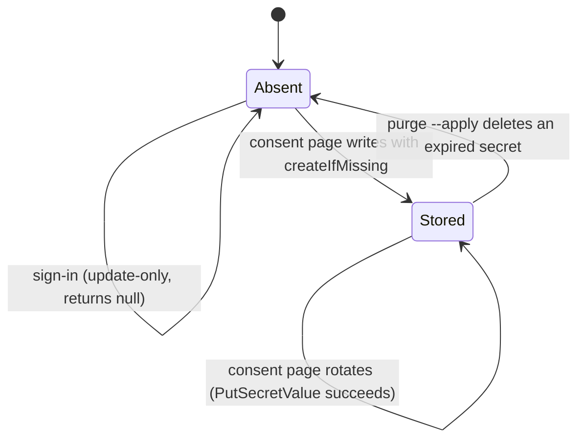

# Cognito Refresh-Token Mirror

The agent runs outside the Next.js web tier, so it cannot read a user's Cognito session. AI Studio therefore mirrors each user's Cognito refresh token into AWS Secrets Manager at a path the agent's IAM role can read, and the agent's data MCP calls use that token on the user's behalf. The mirror lives in `lib/auth/agent-token-sync.ts`. Its secret is one of the per-user slots listed in the [Infrastructure Overview](../infrastructure/overview.md#secrets-management).

Before #1902 every sign-in wrote a secret. Measured in production on 2026-10-12 there were 438 such secrets, 313 of them never read, about $125 a month, and 134 holding refresh tokens that had already expired. The fix made sign-in update-only and moved creation to the consent flow, and a one-off script clears the backlog.

## Secret path and payload

- **Path**: `psd-agent-creds/{environment}/user/{ownerEmail}/cognito-refresh`, built by `cognitoRefreshSecretId()`. The owner email must pass `SAFE_EMAIL_RE`.
- **Payload** (`CognitoRefreshTokenRecord`): `refresh_token`, `obtained_at`, `user_pool_id`, `client_id`, `region`.
- **Creation tags**: `Environment`, `ManagedBy=aistudio`, `OwnerEmail`.

## Two triggers, deliberately asymmetric

| Caller | Options | What it may do | Source |
|---|---|---|---|
| NextAuth JWT callback, initial sign-in and silent refresh | none (`createIfMissing` defaults to `false`) | Rotate an existing secret. Missing secret means no-op. | `auth.ts` → `syncCognitoRefreshForAgentBackground()` |
| `/agent-connect-data` consent page | `{ createIfMissing: true }` | Rotate or create. Only caller that can create. | `app/agent-connect-data/page.tsx` |

`auth.ts` runs the sync in the background and never awaits it. It is skipped on the Edge runtime, and any failure is logged without the token and does not break login. `syncCognitoRefreshForAgent()` also skips local development unless `FORCE_AGENT_TOKEN_SYNC` is set, and it skips when the refresh token or owner email is missing or invalid.

### How a user gets a secret

A user who never uses the agent never gets a secret. When the agent needs data access and has no usable token, the `psd-data` skill (`infra/agent-image/skills/psd-data/common.js`, `mintConsentUrl()`) asks the consent-link route for `kind: 'cognito_data'` and sends the link to the user in chat. The consent page then verifies the signed token and the signed-in session, writes the refresh token with `createIfMissing: true`, and only then burns the one-time nonce. A failed write leaves the nonce unburned, so the same link can be retried. The link mechanism is the same signed-link pattern used by [Credential Entry](credential-entry.md), with a different kind.

## Lifecycle



*Caption: the secret is created only by the consent page. Sign-in rotates it, and the one-off purge is the only deletion path.*

Within `persistCognitoRefreshSecret()`, `PutSecretValue` runs first. On `ResourceNotFoundException` the update-only caller logs at debug and returns `null`. The consent caller falls through to `createRefreshSecret()`. If that create loses a race (`ResourceExistsException`), it retries `PutSecretValue` once.

## Expired-secret purge

`scripts/agent-workspace/purge-expired-cognito-refresh-secrets.ts` clears secrets created before the fix. It is modelled on `purge-agent-slot-tokens.ts`.

- **Selection**: lists secrets with the `name` filter, then re-checks the full `…/user/{email}/cognito-refresh` shape locally, because the filter is not anchored.
- **Expiry heuristic**: deletes only secrets whose `LastChangedDate` is older than `--max-age-days` (default 31, which is the 30-day user-pool refresh validity plus a day). The heuristic holds only because an active user re-mirrors daily, since the 24-hour session max age forces a Node-side sign-in. If `SESSION_MAX_AGE` is ever raised past the pool's refresh validity, revisit this rule.
- **Keeps**: never-read but still-valid secrets, and secrets with no timestamp.
- **Race guard**: re-reads each secret with `DescribeSecret` right before `DeleteSecret`, and keeps it if it has been rewritten since the list.
- **Delete mode**: `ForceDeleteWithoutRecovery: true`. A scheduled-for-deletion secret would make the consent `CreateSecret` fail for up to 30 days.
- **Output**: dry run by default, printing secrets only by the random ARN suffix. `--apply` prints counts only. AWS error text is scrubbed of email addresses.

## Invariants

- Sign-in must not provision a secret for a user who has never connected the agent. Keep `createIfMissing` off the sign-in path. `auth-jwt-callback.test.ts` pins that both sign-in paths call the sync with exactly `(email, refreshToken)`.
- Only `/agent-connect-data` may pass `createIfMissing: true`, and it must burn the nonce only after a successful write.
- The purge must never delete a still-valid secret, because that would force a working user back through consent.
- The token is never logged. Success and failure lines carry the secret ID or a sanitized error, and the logger scrubs email addresses from metadata.

## Change guidance

- **Start here**: `syncCognitoRefreshForAgent()` and `persistCognitoRefreshSecret()` in `lib/auth/agent-token-sync.ts`. Change the consent caller in `app/agent-connect-data/page.tsx` only when the consent contract changes.
- **Adding a caller**: decide whether it may create. Creation must stay on an explicit user action. Passing an option from `auth.ts` is a cost regression, and the sign-in test is the guard.
- **Purge changes**: keep the dry-run default and the re-check before delete. Run dev first, as the script header says.
- **Non-goals**: this mirror does not manage the workspace or Google Workspace user slots. Those use separate secrets, such as `google-workspace-user`, described in the [Infrastructure Overview](../infrastructure/overview.md#secrets-management).

## Focused tests

- `tests/unit/agent-token-sync.test.ts`, `describe("syncCognitoRefreshForAgent")`:
  - rotates an existing secret with `PutSecretValue` and returns the ARN
  - does not create a secret by default when none exists
  - creates the secret with tags when `createIfMissing` is true
  - falls back to `PutSecretValue` when a concurrent create wins the race
  - returns null and writes nothing when no refresh token is supplied
- `tests/unit/agent-connect-data-page.test.tsx`: the consent page calls the sync with `{ createIfMissing: true }`, and a failed write (null ARN) leaves the nonce unburned.
- `tests/unit/auth-jwt-callback.test.ts`, `describe("auth JWT lifecycle")`: both sign-in paths pass no options.

## Validation

```bash
bunx jest --silent agent-token-sync agent-connect-data-page auth-jwt-callback
```

This is the narrow check for every change in this area. Run `bun run typecheck` as well when a signature or the `SyncCognitoRefreshOptions` type changes.

Conditional, operator-only: the purge script calls AWS and changes production state. Run the dry run only when you need to check the backlog, and keep `--apply` for the operator who owns the account. Agents must not run `--apply`.

```bash
ENVIRONMENT=dev AWS_REGION=us-east-1 bunx tsx scripts/agent-workspace/purge-expired-cognito-refresh-secrets.ts
```

## Related

- [Agent Platform Overview](overview.md) covers the skill catalog and the other consent flows.
- [Credential Entry](credential-entry.md) shares the consent-link route but uses `kind: 'credential_entry'`.
- [Infrastructure Overview](../infrastructure/overview.md#secrets-management) lists the secret naming scheme and the authentication files.
