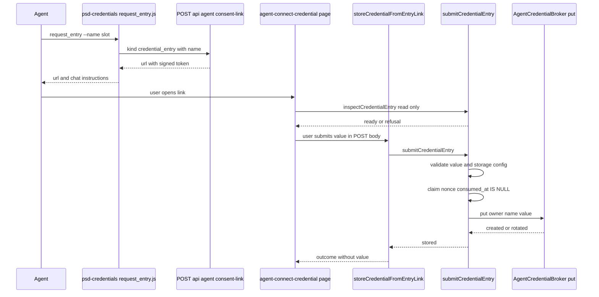
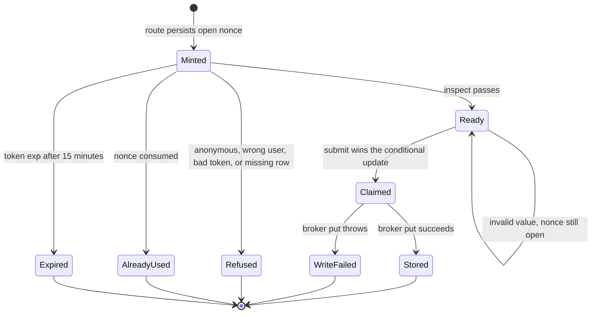

# One-Time Credential Entry

Agents sometimes need a secret that only the user holds, such as a Freshservice API key, a personal AI Studio key, or a GitHub token. Before this path existed, the agent asked the user to paste the value into chat, where it was stored unredacted in `agent_message_content.content_text`. This feature replaces that with a one-time link: the agent mints it, the user types the value into a password field on an AI Studio page, and the value goes straight to the owner-scoped credential broker. The agent never sees the value.

The change is tracked as issue #1887. The feature design note is `docs/features/agent-credential-entry.md`, which this page summarizes for agents and maintainers.

## Flow

A skill that needs a user-held secret, for example `psd-freshservice` exiting with `freshservice_key_missing`, runs `psd-credentials/request_entry.js --name <slot>`. The skill calls `requestConsentLink` in `psd-credentials/common.js`, which posts to `POST /api/agent/consent-link` with `kind: "credential_entry"`. The route returns a URL to `/agent-connect-credential`. The agent sends that URL to the user on a line by itself.



*The value is only present in the final POST from the page to the action. The agent sees the URL, never the value.*

## Components and symbols

| Layer | Symbol or file | Responsibility |
|---|---|---|
| Name grammar | `CREDENTIAL_NAME_RE`, `isCredentialName` in `lib/agent-credentials/name-grammar.ts` | The one definition of a legal slot name, 1 to 128 letters, digits, dot, hyphen, or underscore. It has no AWS import, so the token layer and the mint route can share it. |
| Token | `signConsentToken`, `verifyConsentToken`, `consentTokenExpiry` in `lib/agent-workspace/consent-token.ts` | A `credential_entry` token carries the slot name in a `cred` claim and expires in `15m`. Other kinds keep the 24-hour expiry. Signing and verifying both fail closed when `cred` is missing or invalid. |
| Mint route | `POST` in `app/api/agent/consent-link/route.ts` (`resolveCredentialName`) | Requires `name` for `credential_entry` and rejects `name` for every other kind. The owner comes from the signed invocation context, never from the body. |
| Nonce table | `psd_agent_workspace_consent_nonces`, migration `187-agent-credential-entry-consent-kind.sql` | Widens the `token_kind` check to include `credential_entry`. The nonce gives single use and a per-owner rate limit. There is no PKCE verifier because there is no OAuth round trip. |
| Logic | `inspectCredentialEntry`, `submitCredentialEntry` in `lib/agent-workspace/credential-entry.ts` | `inspectCredentialEntry` is read-only and drives the GET render. `submitCredentialEntry` validates, claims, and then writes. The broker is injectable for tests. |
| Server action | `storeCredentialFromEntryLink` in `actions/agent-credential-entry.actions.ts` | Receives the token and value as arguments, reads the session, and delegates to `submitCredentialEntry`. It logs no arguments. |
| Write | `AgentCredentialBroker.put` in `lib/agent-credentials/broker.ts` | Writes `psd-agent-creds/{env}/user/{email}/{name}` and records a write-audit row with a longer retry budget (`CREDENTIAL_AUDIT_RETRY`). |
| UI | `app/agent-connect-credential/page.tsx`, `_components/credential-entry-form.tsx`, `_components/outcome-card.tsx` | A single masked input and outcome cards. The page is off the navigation and is only reached through the link. |
| Auth gate | `middleware.ts` `PUBLIC_PATHS` | `/agent-connect-credential` is intentionally absent, so a live AI Studio session is required. |
| Skill | `request_entry.js` in `infra/agent-image/skills/psd-credentials/` | Mints the link and emits `url`, `credentialName`, `expiresInMinutes`, and chat instructions. It rejects `--value`. |

## Nonce and link lifecycle



*Rejecting a value before the claim keeps the link open. Once the claim succeeds the link is spent, even if the write fails.*

## Invariants

- **One person.** The page compares the session email to the token `sub`, case-insensitively. A different user gets `wrong-user`, which names only the expected owner. The write always uses the token owner, never the session address.
- **Single use, claim before write.** The nonce is claimed with `UPDATE ... WHERE consumed_at IS NULL RETURNING`, so concurrent submits have one winner. This is the opposite ordering from `/agent-connect-data`, on purpose: a replayable secret form is worse than asking for a second link. A zero-row claim is reported as `already-used` only when the nonce is actually consumed, and as `invalid-token` when the row is gone.
- **Validate before claim.** Empty, too-short (under 8), too-long (over 4096), and placeholder-shaped values are rejected before the claim, so a typo does not cost the link. Slot-specific shape rules run at the same point: `SLOT_PREFIXES` in `lib/agent-workspace/credential-entry.ts` requires the `prr_pat` slot to start with `prr_pat_`, the PSD Public Records token that [psd-prr](overview.md#psd-public-records-psd-prr-1991) uses. Storage configuration is checked before the claim too, so a deployment without `ENVIRONMENT` returns `not-configured` and does not burn links.
- **Secret never leaves the POST body.** It is not in the URL, not in logs, and not in any outcome. `submitCredentialEntry` never echoes it.
- **Audit failure is not a write failure.** Secrets Manager and the audit row cannot share a transaction. `AgentCredentialBroker.put` logs an audit-insert failure after the longer retry budget instead of throwing, so the user is not told a stored credential failed to save.
- **Name is required only for this kind.** The mint route rejects a `name` on OAuth kinds, so a slot name cannot be smuggled into a link that ignores it. `signConsentToken` and `verifyConsentToken` both reject a `credential_entry` token without a valid `cred`.
- **Agent prompts never ask for paste.** `SOUL.md`, `USER.md`, and the `psd-credentials`, `psd-freshservice`, `psd-aistudio`, and `psd-github` skill docs tell the agent to mint a link and not to store a pasted value with `put.js`, because `--value` puts plaintext into the tool-call record.

Middleware keeps `/agent-connect-credential` out of `PUBLIC_PATHS`, unlike `/agent-connect`. A signed token alone proves integrity, not who opened it, so the session is the second factor.

## Agent-side contract

The skill side is `psd-credentials/request_entry.js`. It validates the name, refuses `--value`, and calls `requestConsentLink` in `common.js`, which forwards to the relay at `/api/agent/consent-link`. The agent must send `url` on a line by itself, with no markdown, parentheses, or trailing period, because markdown corrupts the JWT in Google Chat. The `psd-freshservice` missing-key prompt (`promptForKey` in `lib/api.js`) now emits an `entryLinkCommand` with no `storeCommand` and no `%%VALUE%%` marker. The cron Lambda is a second caller of the same route: when a scheduled run fails with a PRR token error, `mintOwnerConsentLink` in `infra/lambdas/agent-cron/index.ts` posts `kind: "credential_entry"` with `name: "prr_pat"` for the owner's failure DM, see [Schedule Failure Streaks and Owner Notices](schedule-failure-notices.md#prr-token-failures).

## Change navigation

- **Start in** `lib/agent-workspace/credential-entry.ts`. The claim and write ordering lives in `submitCredentialEntry`, and the refusal branches live in `verifyLink` and `inspectCredentialEntry`.
- **Name rules** belong only in `lib/agent-credentials/name-grammar.ts`. Do not copy the regex into a skill or route, because drift surfaces only after the user has typed a secret.
- **Expiry** is set by `consentTokenExpiry` in `consent-token.ts`. The 15-minute window is asserted by the Bun smoke, not by jest, because `jose` is ESM-only and cannot be transformed by `next/jest`.
- **Adding a consent kind** touches the `ConsentTokenKind` union, `CONSENT_TOKEN_KINDS`, the route's `Kind` and `ALLOWED_KINDS`, `resolveConsentPath`, the DB `token_kind` check (new migration, plus `infra/database/migrations.json`), and the schema type in `lib/db/schema/tables/agent-workspace-consent-nonces.ts`. Migration 187 is the most recent example of this seam.
- **Do not** add `/agent-connect-credential` to `PUBLIC_PATHS` or move the claim after the write. Both change the security model described above.

## Tests

Each row is a behavior and its narrowest test location.

| Behavior | Test location |
|---|---|
| Owner sees the form; case-insensitive owner match; anonymous visitor asked to sign in without touching the nonce; a wrong user is refused without touching the nonce | `tests/unit/agent-credential-entry.test.ts`, suite `inspectCredentialEntry` |
| Spent link reports `already-used`; unknown nonce reports invalid | same file, `inspectCredentialEntry` |
| Identity on submit: value stored under the token owner, wrong user and anonymous submit write nothing | same file, `submitCredentialEntry — identity` |
| Single use: reused link writes nothing; claim happens before the broker write; a broker throw leaves the link spent | same file, `submitCredentialEntry — single use` |
| Deployment without storage config refuses before the claim | same file, `refuses to spend the link when the deployment cannot store secrets` |
| Over-long and non-string values are rejected without spending the link; the value is never echoed | same file, `submitCredentialEntry — value validation` |
| Form masks input, sends only the token and value, shows outcomes, and blocks duplicate in-flight submits | `tests/unit/credential-entry-form.test.tsx` |
| Consent-link route mints a `credential_entry` link, requires `name`, rejects `name` on OAuth kinds, and needs signed context | `tests/unit/agent-consent-link-route.test.ts`, suite `credential_entry` |
| Real sign and verify: 15-minute expiry, tampering, and missing `cred` fail | `tests/smoke/agent-credential-entry-token.smoke.ts` |
| Broker write audit uses the longer retry budget and still reports stored after retries are spent | `tests/unit/lib/agent-credentials/broker-put-audit.test.ts` |
| Browser guard tier: anonymous redirect, signed link cannot bypass sign-in, owner gets a password field, spent and other-user links show no input | `tests/e2e/agent-credential-entry.spec.ts` (needs a running app; see [Validation](#validation)) |
| Skill: mints the link, tells the agent not to ask for paste, refuses `--value`, fails closed | `infra/agent-image/skills/psd-credentials/request_entry.test.js` |
| Freshservice missing-key prompt sends an entry link and has no paste instruction | `infra/agent-image/skills/psd-freshservice/lib/api.key-missing.test.js` |

A successful write of a valid value is not covered end to end. The broker writes to AWS Secrets Manager, which local development does not have, so the success path is pinned by the unit tests. The valid-value round trip is checked by an agent after deployment.

## Validation

Narrow checks, in increasing scope:

```bash
bun run test:smoke:agent-credential-entry
bun run test:skill:credentials
bunx jest --silent tests/unit/agent-credential-entry.test.ts tests/unit/credential-entry-form.test.tsx tests/unit/agent-consent-link-route.test.ts
```

The E2E guard spec needs a running app and is conditional. Run it only when the page, the action, or the middleware changes:

```bash
PLAYWRIGHT_BASE_URL=http://localhost:3000 bunx playwright test tests/e2e/agent-credential-entry.spec.ts
```

Changes to the `token_kind` check or migration 187 also need a database check, and changes to the consent route or entry types should run `bun run typecheck` before commit, as the root rules require. The `psd-freshservice` prompt test is run with `cd infra/agent-image/skills/psd-freshservice && bun run test`.

## Related

- [Agent Platform Overview](overview.md) covers the skill catalog and the other consent and delivery flows that share the signed-link pattern.
- CI runs the skill and smoke checks as steps in `.github/workflows/ci.yml`, next to the other skill gates.
- [Data Models Overview](../data-models/overview.md) lists the consent nonce table that this feature widens.

