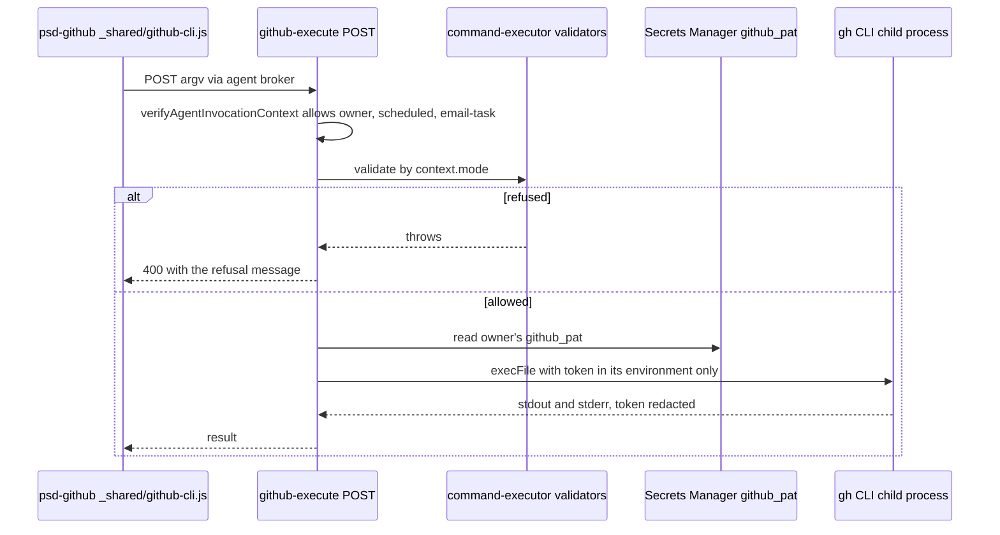

# GitHub Command Broker and Scheduled Read-Only Access

Agents reach GitHub through the `psd-github` skill, which runs the `gh` CLI inside the agent container. The skill never holds a GitHub token. It sends the argv to the web tier, and the web tier decides whether the command may run, then executes `gh` with the owner's stored token. This page covers that broker, the per-invocation-mode policy that decides what each caller may do, and the change rules for the allowlists.

It is one of the broker routes listed in the agent image's `ALLOWED_AGENT_BROKER_ROUTES` in `infra/agent-image/mantle_proxy.py`, next to `/api/agent/workspace-execute` and `/api/agent/schedules`. The general skill catalog and the other broker surfaces are in the [Agent Platform Overview](overview.md). The owner's token is collected through the one-time link described in [Credential Entry](credential-entry.md).

## Request Flow

*A refused command returns before the token is read, so a refused write never touches the owner's credential.*

## Policy by Invocation Mode

`POST` in `app/api/agent/github-execute/route.ts` admits three modes and then picks a validator from the verified context. The validators are layered: each mode's validator calls the base policy first.

| Mode | Validator | What it allows |
|------|-----------|----------------|
| `owner` | `validateGitHubCommand` | Every operation in `COMMAND_POLICIES` (issue, pull request, release, repo, run, search, workflow, and `auth status`), within each command's flag list. |
| `scheduled` | `validateScheduledGitHubCommand` | The base policy, then only commands in `READ_ONLY_GITHUB_COMMANDS` (views, lists, searches, checks, diffs, and `run watch`). A write returns 400 with `Scheduled runs may only read from GitHub; <command> is a write`. |
| `email-task` | `validateEmailTaskGitHubCommand` | The base policy, then only `issue create`, with flags limited to `-R`/`--repo`, `--title`, `--body`, and `--label`. Positionals are refused. |

The scheduled mode exists so that a morning brief can read Life OS tasks and ready pull requests without failing with a bare 403 at the route. The route comment records that rationale. A scheduled run has no human approving each call, and it may read email or documents that try to steer it, so the mode gets a read-only subset. The allowlist is explicit rather than "everything minus writes", so a write command added to `COMMAND_POLICIES` stays blocked for schedules until someone lists it on purpose.

This is the same read/write split that schedule management uses for `create`, `update`, and `delete` (see [Schedule Management](overview.md#schedule-management)), applied to GitHub.

## Base Policy and Argument Rules

`COMMAND_POLICIES` in `lib/agent-github/command-executor.ts` is a `Map` from `"<noun> <verb>"` to a policy with explicit `valueFlags`, `booleanFlags`, `maxPositionals`, and `requireRepo`. There is no `api` command, no raw `gh` forwarding, and no file-reading or editor flags. Unknown commands fail with `GitHub operation is not allowed`, and unknown flags fail with `GitHub flag is not allowed for <command>`.

- `validateArgumentEnvelope` accepts 2 to 100 arguments, each non-empty, at most 100,000 characters, with a 300,000-character total and no control characters. Tab, line feed, and carriage return are allowed inside values, because issue and PR bodies are multi-line.
- `--repo` (or `-R`) must be explicit where `requireRepo` is set. The `--repo` value is validated before the command runs.
- `auth status` accepts no arguments.

## Execution Isolation

`executeGitHubCommand` runs the policy again, then:

- creates a private temporary directory (mode `0700`) and uses it as `HOME` and `GH_CONFIG_DIR`;
- builds a minimal environment from `buildGitHubExecutionEnvironment`, with `GH_TOKEN` set, no prompts, pagers and editors set to `/bin/cat` or `/usr/bin/false`, git global and system config disabled, and a fixed `PATH`;
- runs `gh` (the `GH_EXECUTABLE` override, else `/usr/local/bin/gh`) with a 60-second timeout and a 1 MiB output cap;
- redacts the token and GitHub token-shaped strings (`gh[opusr]_…`, `github_pat_…`) from stdout, stderr, and error text, then removes the temporary directory.

The route reads the token from `psd-agent-creds/{ENVIRONMENT}/user/{ownerEmail}/github_pat`. A missing token returns 404 `GitHub credential is not configured`. The skill guidance tells the agent to send the user a credential-entry link for `github_pat` rather than ask for a paste.

## Invariants

- The mode is taken from the verified invocation context, never from the request body.
- Refusal happens before any credential read, so a refused command has no side effects and no token access.
- The scheduled validator adds a restriction on top of the base policy and cannot widen it. A command refused by the base policy stays refused with the base-policy message.
- The read-only set and `COMMAND_POLICIES` must be changed together: a command must exist in the base policy before it can be listed as read-only.

## Change Navigation

- Start in `COMMAND_POLICIES` for what a `gh` command may take, `READ_ONLY_GITHUB_COMMANDS` for what a schedule may run, and `POST` in the route for mode selection.
- To expose a new read to scheduled runs, add its `"<noun> <verb>"` key to `READ_ONLY_GITHUB_COMMANDS` and add a case to the scheduled test. Do not add any write command there.
- To add a new write for owners, add a `COMMAND_POLICIES` entry and leave it out of the read-only set. Test the scheduled refusal as well.
- Extension seam: a new email-task flag belongs in `EMAIL_TASK_GITHUB_FLAGS`. Extending `email-task` beyond issue creation changes the email-task trust boundary and needs a deliberate review.
- Non-goals: do not add raw `gh api` access or flag forwarding to satisfy one request. Those would bypass the explicit argv schemas.
- Watch out: `psd-github/SKILL.md` does not mention the scheduled read-only limit. A scheduled prompt that asks for a write will get a 400 from the route, and the skill text does not explain it.
- The skill side ships in the agent image (`infra/agent-image/skills/`), so a skill-text change needs an agent image rebuild. Route and policy changes ship with the web tier.

## Focused Tests

- `tests/unit/lib/agent-github/command-executor.test.ts`, suite `scheduled GitHub command policy`: each read in the read-only set is allowed, each write is refused with `Scheduled runs may only read from GitHub`, and the base policy still applies first (`pr merge` is refused as not allowed). The same file covers `trusted GitHub command policy` and `multi-line argument values`.
- `tests/unit/agent-email-task-route.test.ts`, describe `scheduled GitHub access`: the route admits `owner`, `scheduled`, and `email-task`; a scheduled `pr review --approve` returns 400 and never calls the secret read or `executeGitHubCommand`; a scheduled `pr list` returns 200.

**Minimal validation (quiet):** `bunx jest --silent tests/unit/lib/agent-github/command-executor.test.ts tests/unit/agent-email-task-route.test.ts`. The `--silent` flag suppresses passing output and keeps failure diagnostics.

**Escalation.** Run the agent-image skill suites only when `_shared/github-cli.js` or `psd-github/SKILL.md` changes. A change to the route's broker allowlist in `mantle_proxy.py` also needs `infra/agent-image/test_mantle_proxy.py`.

## Related Pages

- [Agent Platform Overview](overview.md) lists `psd-github` in the skill catalog and holds the other broker surfaces.
- [Schedule Management](overview.md#schedule-management) defines the read/write split for schedule routes that this route mirrors.
- [Credential Entry](credential-entry.md) describes how the `github_pat` secret is collected without chat.
