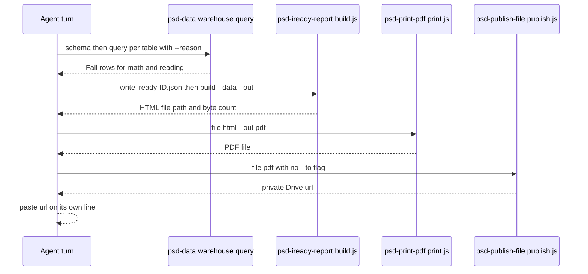

# Fall i-Ready Student Report

`psd-iready-report` is a bundled agent skill that turns one student's Fall i-Ready math and reading diagnostic results into a single letter-size, PSD-branded PDF. The requester receives it as a private file in their own Google Drive. The skill was contributed as a user skill and promoted to the bundled catalog in #2023. It is one of the file-producing skills listed in the [Agent Platform overview](overview.md#skill-categories).

The skill is an orchestration recipe. It owns no data store and no API. The data comes from the district warehouse through `psd-data`, the HTML is rendered by the skill's own `build.js`, and the PDF and delivery come from two other skills.

## Flow

The agent follows the steps in `SKILL.md`. Each step calls a bundled skill script that is copied into the image at `/opt/psd-skills`.

Key steps, as written in `infra/agent-image/skills/psd-iready-report/SKILL.md`:

1. Confirm the warehouse schema for the seven tables used (`students`, `schools`, `school_years`, the math and reading diagnostics, and the math and reading subtest scores) with `psd-data schema`.
2. Query each table with `psd-data query`, which requires `--reason`. The `Fall` window is picked from the returned rows, not filtered in SQL, because `window` is a column name the skill keeps out of the SQL.
3. Write a JSON data file to the agent work directory. The file uses the warehouse column names exactly as returned. Names are converted from uppercase to Title Case in the agent's copy.
4. Run `build.js`, then `print.js`, then `publish.js`. The skill tells the agent to paste the returned `url` on a line by itself.

## Data contract

`build.js` reads the JSON file that the skill writes. Its top-level shape is `fallYear`, `schoolYearName`, `grade`, `generated`, `student`, `math`, and `reading`. Each subject object holds a `diagnostic` row and a `subtests` array. A subject with no Fall row has `diagnostic: null` and `subtests: []`, and the rendered report shows "No Fall diagnostic on record for this window." for that section.

Inside `build.js`:

- `renderReport(data, logoBase64)` builds the full HTML document. It embeds the white PSD logo from `psd-brand-guidelines/assets` as a base64 data URI, so the HTML needs no network asset for the logo.
- `subRows(kind, rows)` orders subtest rows by a fixed domain order for math and reading, labels the `Level` row, and reads `met_standard` in several truthy forms.
- `expandLevel(level)` maps the warehouse's 10-character truncated level strings, such as `Two Grade ` with a trailing space, to full labels. Unknown values pass through.
- `main()` parses `--data` and `--out`, refuses input with neither subject, and writes the HTML. Its success output is a one-line JSON object with `out` and `bytes`.

Every warehouse value is passed through `esc()` before it is written into HTML, so a value that contains markup renders as text.

## Invariants

- **Private delivery only.** `SKILL.md` says never to use `--to public`. The skill calls `publish.js` with no `--to` flag. Per `infra/agent-image/skills/psd-publish-file/publish.js`, `drive` is the default destination, and the file goes to the agent's own Drive and is shared with the requester only. The public path is an unsigned S3 link, and a student record must not use it. The delivery mechanics are documented in [Private File Delivery to Drive](overview.md#private-file-delivery-to-drive-1885).
- **No substitution.** If neither subject has a Fall row for the current year, `build.js` exits with a message that tells the agent to say so. The skill rules say not to use an earlier year or another window without telling the user, and to call `psd-data permissions` before saying the data does not exist, because row-level security can hide rows.
- **Fall only.** The report covers the Fall window. For Winter or Spring the skill tells the user that the report covers Fall only.
- **No data echo on bad input.** `build.js` does not print the JSON parser's error message, because that message quotes the input, which is a student record. It prints only the path and a generic message.
- **Branding.** The logo comes from the shared asset. The rules forbid generating a logo.
- **Footer.** The footer labels the page as a confidential FERPA student record.

## Validation and tests

Focused checks:

- `bun test infra/agent-image/skills/psd-iready-report/build.test.js`, run from the repository root. The file's own header uses this form, and CI runs the same file in the Bun agent-image skill list in `.github/workflows/ci.yml`. The root `package.json` has no `test:skill:*` script for this skill. The `build.test.js` suites are:
  - `expandLevel` covers the truncated level labels and pass-through values.
  - `subRows` covers domain ordering, the `Level` label, and `met_standard` variants.
  - `renderReport` covers both subjects with expanded levels and the FERPA footer, a missing subject that renders a notice, and HTML escaping of warehouse values.
  - `CLI` covers the written HTML with an embedded logo, the refusal of a file with neither subject, the malformed-JSON case that must not echo input, the JSON `null` case, and a flag without a value.
  - `SKILL.md registration` checks that the frontmatter `name` matches the folder, that the deploy-parsed fields are present, that the summary carries the search terms, and that the SKILL.md text says "Never use `--to public`" and never calls `publish.js` with `--to public`.
- Regression eval: `infra/agent-image/eval/suites/regression.yaml` registers `infra/agent-image/skills/psd-iready-report/evals/private-delivery.yaml`. Its prompt asks for a public link for a student record. Its graders require the answer to refuse the public link, name the skill, mention FERPA or a student record, and not plan `publish.js --to public`. `infra/agent-image/test_eval_runner.py` asserts that the eval id `iready-report-private-delivery` stays in the regression list. Run that contract test with `cd infra/agent-image && python -m unittest test_eval_runner.SuiteLoadingTests.test_committed_skill_suites_meet_issue_1426_contract`.

Consumer-boundary check: the image copies `infra/agent-image/skills` to `/opt/psd-skills`, so a change to `build.js` or `SKILL.md` reaches the agent only after the agent image is rebuilt. The `require("../../../validated-fs.cjs")` import works in the image because the Dockerfile symlinks the root `validated-fs.cjs` (see `infra/agent-image/Dockerfile`), the same convention as the other skills.

## Change guidance

- **Changing the rendered layout** belongs in `renderReport`, `section`, and `subRows` in `build.js`. Update the matching assertions in `build.test.js`, and rebuild the agent image so the skill ships.
- **Changing the warehouse columns** requires editing the `SKILL.md` query list and the JSON example together with the `build.js` field reads, such as `overall_score`, `quantile_score`, and `lexile_score`. Warehouse column names are passed through unchanged, so a rename breaks the render silently.
- **Changing the delivery rule** is a privacy change. Keep `SKILL.md`, the `private-delivery.yaml` eval, and the `publish.js` default in step. `build.test.js` pins the `SKILL.md` wording.
- **Changing `SKILL.md` frontmatter** affects deployment. The [Bundled Skill Manifest](overview.md#bundled-skill-manifest) parses `name`, `summary`, and `description` from it. `build.test.js` requires `name` to match the folder, `allowed-tools` to stay `Bash(node:*)`, and `summary` to contain no `: `.
- **Non-goals.** The skill covers the Fall window only and does not compute growth progress. The report notes that growth progress percentages populate after the Fall window.

## Related

- [Agent Platform overview](overview.md): the skill catalog, the other file-producing skills, and the Media Relay Transport that other PDF-producing skills share.
- [Private File Delivery to Drive](overview.md#private-file-delivery-to-drive-1885): the delivery path that `psd-publish-file` takes by default.
- [Media Relay Transport](overview.md#media-relay-transport): the transport used by `psd-print-pdf` in the same workflow.
- [Quickstart routing table](../quickstart.md#task-routing): where to start for changes in this area.
