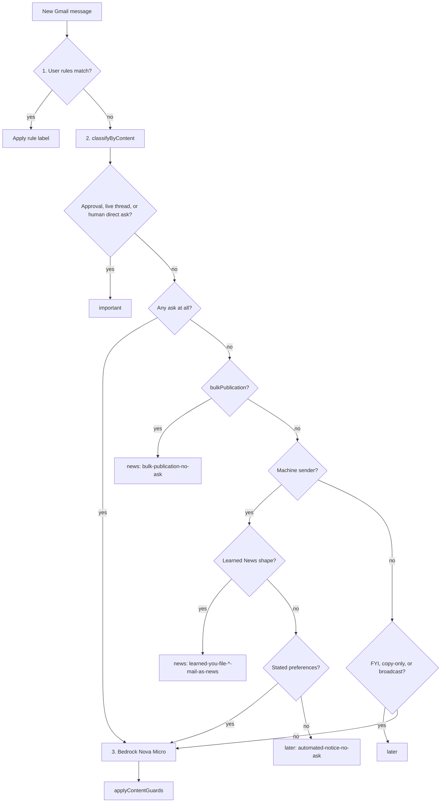
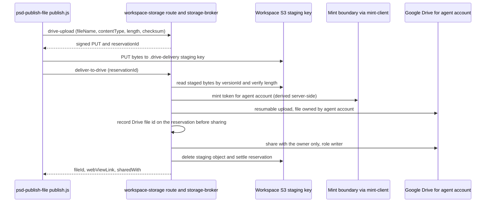
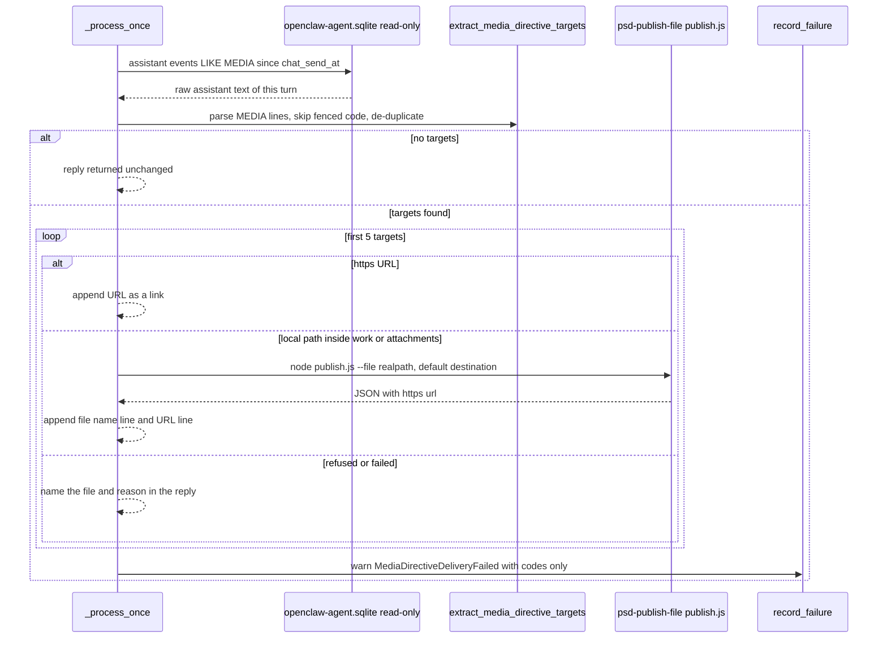
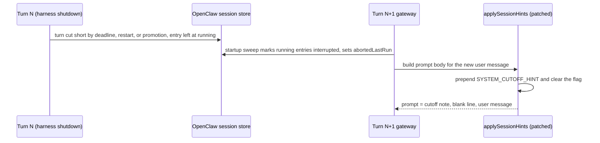
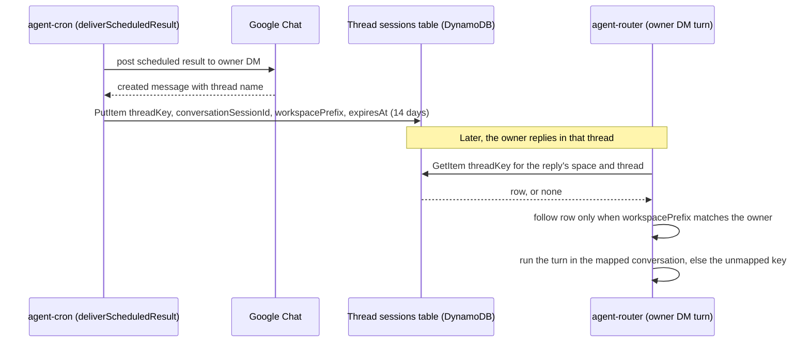
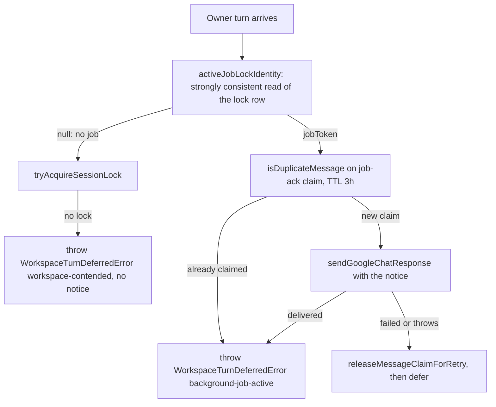
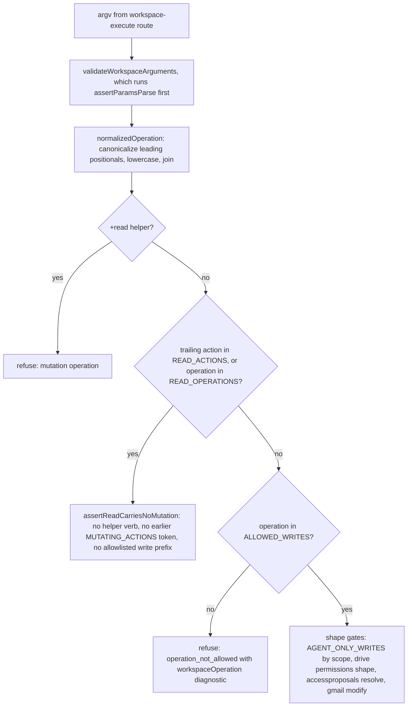
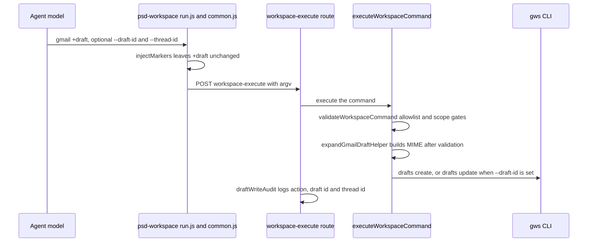

# Agent Platform

AI Studio includes an agent platform that enables autonomous AI assistants to perform real work through a growing library of skills. The platform prioritizes security, auditability, and K-12-specific workflows.

## Agent Skills System

**Location**: `/infra/agent-image/skills/`

Agent skills are modular capabilities packaged in standardized directories. Each skill follows the same structure:

```
infra/agent-image/skills/{skill-name}/
├── SKILL.md              # Skill definition and usage
├── run.js                # Primary execution logic
├── run.test.js           # Tests
├── package.json          # Dependencies
└── references/           # Supporting documentation
```

### Skill Categories

**Administrative & District Operations**
- `psd-atrium` — Read/search/create content in Atrium; artifact data persistence (list-data, submit); viewer-scoped PSD data queries from artifacts via shared connector resolution with Nexus; CSP guidance for artifact scripts/styles (inline preferred, CDN allowlist enforced); visibility/grant management with `read-grants` command and merge mode (`--add-grants`/`--remove-grants`) for safe audience changes (#1763); per-person sharing via `find-people` to resolve email/name to users.id plus `add-person` for staff who never signed in (#1860); "Live PSD data inside an artifact" section mirrors `lib/content/atrium-data-contract.ts` guidance but is hand-maintained — change both when the bridge contract changes (#1749)
- `psd-freshservice` — Freshservice tickets, service catalog items, approvals, and team summaries using each caller's own API key; create catalog request forms with field validation
- `psd-email-triage` — Smart email triage with three-stage classification (rules → content → LLM), human sender protection (never muted, never marked as news), rhetorical question guard (`hasDirectQuestion` requires second-person clause), automated-sender veto on question/action-request branch, bulk-publication detection (List-Unsubscribe or bulk Precedence, publication wording, and marketing footers) filed as News (#1866), keyword rules with stable IDs, preferences system for user-stated classification intent, and real digest counts from daily stats. Configured entirely from chat. See `/docs/operations/email-triage.md` for runtime architecture and Phase 3 (#1855, #1861) details
- `psd-schedules` — Scheduled agent tasks (cron/rate/at) with read access for scheduled-mode turns; reply IS the delivery — never hunt for DM; confirms saved schedules from the broker's `description` and `nextRuns` read-back, see [Agent Schedules](agent-schedules.md)
- `psd-rules` — Tier-1 governance rules for agent behavior
- `psd-conversation-coach` — Crucial Conversations framework coaching for difficult conversations
- `psd-morning-brief` — Personalized daily newspaper/podcast delivered through private Atrium artifacts
- `psd-observances` — Cited dates for national observances, awareness months, state school holidays, and education conferences via NSPRA calendar lookups
- `psd-directory` — Identity lookup for staff and colleagues by email or Google Chat sender ID

**Content & Media**
- `psd-aistudio` — Live capability discovery + authenticated actions in AI Studio, including repository list/describe/search/source/changes and, since #1907, `repositories-create` and `repositories-add-item` (text items only, staff and administrator, gated by the live `knowledge-repositories` capability). The write contract and ingestion states are in **[app-features/overview.md](../app-features/overview.md#repository-mcp-tools-1266-1907)**
- `psd-learning-page` — Multimodal UDL learning page generation
- `psd-hyperframes` — HTML/CSS/JS to MP4 video rendering
- `psd-html-artifact` — HTML artifacts published to Atrium with WCAG 2.2 AA audit, delivered as internal reader pages (not S3); enforces strict CSP — inline scripts/styles only, external CDN limited to allowlist (default: cdnjs.cloudflare.com), connect-src blocked
- `psd-print-pdf` — HTML to printable PDF with headless Chromium (8.5×11, letter, A4, landscape), honouring `@page` CSS, flexbox, and web fonts; routes through agent-media Lambda
- `psd-media` — ffprobe inspection + ffmpeg transcode via named presets (`social-mp4`, `web-mp4`, `audio-mp3`); routes through agent-media Lambda
- `psd-transcribe` — Speech-to-text using Amazon Transcribe over audio/video in owner's private workspace; routes through agent-media Lambda
- `psd-pdf-to-markdown` — PDF to Markdown conversion; scanned/image-only PDFs rendered to page images via `--rasterize-pages`
- `psd-image-gen` — Image generation through the owner-gated broker; the model ID is pinned in one broker constant (see [Agent Image Generation](#agent-image-generation-psd-image-gen))
- `psd-sop-creator` — PSD Standard Operating Procedure document creation
- `psd-instructional-vision` — PSD instructional framework (Instructional Essentials, UDL, MTSS) from live repository
- `psd-publish-file` — Hands a generated local file to the requesting user. Default: a private Drive file in the agent's account, shared with that one user (see [Private File Delivery to Drive](#private-file-delivery-to-drive-1885)). `--to public` remains an unsigned public-by-link S3 URL that expires after 30 days

**Data & Integration**
- `psd-data` — District data queries (PowerSchool, spreadsheets)
- `psd-workspace` — Google Workspace wrapper for agent accounts; Drive queries with quoted values (`name contains 'X'`) MUST use `--params-file` — tokenizer cannot preserve single quotes (#1801)
- `psd-credentials` — Owner-bound credential broker client. Collects user-held secrets through a one-time entry link (`request_entry.js`) instead of chat; see [Credential Entry](credential-entry.md) (#1887)
- `psd-canva` — Canva design integration
- `psd-plaud` — Plaud note integration
- `psd-open-adaptive-district` — Open Adaptive District operating model (six-week build cycle)

**Analysis & Reporting**
- `psd-deep-research` — Gemini Deep Research for cited multi-source reports
- `psd-workflows` — Dynamic PSD gateway workflows (evaluations, requests, timesheets) with caller binding
- `quartile-growth-report` — Growth-by-quartile spreadsheet generator for elementary school principals (one tab per grade, data-only output)
- `psd-failure-report` — Failure analysis and reporting
- `psd-last30days` — Recent activity analysis
- `psd-github` — GitHub integration through the owner-bound `gh` broker; scheduled runs may only read (see [GitHub Command Broker and Scheduled Read-Only Access](github-access.md))
- `psd-summarize` — Content summarization
- `psd-tts` — Text-to-speech
- `psd-strategic-plan` — Peninsula 2030 strategic plan queries from live repository 166

**Utilities**
- `chat-card`, `chat-chart` — Chat UI enhancements
- `psd-brand-guidelines` — PSD branding enforcement
- `psd-skills-meta` — Skill metadata and discovery

### Email Triage Content-First Classification (#1855, #1861)

**Sources**: `/docs/operations/email-triage.md`, `/infra/lambdas/agent-triage-poll/content-features.ts`, `/infra/lambdas/agent-triage-poll/llm.ts`, `/infra/lambdas/agent-triage-poll/learning.ts`, `/infra/agent-image/skills/psd-email-triage/SKILL.md`

Phase 3 introduced a three-stage classification pipeline that decides based on content first, sender identity last. This prevents the same message from different addresses receiving different classifications. Since #1866 the pipeline has three labels with a defined split: **Important** (needs action), **Later** (real mail written to this user that asks nothing of them yet), and **News** (broadcast publications written for a list rather than for this reader). Later vs News is decided by who the message was written for, not by whether it asks something.

#### Three-Stage Pipeline

For each new message, the classifier runs stages in order (cheapest first). The Lambda's `classifyMessage` in `index.ts` owns the order; each stage is a separate module.



*Caption: the order of `classifyByContent` and `classifyNoAsk` in `content-features.ts`, followed by the model stage in `llm.ts`. Stage 3 runs only when the content stage returns `null`.*

1. **User's own rules** — VIP, mute, thread-with-user-reply, keyword rules. An explicit instruction always wins.
2. **Content stage** (`content-features.ts`) — Derives signals from what the message asks and who it is addressed to, independent of sender identity:
   - Approval or signature request → `important` (even from a machine)
   - Reply in a thread the user has written in → `important`
   - Direct question addressed to user, from non-automated sender → `important`
   - Action request addressed to user, from non-automated sender → `important`
   - Bulk publication with no ask (see [Bulk Publications Route to News](#bulk-publications-route-to-news-1866)) → `news`
   - Something that asks nothing of a recipient who is only copied → `later`
   - One-off automated notice with no ask → `later`, unless the user has a stated preference profile, in which case the stage returns no decision and the model judges it
   - Human FYI with no ask → `later`
3. **Bedrock Nova Micro** — Only for what remains (`classifyByContent` returned `null`), with content signals leading the prompt and sender demoted to a weak prior. Its output then passes through `applyContentGuards`.

The content stage is deterministic, recorded as `source: "content"` with confidence 0.7, and produces consistent labels regardless of which address sent the message.

#### Human Sender Protection

**Rule**: An address that cannot be proven automated counts as a person and is never muted or marked as news.

Automated senders are detected by `isAutomatedSender` from:
- `noreply`/`no-reply`/`donotreply` local parts
- PSD service-account naming: `serv_*`, `tsd-*`, `svc_*`
- Unambiguous publication mailboxes (`newsletter@`, `newsletters@`, `enews@`, `e-news@`, `mailings@`) and local parts containing `-newsletter` (#1866)
- Headers: `List-Unsubscribe`, `Auto-Submitted`, `Precedence`

`news@`, `marketing@`, `bulletin@` and `digest@` are deliberately not in the mailbox set: they are often staffed by people. Those mailboxes still reach News when they send with a list header. The set also bounds which senders the learner may suggest muting, so it must stay narrow.

**Colleague list posts stay people.** For a sender on the user's own domain, `isAutomatedMessageSender` discounts the `List-Unsubscribe` and bulk `Precedence` headers. A post by a colleague through a district Google Group therefore stays Later and is not treated as a newsletter. `Auto-Submitted`, a non-list `Precedence`, and a machine-shaped local part still count, so a district newsletter sent from `newsletter@psd401.net` still reaches News.

The nightly learner refuses to emit `mute` suggestions for unproven-automated targets. `suggestions apply` refuses to write a human mute without `--confirm-human`. The `prefs people-suggestions off` setting additionally silences VIP suggestions about individuals.

#### Content-Stage Fixed (#1861)

Four defects lined up to over-promote a Google Search Console blast to `important`:

1. **Rhetorical questions counted as direct questions** — `directQuestion` was `text.includes("?")`, so "Think this is awesome?" counted. Now requires the question clause to speak to the reader in second person (`hasDirectQuestion`). A "your" in the next sentence cannot rescue a rhetorical question.

2. **Automated senders were not vetoed** — Questions and action requests from `noreply` addresses counted as `important`. Nobody is waiting on a reply to a noreply mailbox. Now vetoed in `classifyByContent`; those messages fall through to the LLM (which still sees every signal) or to default `later`. **Approval/signature requests are exempt** — a service desk legitimately asks for one from a noreply address.

3. **Fixed confidence cleared high-confidence bar** — Content-stage decisions stamped 0.9 confidence, clearing the 0.85 escalation threshold. Two guards now: `CONTENT_DECISION_CONFIDENCE` is 0.7, and `shouldEscalate` only lets `source === "llm"` clear the bar. Explicit escalation rules still ping in every mode except `none`.

4. **Bulk-mail boilerplate was not informational** — Now a `List-Unsubscribe` header is sufficient on its own. Marketing footer phrases ("unsubscribe", "you are receiving this", "go ahead and") are consulted **only when sender is already automated** — "go ahead and" is ordinary English from a colleague.

The `simulate` command now reports `firedSignals` (names of true signals) on all branches, and accepts `--list-unsubscribe` for bulk mail simulation.

#### Bulk Publications Route to News (#1866)

**Problem**: In the reported corpus every newsletter and digest landed in Later. Three causes: the content stage had no News outcome; its fixed `later` for machine mail fired before the user's stated preferences were read; and corrections to News were folded into Later, so they taught the opposite lesson.

**Signal derivation** (`detectContentSignals` in `content-features.ts`):
- `bulkHeader` is true for a non-blank `List-Unsubscribe` or a `Precedence` in `BULK_PRECEDENCE` (`bulk`, `list`). It also drives `broadcast` and `informational`.
- `bulkPublication` is true only for an automated sender (`isAutomatedMessageSender`). With a bulk header it is true outright. Without one, it needs a broadcast fan-out (`BROADCAST_RECIPIENT_COUNT`), publication vocabulary (`PUBLICATION_RE`: "digest", "newsletter", "highlights", "latest issue", "webinar", and similar), or marketing-footer boilerplate.
- A one-off machine notice to a single person ("your password was reset") is not a publication. It keeps the `notification` shape.
- `deriveShape` returns `bulk` before `notification`, so corrections against one shape do not move the other.

**Decision** (`classifyNoAsk`, reached only when `hasAsk` is false): `bulkPublication` returns `news` with `content:bulk-publication-no-ask`. Approval requests and human direct asks return `important` earlier in `classifyByContent`, so a list-bearing service desk's approval request still wins.

**Invariants**
- `bulkPublication` implies `automatedSender`. A person is never a publication, even with list headers.
- A colleague's post to a district Google Group (own-domain sender with `List-Unsubscribe` and `Precedence: list`) stays Later. A machine-shaped mailbox on the same domain (`newsletter@psd401.net`) still reaches News.
- The skill's `simulate` reports `bulkPublication` in `firedSignals`, and accepts `--list-unsubscribe` or `--precedence bulk` to exercise it.

**Focused tests**
- `infra/lambdas/agent-triage-poll/content-features.test.ts`: `newsletters and digests are News, not Later (#1866)` (named examples, colleague FYI, password-change notice, approval beats bulk); `a colleague's post to an internal list stays Later (#1866)`; `human-staffed publication mailboxes need header evidence (#1866)` under `isAutomatedSender`; `stated preferences get a vote on machine mail (#1866)`.
- `infra/lambdas/agent-triage-poll/content-learning.test.ts`: `corrections to News generalise by shape (#1866)`, `a declared list mailing the model calls Later is News (#1866)`.
- Skill mirror: `infra/agent-image/skills/psd-email-triage/parity.test.js` (`content stage parity`, `the publication vocabulary is identical (#1866)`, `learnedNewsShapes applies the same bars`) and `run.test.js`.

**Mirror rule.** The skill's `lib.js` duplicates the Lambda's content logic in CommonJS (`run.js` calls into it for `simulate`), so a change to `PUBLICATION_RE`, the marketing-footer list, or `isAutomatedSender` must be made in both places and is enforced only by `parity.test.js`. Do not hand-edit `lib.js` without updating the Lambda first.

**Validation**
- `cd infra/lambdas/agent-triage-poll && bun test content-features.test.ts content-learning.test.ts` (focused; the root `test:lambda:triage-poll` script also runs `bun install --frozen-lockfile` first).
- `cd infra/agent-image/skills/psd-email-triage && bun test run.test.js parity.test.js` (the same suite the root `test:skill:email-triage` script runs).

**Scope boundary**: the human-facing rules (what News means to the user) live in `/docs/features/email-triage-user-guide.md`. This page documents the implementation.

#### Keyword Rules with Stable IDs

**Problem**: Legacy keyword rules stored by `--from` with no value matched nothing and could not be addressed by value for deletion.

**Solution**: Keyword rules now have stable `id` fields. Removal accepts:
- The rule's `id`
- The `#index` from `rules list` (or `--index <n>`)
- Any value the rule matches on (case-insensitive)

`rules remove keyword --malformed` deletes all rules that can never match. `isWellFormedKeywordRule()` rejects rules with empty or boolean criteria.

#### Preferences System

The classifier reads the user's stated preferences on every message:

| Subcommand | Effect |
|------------|--------|
| `prefs show` | Stated profile + learned patterns in plain language |
| `prefs set "<text>"` | Store profile (max 2000 chars). Outranks built-in heuristics |
| `prefs clear` | Clear stated profile (learned patterns untouched) |
| `prefs people-suggestions on\|off` | Whether suggestions may name individuals |

The preferences text is injected into the LLM prompt and can express intent that per-sender rules cannot capture ("FYI forwards from X are Later unless they ask me something"). A stated profile also changes the content stage: a one-off machine notice with no ask is passed to the model rather than fixed to Later, so the profile gets a vote (`classifyByContent(..., { hasStatedPreferences })`, passed by both `index.ts` and the skill's `simulate`).

#### Correction-Driven Content Guards

Decisions record the message's `shape` (what it asks). Corrections snapshot it. `computeContentPreferences` in `learning.ts` mines those into per-shape leanings, and `applyContentGuards` in `llm.ts` enforces them.

- **Three-way leaning** (#1866): `correctionLean` maps `news` to News, `archived`/`later` to Later, and `inbox`/`important` to Important. `strongestLean` picks the label with the most decayed weight and reports the margin over the runner-up. A shape corrected in two directions therefore yields no leaning.
- **Bar to act**: a leaning applies only when its weight is at least `CONTENT_BIAS_MIN_WEIGHT` (1.5) and it has at least `CONTENT_BIAS_MIN_COUNT` (2) corrections.
- **Guards run in order** over the model's label. Each guard may rewrite the label:
  1. An `important` that asks nothing is demoted to the user's learned Later/News leaning for that shape.
  2. A machine `later` on a learned News shape becomes `news` (`learned:you-file-<shape>-mail-as-news`). Machine mail only.
  2b. A declared list mailing (`bulkPublication`) that the model itself called `later` becomes `news`. A `later` forced by a confidence floor (`downgraded`) or by the Bedrock fail-safe stays `later`.
  3. `news` is never applied to a person's mail. This guard runs last so nothing above can leave a colleague filed as News.

Guards are shape-keyed, not sender-keyed, so one correction generalises to other senders with the same shape. Keeping News distinct from Later matters: before #1866, `correctionLean` folded News into Later, so a user's News correction taught the opposite of what they asked for.

#### Real Digest Counts

**Problem**: `recentDecisions` capped at 20, so digests reported "20 messages sorted in the last 24h" daily at any volume.

**Solution**: The classifier writes `dailyStats` — per-day counters keyed `YYYY-MM-DD` in the user's digest timezone (45 days retained). Digests sum the days since `lastDigestAt` (clamped to 14). `recentDecisions` still supplies example rows; header counts come from the aggregates.

Sweep slices deliberately do not count — a backfill of 1000 messages is not today's mail.

#### Broker Allowlist Synchronization

**Source**: `/app/api/agent/email-triage/route.ts` — `SAFE_STATE_FIELDS`

`update-state` is gated by an allowlist. Missing fields return HTTP 400. When the skill starts writing a new attribute, add it in the same change. Missing fields: `pendingSuggestions`, `dismissedSuggestions`, `appliedSuggestions`, `tasksMode`, `tasksNotifySuccess`.

**Validation**: `tests/unit/agent-triage-worker-security.test.ts`

#### Runtime Topology

**Sources**: `/infra/lambdas/agent-triage-poll/dispatcher.ts`, `/infra/lambdas/agent-triage-poll/worker.ts`, `/infra/lambdas/agent-triage-poll/queue.ts`, `/infra/lambdas/agent-triage-poll/index.ts`

Triage work is fanned out, not run inline. The dispatcher runs on the 5-minute poll and on the daily `learn` rule (input `{ job: "learn" }`). It enqueues one FIFO message per enabled user, plus a `sweep` kick for any user whose initial-inbox sweep is pending or stalled (`sweepNeedsKick`). The worker consumes the queue and dispatches by message type:

- `poll` — the live triage tick for that user: `processUser` in `index.ts`, a library the worker imports, not a Lambda entry point.
- `sweep` — one initial-inbox-sweep slice via `runSweepSlice`; it re-enqueues a continuation keyed on the page cursor until the sweep completes.
- `learn` — nightly correction-driven learning via `runLearning`.

`enqueue` and `enqueueMany` in `queue.ts` set deduplication ids (`clampDedupId`); sweep continuations key on the page cursor so consecutive slices stay distinct. `processBatch` in `worker.ts` groups records so that a `poll` and a `sweep` or `learn` for the same user can share a batch. The worker drops any message whose user row is missing or disabled, so work dispatched before a user was turned off is not acted on.

Focused checks: `cd infra/lambdas/agent-triage-poll && bun test dispatcher.test.ts worker.test.ts queue.test.ts` (or `bun run test:lambda:triage-poll`, which also runs a frozen install first).

#### Phase 3 Files

- `infra/lambdas/agent-triage-poll/` — `content-features.ts`, `daily-stats.ts`, `content-features.test.ts`, `content-learning.test.ts`, `daily-stats.test.ts` (+ extensions to `rules.ts`, `learning.ts`, `storage.ts`, `gmail.ts`, `types.ts`, `index.ts`)
- `infra/lambdas/agent-triage-digest/` — `digest-window.ts`, `digest-window.test.ts` (+ extension to `index.ts`)
- `infra/agent-image/skills/psd-email-triage/` — `run.js`, `run.test.js`, `lib.js`, `parity.test.js`, `SKILL.md`
- `app/api/agent/email-triage/` — `route.ts`, `__tests__/route-security.test.ts`
- `.github/workflows/ci.yml` — `test:skill:email-triage`, `test:lambda:triage-poll`, `test:lambda:triage-digest` jobs

### Atrium Per-Person Sharing (#1860)

**Sources**: `/infra/agent-image/skills/psd-atrium/SKILL.md`, `/lib/content/people-search.ts`, `/lib/agent-workspace/atrium-owner-operation.ts`, `/docs/features/atrium-agent-access.md`

A `user` visibility grant stores a numeric `users.id`, never an email. Before #1860, agents could share with roles, buildings, grades, and groups, but **not with a named person** — `psd-directory` returns names and Chat IDs, not AI Studio row IDs, and the web people picker is a server action unreachable from the agent.

#### Two-Step Pattern

Per-person sharing requires two operations:

```bash
# 1. Resolve email/name to users.id
node run.js find-people --query "mondryj@psd401.net"
# → { "people": [{ "id": 412, "name": "J Mondry", "email": "mondryj@psd401.net" }], … }

# 2. Grant with the numeric id
node run.js set-visibility --id <id> --level group --add-grants user:412
```

**Always verify the returned `email`** before granting — server cannot verify intended recipient, and a wrong `user` grant shares with the wrong person.

#### User Table Derivation

Critical invariant: `users` is a **sign-in-derived population**, not a directory mirror. Rows are created by:

1. JIT sign-in provisioning (`lib/auth/resolve-user.ts`)
2. Google Chat agent OAuth
3. Admin POST endpoint
4. Seeded service accounts
5. **NEW**: Agent-initiated creation via `add-person` (#1860)

A colleague who never signed in has no `users.id` until the agent creates one.

#### Staff Who Never Signed In

For district staff not yet in the system:

```bash
node run.js add-person --email "newteacher@psd401.net" --first-name Ann --last-name Lee
# → { "person": { "id": 913, "name": "Ann Lee", "email": "newteacher@psd401.net" }, "created": true }
```

The person's first sign-in links this row by email and keeps the `id`, so grants made beforehand apply automatically.

**Domain restriction**: Only `@psd401.net` staff addresses accepted. Student-number addresses (`@edtools.psd401.net`) and other domains are rejected.

**Role assignment**: New rows get `staff` role with source `manual` — the default role sign-in gives a new staff user. Required because the first sign-in takes the link path which never calls `assignDefaultRole`.

#### Query Bounds

- **Minimum query length**: 2 characters (queries shorter return empty without searching)
- **Maximum query length**: 100 characters (validated by zod schema before search)
- **Result limit**: 20 rows
- **Truncation flag**: `truncated: true` indicates more matches exist beyond the 20 returned

Matches email, first name, last name, and full concatenated name. Exact email match ranks first to prevent the right row from falling off a capped list.

#### Reserved Broker Path

The lookup endpoint `/_people` uses an **underscore prefix** to prevent slug shadowing. Unlike bare `/collections` which intercepts any content object with that slug:

- `slugifyTitle` emits only `[a-z0-9-]` characters
- No slug can ever equal `_people`
- The path is airtight against collision

#### Security Model

Both `find-people` (GET) and `add-person` (POST) are gated on the `atrium-content` authoring capability — they return directory rows, not content, so they do not belong with ungated reads. The gate matches the web people picker (`actions/db/atrium/search-people.ts`).

**No rate limiting** beyond query bounds. The caller is the signed workspace owner acting with their own authoring authority, and that same person can already loop the web action from a browser.

**Sources**:
- `/lib/content/people-search.ts` — Shared query module (web + agent)
- `/lib/agent-workspace/atrium-owner-operation.ts` — Broker implementation (`executePeople`)
- `/tests/unit/atrium-people-search.test.ts` — Query module tests
- `/tests/unit/agent-atrium-owner-operation.test.ts` — Broker tests

### Skill Execution

Skills run in the agent container defined by `/infra/agent-image/Dockerfile`. The harness:
1. Loads skill from `/opt/psd-skills/{skill-name}/`
2. Validates governance policies via Cedar
3. Executes skill logic with requested capabilities
4. Audits all credential reads and tool invocations

The Dockerfile installs `jq`, `poppler-utils` (`pdftotext`, `pdftoppm`), and `file` in the same apt layer as the base tools. The model reaches for them in `exec` on its own. Its own comment records 47 "not found" failures across about 25 users between 2026-10-04 and 2026-10-26. Add a tool to that layer when the model keeps calling it directly, and keep the install in the existing `RUN` rather than adding a new one.

### Agent Image Generation (`psd-image-gen`)

**When to consult**: changing the image model, the OpenAI image request body, or the error text an image failure produces. Nexus chat image generation is a separate path. It is documented in [app-features/overview.md](../app-features/overview.md#gemini-image-model-ids-1967).

**Flow**: `infra/agent-image/skills/psd-image-gen/generate.js` calls the agent broker with `kind: "openai-image"` on `/api/agent/credentials`. That route checks `canAccessSkill(ownerEmail, "skill.image-gen")` and then calls `executeOpenAiImageOperation` in `lib/agent-credentials/owner-operation-broker.ts`. The broker reads the shared `openai_api_key` through `AgentCredentialBroker.get` with `sharedOnly`, posts to OpenAI's image endpoint, and returns the base64 image. The skill then stores the image under the workspace `public-images/` prefix and returns an unsigned link, as described in `SKILL.md`.

**Model pin**: `AGENT_IMAGE_MODEL_ID` (`"gpt-image-2.5-flare"`) is exported from `owner-operation-broker.ts` and written into the request body by `openAiImageRequestBody`. The skill's `MODEL_ID` only reports the model back, but it must equal the broker value. The `SKILL.md` text and the skill's `package.json` description also name it. On 2026-10-26 OpenAI stopped serving `gpt-image-2` to the district project, and every call failed with 403 `model_not_found`.

**Error detail**: `openAiErrorDetail` reads up to 64 KiB of an error body and appends OpenAI's `error.code` and a clipped `error.message` (300 characters) to the thrown `Image provider HTTP <status>`. It never throws. An unreadable body keeps the bare status. Before this change a retired model logged the same text as a credential fault.

**Invariants**
- The broker value and the skill's `MODEL_ID` change together. A skill that reports a different model than the broker used gives the user a wrong answer.
- A caller without `skill.image-gen` gets 403 before any credential is read. A missing or user-scoped `openai_api_key` throws `Image generation credential is not configured`.
- Image bytes are never returned from the failure path, only the bounded error text.

**Change navigation**
- Start in `executeOpenAiImageOperation`, then `validatedImageOperation` for the accepted size, quality, and background values and `openAiImageRequestBody` for the outgoing body.
- Changing the model requires three edits: `AGENT_IMAGE_MODEL_ID`, `MODEL_ID` in `generate.js`, and `SKILL.md`. The skill ships in the agent image, so it needs an image rebuild.
- Non-goal: the skill directory has no unit test file. Behavior is covered from the broker side.

**Focused tests**: `tests/unit/agent-owner-operation-broker.test.ts`, describe `OpenAI image operation`. It checks that the request uses `AGENT_IMAGE_MODEL_ID`, that OpenAI's code and message reach the thrown error, and that an unreadable error body leaves the bare `HTTP 502`.

**Minimal validation (quiet)**: `bunx jest --silent tests/unit/agent-owner-operation-broker.test.ts`.

### Media Relay Transport

**Source**: `/infra/agent-image/skills/_shared/media-relay.js`, `/infra/agent-image/mantle_proxy.py`

The `psd-print-pdf`, `psd-media`, and `psd-transcribe` skills route through a shared transport that:

- Uploads workspace objects to `.media-scratch/` via the workspace broker (added to checkpoint exclusions in workspace-policy.json)
- Invokes the agent-media Lambda through the root-owned loopback relay
- Validates workspace-relative paths against traversal, backslashes, and control characters
- Removes scratch objects on all exit paths (important for transcription: the transport copy is someone's voice)

The relay injects `workspacePrefix` from the web-verified invocation context — the caller never states who it is, preventing cross-owner access. Publishing stays separate through `psd-publish-file` and its sensitivity gate.

### Private File Delivery to Drive (#1885)

**When to consult**: any change to how an agent hands a generated file to a person (`psd-publish-file`, the only caller of `_shared/drive-deliverer.js`, plus the SKILL.md guidance of the other file-producing skills that points at it), to the `drive-upload` / `deliver-to-drive` storage operations, or to the Drive delivery type policy.

**Why it exists**: Before #1885 the only outbound path for an agent-made file was `publishArtifact()`, an unsigned public-by-link S3 object. Office files could not be published at all, and Drive `drive +upload` is refused because the Workspace CLI runs in an empty temp directory on the web tier. A file containing student or staff data therefore had either a public link or nothing. The new default creates the file inside the agent's own account (`agnt_<uniqname>@psd401.net`) and shares it with exactly one person, the caller, as a `writer`.

**Flow**: the skill stages bytes through the broker, then asks the broker to create the Drive copy. The bytes never pass through the broker's JSON route.



**Runtime invariants**:
- **Single recipient, no transfer.** `shareDriveFileWithUser` creates one `type: "user"` permission (`writer`) for the owner's email. It never creates `anyone`, domain, or second-person grants, and never transfers ownership. The agent account remains owner, which keeps `assertAgentOwnsSharedFile` in `command-executor.ts` true for later operations.
- **Containment before claim.** `deliverStagedUploadToDrive` reads the reservation scoped to the owner key. Its `targetKey` must decode through `driveDeliveryFileName()` as this owner's `.drive-delivery/<ownerHash>/<slot>/<name>` key. A reservation for a workspace path or public artifact is refused before it is claimed, so a refusal never wedges another upload in `verifying`.
- **Name comes from the key.** The Drive file name is read back from the reservation's target key, not from a request parameter.
- **Record before share.** The Drive file id is written to the reservation (`objectVersionId`) before sharing, so an interrupted delivery is finished by replay instead of creating a second copy.
- **No public fallback.** A failed share deletes the unshared file (best effort) and reports `share_failed`. The claim is reset so the agent can retry. Every refusal's message avoids suggesting a public link.
- **Replay is idempotent.** A `committed` reservation returns the stored file id with `reused: true`. A `verifying` reservation with a file id goes through `recoverDriveDelivery`, which re-shares (Drive returns the existing permission) and settles without uploading again.
- **Staging cleanup is non-fatal.** The staging object is deleted after Drive succeeds; a failure there is logged, never thrown, so the agent does not retry into a second copy.
- **Bounded time.** The server's worst case (initiate + upload + share) is 210 s and must fit inside the skill's 240 s `DELIVER_TIMEOUT_MS`. If the skill gives up first, the server still delivers and a retry creates a duplicate.

**Type and size policy**: `DRIVE_DELIVERY_CONTENT_TYPES` in `/lib/agent-workspace/drive-delivery.ts` allows `.csv .docx .jpeg .jpg .md .pdf .png .pptx .txt .webp .xlsx`, each with exactly one content type. `MAX_DRIVE_DELIVERY_BYTES` is 100 MiB, equal to `MAX_PUBLIC_ARTIFACT_BYTES`. Publish-only types (`.svg`, `.json`, `.mp3`, `.mp4`) and `.html` are not deliverable; HTML belongs in Atrium. A declared content type that disagrees with the extension is refused as `content_type_mismatch`.

**Routing and gates**:
- `/app/api/agent/workspace-storage/route.ts` lists `drive-upload` and `deliver-to-drive` in `STORAGE_OPERATIONS`, dispatching to `createDriveDeliveryUpload` and `deliverStagedUploadToDrive`. `DriveDeliveryError` surfaces its `code` in the JSON error.
- `/infra/agent-image/mantle_proxy.py` admits both operations on the model-callable path (the same class as `publish`), and the finalization drain closes them before root sync begins.
- `/infra/agent-image/skills/_shared/drive-deliverer.js` (`deliverFileToDrive`) is the agent-side entry used by `psd-publish-file`; `staged-upload.js` owns the signed PUT, and `artifact-publisher.js` is the public-link ending of the same staging move.
- `psd-publish-file/SKILL.md` tells the agent to run with no `--to` flag and documents the error codes (`share_failed`, `unsupported_type`, `content_type_mismatch`).

**Extension seam: adding a deliverable type.** Change `DRIVE_DELIVERY_CONTENT_TYPES` in `drive-delivery.ts` and its skill-side mirror `DRIVE_DELIVERABLE_TYPES` in `drive-deliverer.js`, which `publish.js` imports for its `--to drive` gate. The public path has a separate list: `PUBLISHABLE_TYPES` in `publish.js` mirrors `PUBLIC_EXTENSIONS` in `storage-broker.ts`. `tests/unit/agent-image-drive-delivery-drift.test.ts` and the "publishable set matches the storage broker" test in `publish.test.js` fail when these diverge. Update `SKILL.md`'s "What you can deliver" list too. Non-goals: adding `.svg` or other active content to Drive without an explicit decision; the source comment calls that a different risk.

**Focused tests**:
- `tests/unit/lib/agent-workspace/drive-delivery.test.ts` — type policy (`Drive delivery type policy`), resumable create (`createAgentDriveFile`), share permissions (`shareDriveFileWithUser`, exactly two permissions), and cleanup.
- `tests/unit/lib/agent-workspace/storage-broker-drive-delivery.test.ts` — key round-trip and owner isolation (`driveDeliveryTargetKey` / `driveDeliveryFileName`), `createDriveDeliveryUpload`, containment (`deliverStagedUploadToDrive containment`), failure and replay (`... failure handling`, `... recovery`).
- `tests/unit/agent-workspace-storage-route.test.ts` — route operations and error mapping.
- `tests/unit/agent-image-drive-delivery-drift.test.ts` — skill-side mirrors, the 30-day public-expiry wording, and that other file skills point to the private path.
- `infra/agent-image/skills/psd-publish-file/publish.test.js` — argument handling, type gate, the broker publishable-set contract, and a Drive refusal surfacing its broker code.

**Validation**:
- `bun run test:skill:publish-file` (runs the skill package's own `bun test` suite).
- `bun run test -- tests/unit/lib/agent-workspace/drive-delivery.test.ts tests/unit/lib/agent-workspace/storage-broker-drive-delivery.test.ts tests/unit/agent-image-drive-delivery-drift.test.ts` (root Jest, narrow paths).
- Consumer boundary: the drift test and `infra/test/agent-skill-cdn-allowlist.test.ts` (which allowlists `drive.google.com` for returned Drive links) are the checks that cross from broker code into the shipped skill. Changing the skill files requires rebuilding the agent image; the source of truth for skill text is `infra/agent-image/skills/`.

**Scope boundaries**: this path does not change public-artifact lifecycle or the public reconciliation ledger (see [Workspace Checkpoint Recovery](#workspace-checkpoint-recovery)). Mint and Drive token details live in [Google Workspace Integration](#google-workspace-integration). `drive +upload` remains refused by the Workspace command allowlists in `command-executor.ts`; the broker operations above are the replacement, not a relaxation of that refusal. A file the model names in a reply `MEDIA:` line takes the same private Drive path in the harness; see [MEDIA Directive Delivery](#media-directive-delivery).

### MEDIA Directive Delivery

**When to consult**: any change to how a file the model mentions in its reply reaches the user (`MEDIA:` lines, `_deliver_media_directives` in `harness_adapter.py`), the file-delivery rules in `psd-rules`, or the folders a `MEDIA:` path may resolve into.

**Why it exists**: OpenClaw's own system prompt teaches the model to attach a file by ending its reply with a `MEDIA:<path>` line. OpenClaw strips that line from the reply and hands the file to its native channel delivery. This deployment never uses that channel: replies reach Google Chat through the router, which carries text only. The file was silently dropped while the reply still said "here's the CSV" (dev report 2026-10-26; the same symptom in prod on 2026-10-21). The harness now delivers those files itself, through the same private Drive path as `psd-publish-file`.

**Flow**: `OpenClawAdapter._process_once` runs this after the model has finished and before the reply is returned. The directive line is read from the transcript database, not from the chat event, because OpenClaw removes the line from the text it broadcasts.



*The appendix is added after the model's text. If the model wrote no text, the appendix becomes the whole reply.*

**Runtime invariants**:
- **This turn only.** `_read_turn_media_targets` reads assistant records for the session and agent whose timestamp is at or after `chat_send_at`. It opens the database read-only with a 0.1 s timeout and never raises; an unreadable store yields no targets.
- **Containment.** `_resolve_media_path` follows symlinks with `realpath` and accepts only a regular file strictly inside `MEDIA_DIRECTIVE_ROOTS`: `/home/node/.openclaw/work` and `/home/node/.openclaw/attachments`. The state directory is excluded because it holds every session's transcript and `openclaw.json`. `/tmp` is excluded because it is not the documented output location.
- **Model text is not authority.** Text in an uploaded document can steer the model into writing a `MEDIA:` line, so the roots are the only trust boundary. Targets outside them are reported as "outside the folders files can be sent from" and never reach `subprocess`.
- **Default destination only.** Local files go to `psd-publish-file` with no `--to`, so the file lands in the agent's private Drive and is shared with the caller alone. The call runs inside the turn so the broker proxy still holds this invocation's signed context.
- **Limits.** At most `MEDIA_DIRECTIVE_MAX_FILES` (5) targets per reply. Each publish has a `MEDIA_PUBLISH_TIMEOUT_S` (120 s) timeout, and all deliveries share one `MEDIA_DELIVERY_BUDGET_S` (180 s) budget, which must stay inside the turn deadline.
- **Links stay links.** An `https://` target is appended as-is and is not fetched or published. A published file is listed as `<name>:` followed by its URL on its own line, so Chat renders it as a link.
- **Failures are named, not silent.** Each undelivered file is named in the reply with its reason. `record_failure` (see [Failure Telemetry Hygiene](#failure-telemetry-hygiene)) receives only counts and error codes, never file names, because a file name can identify a student.

**Skill parity.** `psd-rules/SKILL.md` carries the model-side half of this. It says that "show me", "send me", or "give me" a file or image means run `psd-publish-file` in the same turn and put the returned link in the reply. Viewing an image with the `image` tool does not show it to the user, and offering to publish is not delivery. The rule keeps the default private destination and forbids `--to public` for student or staff data. It also says not to write a `MEDIA:` line, because Chat does not show one; the harness fallback is only a backstop. The self-check's R16 item requires delivery with a delivery skill. The rule text ships in the agent image, so a change to it needs an image rebuild.

**Extension seams and non-goals**: adding a root, raising the file cap, or sending to a public destination changes the trust boundary and needs explicit review. Do not widen `MEDIA_DIRECTIVE_ROOTS` to the state directory or `/tmp` to make one file work. Changing the wording of the model-side rule and the harness behavior together is the only consistent way to change delivery.

**Focused tests**:
- `infra/agent-image/test_harness_adapter.py`, class `MediaDirectiveParsingTests`: the directive line is found; wrapper quotes, `file://`, and lower-case `media:` are handled.
- Same file, class `MediaDirectiveTranscriptReadTests`: only this turn's assistant records for this session are read; missing databases and unsafe session ids yield nothing.
- Same file, class `MediaDirectiveDeliveryTests`: production roots are only `work` and `attachments`; the transcript database and config are never published; a local file is published with the default destination and its link on its own line; a refused publish is named in the reply and recorded with codes only; out-of-root and missing paths never run `subprocess`; unparseable publisher output is a failure, not a crash; the budget stops further deliveries; an https target passes through; at most five files are sent.
- `tests/unit/agent-image-skill-scratch-dir.test.ts`, test "tells the agent that 'show me' means publish now, privately": pins the `psd-rules` wording, including the no-`MEDIA:` rule and the FERPA routing sentence.

**Minimal validation (quiet)**: `cd infra/agent-image && python -m pytest -q test_harness_adapter.py -k MediaDirective` and `bunx jest --silent tests/unit/agent-image-skill-scratch-dir.test.ts`. The `-q` and `--silent` flags suppress passing output and keep failure diagnostics.

**Escalation**: run the full `test_harness_adapter.py` when `_process_once` or the transcript read changes, since the reply path is shared with silent-reply and usage handling. The publish call depends on `psd-publish-file`; run `bun run test:skill:publish-file` when `publish.js` changes. The `MEDIA:` rule text and harness code must stay consistent: they are validated separately, so change both in the same edit.

### Artifact Content Security Policy (#1750)

**Problem**: Atrium artifact CSP allowlist (`atriumAllowedArtifactCdns`) existed but was never set, so deployments shipped with an empty list. External `<script src>` from any CDN was silently dropped with no visible error—the page renders but charts and interactive features are dead.

**Solution**: The default now lives in `infra/cdk.json` under `atriumAllowedArtifactCdns` context key (defaults to `https://cdnjs.cloudflare.com`). This single value feeds both:
1. **Enforcement** — CSP baked into sandbox host page by `AtriumSandboxStack`
2. **Guidance** — `ATRIUM_ALLOWED_ARTIFACT_CDNS` env var on ECS task, surfaced via `buildArtifactCspGuidance()` in tool descriptions

Guidance and enforcement can never disagree because both read from the same CDK context key.

**Skill-Level Guidance**: Agent skills (`psd-atrium`, `psd-html-artifact`) carry hand-written CSP guidance stating the default CDN origin and inline-script policy. These ride the agent image, not the app deploy. When updating the allowlist, grep skill files for the old origin and rebuild the agent image.

**Drift Protection**: Two gates prevent skill prose and CSP allowlist from drifting:
1. **PR-level** — `/infra/test/agent-skill-cdn-allowlist.test.ts` gates the pull-request path
2. **BUILD-level** — `/infra/agent-image/check_config_consistency.py` → `check_skill_cdn_allowlist()` gates the build path

Both are required because the skills ride the agent image (separate deploy pipeline) while the allowlist lives in `cdk.json` (app deploy pipeline). See **[infrastructure/overview.md → Agent-Skill CDN Drift Guard](../infrastructure/overview.md#agent-skill-cdn-drift-guard-1764)** for the full guard documentation.

**Authoring Rules for Artifacts**:
- **Inline scripts/styles are permitted** — This is the intended way to build artifacts
- **Script execution order is guaranteed (#1785)** — Scripts run in document order; an inline script waits for its preceding external `<script src>` to load before executing. CDN library followed by inline usage now works as expected.
- **DOMContentLoaded/load fire once (#1785)** — After all artifact scripts complete, `DOMContentLoaded` fires on `document` and `load` fires on `window` exactly once, so `document.addEventListener("DOMContentLoaded", init)` bootstraps normally.
- **External scripts**: Only from allowlisted CDN (`https://cdnjs.cloudflare.com` by default); pin an exact version (not `latest`)
- **No network requests**: `connect-src` is `'none'` — fetch/XHR/WebSocket blocked
- **Fonts**: `font-src` allows only `data:` URIs; Google Fonts `<link>` silently fails, use system fonts or embedded data URIs
- **Images**: `img-src` allows `data:` URLs and the CDN allowlist; other origins blocked
- **Silent failures**: Non-allowlisted external resources load with no error—the feature is dead

**Key Sources**:
- `/infra/cdk.json` — `atriumAllowedArtifactCdns` context key
- `/infra/lib/atrium-sandbox-stack.ts` — CSP construction from allowlist
- `/lib/content/artifact-sandbox-config.ts` — `buildArtifactCspGuidance()` function
- `/infra/agent-image/skills/psd-atrium/SKILL.md` — Skill-level CSP guidance
- `/infra/agent-image/skills/psd-html-artifact/SKILL.md` — Skill-level CSP guidance

**Focused Tests**:
- `/infra/test/atrium-sandbox-csp.test.ts` — CSP construction from allowlist
- `/tests/unit/atrium-mcp-content-tools.test.ts` — CSP guidance in MCP tool descriptions

### Bundled Skill Manifest

Agent image builds include a bundled skill catalog (`/infra/lib/bundled-skill-manifest.ts`) that enforces catalog approval for skill loads. The manifest:

- Parses SKILL.md frontmatter (name, summary, allowed-tools)
- Validates against image tag and source hash
- Registers skills via CloudFormation custom resource (`agent-skill-initializer` Lambda)
- Enforces catalog approval before execution

The skill initializer (`infra/lambdas/agent-skill-initializer/`) handles both registration and retirement of bundled skills, ensuring only approved capabilities execute in the agent container.

---

## Credential Entry (#1887)

When a skill needs a secret only the user holds, the agent does not ask for it in chat. `psd-credentials/request_entry.js` mints a 15-minute, single-use link through `POST /api/agent/consent-link` with `kind: "credential_entry"`. The user types the value into a password field at `/agent-connect-credential`, and the server action writes it through `AgentCredentialBroker.put`. The claim-before-write ordering, the nonce lifecycle, and the test matrix are documented in [Credential Entry](credential-entry.md). The agent-side rule that forbids asking for a paste is shared by `SOUL.md`, `USER.md`, and the `psd-credentials`, `psd-freshservice`, `psd-aistudio`, and `psd-github` skill docs.

---

## Agent Harness Model

**Sources**: `/lib/agents/platform-model.ts`, `/infra/agent-image/openclaw.json`, `/infra/database/schema/186-agent-sonnet-5-5-pricing.sql`

The Google Chat agent platform runs on a single harness model selected in `openclaw.json`. This model is recorded on `agent_messages.model` by the wrapper and priced by `ai_models` rows.

### Current Model: Claude Sonnet 5.5 (Dev Trial)

**Status**: Dev only (as of 2026-10-03). Production remains on Claude Sonnet 5.

| Constant | Value | Purpose |
|----------|-------|---------|
| `AGENT_MODEL_ID` | `us.anthropic.claude-sonnet-5-5` | Recorded on `agent_messages.model` |
| `AGENT_REQUEST_MODEL_ID` | `us.anthropic.claude-sonnet-5-5` | Sent in OpenClaw provider request |

**Migration 186** seeds pricing for Sonnet 5.5 in `ai_models`. Without matching rows, every agent turn silently prices at $0 (bug #1083).

**Pricing** (same rates as Sonnet 5):
- Input: $3.00/1M tokens
- Output: $15.00/1M tokens
- Cache read: $0.30/1M tokens
- Cache write: $6.00/1M tokens (1h TTL)

### Model Identity Module

**Source**: `/lib/agents/platform-model.ts`

The `platform-model.ts` module is the single source of truth for harness model identity:

- `AGENT_MODEL_ID` — What the wrapper RECORDS on `agent_messages.model`
- `AGENT_REQUEST_MODEL_ID` — What OpenClaw SENDS in the provider request
- `AGENT_MODEL_ID_ALIASES` — All historical ids the harness model has been recorded under

These constants prevent drift between cost-projection filters, telemetry fallback, and drift tests. Multiple places need these ids:

1. **Cost projection self-exclusion**: `AGENT_MODEL_ID_ALIASES` prevents projecting the harness model onto itself
2. **Wrapper telemetry fallback**: `agentcore_wrapper.py` uses `AGENT_MODEL_ID` when logging latency
3. **Drift tests**: Test files verify the model id constants match the deployed harness

**Historical context**: The REQUEST id and RECORDED id historically DIFFERED — Bedrock Mantle's Anthropic Messages endpoint echoed the bare `claude-sonnet-5` for a request of `anthropic.claude-sonnet-5`. Since #1227 moved to bedrock-runtime's native endpoint, both are equal again, but they remain separate constants because they are distinct concepts.

**Why this matters**: Getting the recorded id wrong does NOT fail loudly — rows simply stop joining `ai_models` and the cost UI silently reads $0. Migration 092 priced Sonnet 5 forms; migration 186 prices Sonnet 5.5 forms.

### Deploy Order for Model Changes

When changing the harness model:

1. **Web app + database migration** — Before the first turn with the new model. Without the migration, turns record $0; without the web app, skills using the model proxy (`psd-summarize`) get a 400.
2. **IAM grant** — `AgentPlatformStack` grants must include both old and new models during the transition period to support rollback.
3. **Agent image** — Build and push by digest; deploy to dev for trial before prod.

**Rollback**: Redeploy the previous agent image digest. IAM grants and pricing rows should cover both models.

**Dev Trial Checklist**: See `/docs/operations/agent-sonnet-5-5-dev-trial.md` for the complete Sonnet 5.5 validation checklist including 10 test prompts and post-run verification steps.

---

## OpenClaw Tool Policy

**Sources**: `/infra/agent-image/openclaw.json`, `/infra/agent-image/test_openclaw_tool_policy.py`, `/infra/agent-image/harness_adapter.py`

The OpenClaw gateway configuration enforces tool denial policies that prevent runtime failures from poisoning the agent's context. The most critical denial is `ask_user`.

### `ask_user` Tool Denial

**Configuration**: `openclaw.json` → `tools.deny`

The `ask_user` tool is **permanently denied** in the OpenClaw configuration. This is not a preference—it is a structural requirement of the AgentCore runtime:

1. **Gateway Lifecycle**: AgentCore provides one container per invocation. The harness stops the OpenClaw gateway ~3ms after the final event and starts a fresh one for the next message.
2. **Question Lifetime**: `ask_user` registers a question on the gateway and waits for `question.resolve`. When the gateway stops, the question dies.
3. **Resolution Failure**: On the next turn, the resolve attempt fails with `question '<id>' was not found`. Production logs from 2026-08-31 to 2026-09-05 show 19 attempts, 19 failures, zero successes.
4. **Context Poisoning**: The orphaned `toolCall` receives a synthetic `isError: true` result reading:
   ```
   [openclaw] missing tool result in session history; inserted synthetic error result for transcript repair.
   ```

The model interprets this error as the user interrupting it. In a real session, the agent responded "Got it — pausing since you interrupted that run" four turns after asking a question, even though the user had never stopped anything.

### Synthetic Repair Marker

**Source**: `/infra/agent-image/skills/psd-rules/SKILL.md`

The `psd-rules` skill contains a rule that names the synthetic repair marker verbatim. This teaches the model that the marker is **bookkeeping about a tool**, never a statement about the user.

The rule instructs the agent to read the marker as "that one tool produced nothing — redo it or work around it" and to never turn it into a claim that the user stopped, interrupted, or aborted anything.

The aborted-run hint is a second, independent source of the same false stop claim. It is handled in [Aborted-Run Session Hint (#1897)](#aborted-run-session-hint-1897) below.

### Aborted-Run Session Hint (#1897)

**Sources**: `/infra/agent-image/openclaw_aborted_hint.mjs`, `/infra/agent-image/openclaw_runtime_patch.mjs`, `/infra/agent-image/openclaw_patch_text.mjs`, `/infra/agent-image/skills/psd-rules/SKILL.md` (R15 "second signal" paragraph)

OpenClaw keeps a one-shot `abortedLastRun` flag per session. When the next turn's reply pipeline (`applySessionHints`) sees it, upstream prepends "The previous agent run was aborted by the user. Resume carefully or ask for clarification." above the user's message and clears the flag. The model therefore reads, before anything the user typed, that the user stopped it and that it should ask permission to continue. That is the origin of "it looks like you stopped the last run" replies and of unnecessary "continue?" pauses.

In this deployment the sentence is never true. Each setter of `abortedLastRun` in the pinned bundle is the platform: a startup sweep that marks sessions left at `running` after a turn was cut short, a `chat.abort` the harness itself sends, a forced run-registry clear, and restart-recovery cleanup. Google Chat has no stop control. The fix therefore replaces the sentence instead of suppressing the hint, because the hint still carries real information (the previous run did not finish).



*Caption: how the cutoff note reaches the model. The build-time patch changes only the text prepended in the last step.*

**What the model reads instead** (`SYSTEM_CUTOFF_HINT`). The note names the four platform causes (turn time limit, gateway restart, promotion to a background job, replacement of an overlapping run). It states that the user did not stop or abort the agent and tells the model not to say or imply that they did. It tells the model that the user's message comes first and may change or cancel the earlier request. It tells the model to resume without asking permission, with two exceptions the skill keeps: missing information it cannot obtain, and destructive or irreversible actions. It tells the model to re-check side effects before repeating them, and not to mention the note to the user.

**Build-time patch.** `openclaw_runtime_patch.mjs` finds the reply-body bundle by the upstream assignment anchor (`UPSTREAM_ABORTED_HINT_ANCHOR`) and the `async function applySessionHints(params)` marker, so it cannot bind to the control-UI bundle that repeats the sentence. It replaces the assignment with `PATCHED_ABORTED_HINT_ASSIGNMENT` through the shared `replaceOnce` helper in `openclaw_patch_text.mjs`. The helper is fail-closed: a missing anchor, a repeated anchor, or a second run throws and fails the image build. The `Dockerfile` RUN step that runs the patch also deletes `openclaw_runtime_patch.mjs`, `openclaw_aborted_hint.mjs`, and `openclaw_patch_text.mjs`, so the helpers do not ship in `/app`.

**Skill parity.** `psd-rules/SKILL.md` R15 quotes the note's opening and carries the same instructions, so the model recognises the note and does not treat it as a user statement. The parity is pinned by tests and must be updated together with the constant.

**Invariants**
- The note never attributes a cutoff to the user, and never uses the forbidden phrases in `FORBIDDEN_HINT_PHRASES` ("aborted by the user", "ask for clarification", "you stopped", "you interrupted").
- The user's message follows the note unchanged.
- The patch applies only to the reply-body bundle, exactly once per build.
- Upstream anchor drift fails the build; it is never shipped silently.

**Change guidance**
- To change wording, edit `SYSTEM_CUTOFF_HINT` and the psd-rules R15 "second signal" paragraph in the same change. The clause-parity tests fail if they drift.
- After a pinned OpenClaw host bump, the anchor test in `test_aborted_run_hint.py` and the build patch both depend on the upstream text. Update `UPSTREAM_ABORTED_HINT_ANCHOR` and the pinned version together, and verify the bundle as described below.
- Do not re-add "ask for clarification" or user-stop wording to the note. The explicit denial is deliberate, because the false claim reinforces itself once it is in the session history.
- The helper modules are build-only. Do not import them from runtime code.
- This is a separate source from the orphaned `ask_user` repair marker above, which #1740 fixed.

**Tests**
- `infra/agent-image/test_aborted_run_hint.py` (`unittest`) contains these suites:
  - `TheAnchorMatchesThePinnedHost` pins the upstream anchor.
  - `TheReplacementTextIsHonest` covers the platform-cause naming, the denial, no permission invitation, deferral to the user's message, and the forbidden-phrase check.
  - `TheNextTurnContextBlamesThePlatform` checks that the note precedes the user's message and leaves it intact.
  - `AHostBumpMustFailTheBuild` covers missing, duplicated, and rerun anchors.
  - `TheRewriteRunsOnARealisticBundle` checks that only the hint text changes and the result is valid JavaScript.
  - `TheBuildAppliesTheRewrite` checks the patch-script wiring and the build-only modules.
  - `RulesMatchTheNewBehaviour` checks psd-rules parity.
- `tests/unit/agent-image-openclaw-runtime-patch.test.ts` asserts that the patch script imports `fail` and `replaceOnce` from `openclaw_patch_text.mjs`, and that the helper keeps its fail-closed messages.
- The Python suite is listed in the agent-image unittest step in `.github/workflows/ci.yml`.

**Minimal validation**
```bash
python -m unittest infra/agent-image/test_aborted_run_hint.py
bun run test -- tests/unit/agent-image-openclaw-runtime-patch.test.ts
```

Run the Python check from the repository root, as CI does. The Jest run uses the root `test` script with a narrow path.

**Conditional, expensive check.** Running the real patch against the extracted pinned OpenClaw bundle requires the digest-pinned base image from the `Dockerfile`. Run that only when the upstream anchor, the pinned version, or the patch script changes. It is not needed for wording-only edits covered by the unit suites.

### Contract Validation

**Source**: `/infra/agent-image/test_openclaw_tool_policy.py`

The `test_openclaw_tool_policy.py` test suite validates:

- `ask_user` is in the `tools.deny` list
- The denial name matches the normalized tool name (`ask_user`, not `askUser` or `ask-user`)
- The existing denials (`cron`, `nodes`, `gateway`, `sessions`, `agents`) survive
- `psd-rules/SKILL.md` quotes the synthetic repair marker verbatim

**Test Command**:
```bash
cd infra/agent-image && python -m pytest test_openclaw_tool_policy.py -v
```

### Historical Context

The `_resolve_pending_question()` function in `harness_adapter.py` is **kept but unreachable**. The function was written to resolve questions on subsequent turns, but the gateway restart invalidates the question before resolution is possible. Its docstring now records that it has never succeeded and why, so future readers do not re-derive the same broken solution.

A `question.resolve` line in the logs is now a signal that something re-introduced a question-asking tool.

### Update Channel Configuration

**Source**: `/infra/agent-image/openclaw.json` — `update.channel`

The `update.channel` setting pins plugin resolution to the host version, preventing upstream npm dist-tag moves from breaking agent cold starts.

**Problem (2026-09-10 Production Incident)**:

OpenClaw's startup doctor treats plugins named in `plugins.entries` as "missing configured plugins" and npm-installs them on every container cold start into `~/.openclaw/npm/projects/`. This install is dead weight—the loader immediately discards it and uses the vendored copies—but the install's *failure* is fatal.

Without an explicit update channel, the running beta core version (2026.7.2-beta.5) forced the `beta` channel via `resolveRegistryUpdateChannel()`, which rewrote bare specs to `<name>@beta`. On 2026-09-08, both `@beta` dist-tags moved to version 2026.9.3, which declares `compat.pluginApi >=2026.9.3`. The digest-pinned base image exposes plugin API 2026.7.2-beta.5.

The doctor refused to report the gateway ready. AgentCore returned 424 to every request. 1,849 of 1,926 prod cold starts failed (96%) with no code deploy—the running image was unchanged.

**Fix**:

`update.channel: "extended-stable"` takes an alternate branch in `resolveNpmInstallSpecsForUpdateChannel()`. For trusted official plugins (both `amazon-bedrock` and `parallel` are in the official catalog), it resolves `<name>@<coreVersion>` — the exact host version.

This matches the vendored copies in `/opt/openclaw-plugins/`, so the doctor's throwaway install always succeeds. Future upstream tag moves cannot reach the agent.

**Resolution comparison**:

| Channel | Resolution | Outcome |
|---------|------------|---------|
| (unset, beta core) | `<name>@beta` | Broke when @beta moved to 2026.9.3 |
| `stable` / `dev` | `<name>@latest` | Also 2026.9.3 — would still break |
| `extended-stable` | `<name>@2026.7.2-beta.5` | Matches vendored copies, always works |

**Security note**: `update.auto` remains disabled (`update.auto.enabled` is false when unset). This setting affects plugin resolution only, not core self-updates.

**Test**: The `check_config_consistency.py` validation passes with this configuration.

---

## Fused Chat Final Recovery

**Source**: `/infra/agent-image/harness_adapter.py` — `_prefer_terminal_segment()`

The live OpenClaw gateway fuses a turn's assistant text blocks into a single `final` payload. This section documents how the harness prevents that fusion from shipping narration to the user.

### Gateway Fusion Behavior

The chat channel's `final` payload carries **every assistant text block the turn produced**, concatenated into one string with **no separator**. A turn with six assistant messages (five ending with `stopReason=toolUse`) arrives as a single fused message.

**Production Evidence**: Run `a33a3f92` on 2026-09-06 produced a 54-tool-call turn with six assistant messages. The final payload was 1630 chars—the exact sum of all six blocks—reading:

> "...fix that written file.Let me just avoid the script entirely and use jq.Bad literal newline. Let me repair it.None of the 18 items match…"

The boundary-aware accumulator had already isolated the terminal segment, but the `final` payload overwrote it, delivering the fused scratchpad to the user.

### Terminal Segment Preference

The `_prefer_terminal_segment()` static method undoes the fusion when the signature is unambiguous:

**Trigger conditions (ALL required)**:
- Chat text is non-empty
- Accumulator is non-empty
- Chat text ≠ accumulator
- Chat text **ends with** the accumulator (strict suffix)

When these conditions match, the method returns the accumulator (terminal segment) instead of the fused chat text. Otherwise, the gateway's final wins—even when richer than the accumulator.

**Why narrow**: The method fires ONLY on the fusion signature. A clean final, an equal string, or text that merely contains the segment elsewhere is returned untouched.

### Historical Context

**Problem Measurement**: Across this workspace's history, **56% of turns ship more than one text block**. On those turns, a median **51% of what the user reads is narration**. In the worst case, it was 98%.

This was invisible to `ReplyIsTheAnswerOnly` tests for two years because `FakeGateway`'s final carries no message text—the test never reached the problematic assignment. The production gateway does carry text, and it overwrote the accumulator.

**Recommended Agent Behavior**: Write **no text until writing the answer**. Think in reasoning, act with tools, and stay silent between them. The first character of visible text should be the first character of the finished reply. This follows `psd-rules` Rule 1 guidance.

### Test Validation

**Source**: `/infra/agent-image/test_reply_replay.py`

---

## Transport Truncation Awareness

**Sources**: `/infra/agent-image/SOUL.md`, `/infra/agent-image/skills/psd-rules/SKILL.md`

### Message Size Boundary

One Google Chat message carries **32,000 bytes** of text plus cards. The Router truncates anything longer *after* the agent finishes and appends a notice. The agent's transcript therefore holds full text even when the user received only part of it: **what the agent wrote is not proof of what was delivered.**

### Agent Guidance

The SOUL.md "Message size — the transport can cut your reply" section (lines 135-172) instructs the agent on:

- **Believe the user.** When they say "you cut that off" or "where's the rest?", they are right. The transport did it, not the agent. Never argue that the full text was sent. Re-deliver the tail from where they say it stopped, or publish the full version and share the link.
- **Plan before sending.** Long deliverables (reports, analyses, tables) belong in Atrium, not Chat bubbles. Create the document with `--visibility private`, publish it, and reply with a short summary plus the returned `readerUrl`.
- **One turn produces one message.** The agent cannot split across multiple Chat messages. Numbering "1 of 3" does not make three messages—it makes one oversized message that gets cut. Parts 2 and 3 are lost.
- **Scheduled briefs follow the same rule.** When a scheduled brief runs past the cap, publish the full brief and deliver the headline summary plus link. Never silently shorten the brief or skip sections to fit.

### FERPA and Visibility

Document creation uses `--visibility private` on the `create-document` command, not on `publish`. Publish flips only Live/Draft and never sets an audience. Creation into a collection with a wider default audience, without the visibility flag, causes the document to inherit that wider default—so explicit visibility matters.

### Rule 6a Integration

The `psd-rules` skill includes Rule 6a covering transport truncation behavior, matching the SOUL.md guidance. The self-check line at rule end verifies the agent's reply does not claim a tool/step/file or use forbidden narration patterns.

### Historical Context

Prior to #1845, every Chat delivery path capped replies at 4,096 *characters* (not bytes) and appended "(Response truncated -- ask me to continue)". The cap was 87% below Google's real 32,000-byte limit. The suffix blamed the agent ("ask me"), but truncation happened after the agent returned. When users said "you cut that off", the agent truthfully denied it—the transcript held the full text. The new guidance closes this mismatch by naming the transport as the cause and offering two recovery paths (re-send tail, or publish + link).

---

## Scheduled Run Silent Reply (#1853)

**Sources**: `/infra/agent-image/harness_adapter.py`, `/infra/agent-image/agentcore_wrapper.py`, `/infra/lambdas/agent-cron/index.ts`

Scheduled runs (watchers, monitors, periodic checks) can deliberately end in silence when there is nothing to report. This prevents noise from filling DMs with "📋 Watcher Name" headers every time a condition check finds no changes.

### Silent Reply Token

OpenClaw defines `NO_REPLY` as the silent reply token. When a model ends a scheduled turn with exactly this text (case-insensitive, optionally repeated, optionally wrapped in whitespace or edge punctuation), the harness recognizes it as intentional silence:

- **Scheduled runs**: The turn completes successfully with no Chat post, no failure row, and no nudge
- **Interactive runs**: The token is treated like any other empty reply — the nudge fires and the fallback text is delivered
- **Transcript**: The model's raw text ("NO_REPLY") is preserved in transcript_events; only the delivery path strips it

### Harness Implementation

**Source**: `/infra/agent-image/harness_adapter.py`

The `is_silent_reply_text()` function mirrors OpenClaw's `isSilentReplyText` from the pinned host (2026.7.2-beta.5):

- Matches the token, optionally repeated (`NO_REPLY NO_REPLY`)
- Case-insensitive (`no_reply`, `NO_REPLY`, `No_Reply` all work)
- Allows edge Unicode punctuation wrapping (stripped before matching)
- Rejects the token inside a sentence ("Got it, NO_REPLY for now" is a real reply)

The harness passes `allow_silent=True` to `process()` only when `payload.source == "scheduled"`. This is not an authority boundary — the worst a forged value can do is let a turn stay quiet.

`TurnResult.silent` (default `False`) is set when:
1. The final assistant record in the turn window ended with the silent token
2. `allow_silent=True` was passed
3. The turn did not fail

The `_fold_usage_records()` method reports `final_silent: 0/1` in the usage dict, allowing downstream consumers to distinguish intentional silence from an empty turn that needs nudging.

### Delivery Path

**Source**: `/infra/lambdas/agent-cron/index.ts`

The `toInvokeResult()` function maps `metadata.silent` to `InvokeResult.silent` only when `metadata.failed !== true`. A failed turn always surfaces its error text.

`deliverScheduledResult()` checks `result.silent`:
- **Silent result**: Logs "Scheduled run ended silently — nothing posted", records success telemetry, skips the Chat post entirely (no bare "📋 name" header)
- **Non-silent result**: Posts `📋 *{scheduleName}*\n\n{response}` to the owner's DM. The header uses single-asterisk bold because Google Chat renders `**` as literal asterisks

Both paths record identical telemetry via `recordScheduledCompletion()` — only the Chat post differs.

### Historical Context

**Prod regression** (2026-10-03, surfaced by Sonnet 5.5 rollout #1851):

Two every-15-minute watchers in prod tell the model to reply exactly `NO_REPLY` when the sheet's row count has not changed. Sonnet 5 had been leaving a stray character instead, so the schedules posted a near-empty "📋 name" DM every run. Sonnet 5.5 follows instructions exactly and turned that noise into failures:

- 22 runs in ~75 minutes
- 9 nudges fired
- 6 `EmptyAgentResponse` failures recorded
- Owner's DM filled with "I processed your message but had no response" every 15 minutes

The fix honors `NO_REPLY` only for scheduled runs, and only when the model explicitly said it. Interactive turns are unchanged.

### Test Validation

**Sources**:
- `/infra/agent-image/test_harness_adapter.py` — Silent reply recognition, scheduled vs interactive behavior, nudge leg silence, usage fold
- `/infra/lambdas/agent-cron/silent-scheduled-run.test.ts` — Metadata mapping, delivery skipping, failure precedence

**Test commands**:
```bash
cd infra/agent-image && python -m pytest test_harness_adapter.py -k silent -v
cd infra/lambdas/agent-cron && bun test silent-scheduled-run.test.ts
```

---

## Scheduled Post Thread Mapping (#1891)

**Sources**: `/infra/lambdas/agent-cron/thread-session-map.ts`, `/infra/lambdas/agent-router/thread-session-map.ts`, `/infra/lambdas/agent-cron/index.ts`, `/infra/lambdas/agent-router/index.ts`, `/infra/lib/agent-platform-stack.ts`

**Problem**: A scheduled post (morning brief, report, digest) is sent top-level into the owner's DM and its run lives in its own transcript (`scheduledConversationSessionId`). A reply in that Chat thread used to resolve to the generic `space + thread` session, so the agent could not see the post it was being asked about.

**Mechanism**: a pointer row from Chat thread to run transcript, written by cron and read by the router.



Caption: a reply in a scheduled post's thread resolves to that run's transcript; any other thread keeps the `space + thread` key.

Write side (`agent-cron`): `sendPreparedChatMessage` returns the thread name Google assigns on create. After a successful post, `recordScheduledThreadSession` writes `threadKey = space:<space>\nthread:<thread>` with the run's `conversationSessionId`, the owner's `workspacePrefix`, a `createdAt` operator field, and an `expiresAt` 14 days out (`THREAD_SESSION_TTL_SECONDS`). The promotion acknowledgement that cron posts when a run moves to the background job runner is mapped too, unless the promotion reason is `context-overflow`, because that promotion deliberately restarts the conversation.

Read side (`agent-router`): `resolveOwnerConversationSessionId` runs only for owner DM turns that are not `/btw` asides, so room turns and asides skip the lookup. `lookupThreadSession` enforces `expiresAt` itself, because DynamoDB TTL deletion is asynchronous. `resolveThreadConversationSessionId` follows a row only when its `workspacePrefix` matches the turn's owner.

**Invariants**:
- The write sits outside the delivery try/catch and never throws. A mapping failure must not look like a delivery failure and re-queue an already-delivered post.
- The row is written after the post lands. A post that never delivered leaves no pointer to an invisible message.
- A row for a different owner is ignored. The mismatch warning is value-free, so it logs neither identifier.
- Scheduled conversation ids embed the owner's email local part, so logs carry `conversationSessionIdHash`, never the raw id.
- Two fires of one schedule on the same UTC day share one transcript, so both threads map to it. This follows the existing one-transcript-per-schedule-per-day design.
- Knowingly unmapped: posts that land only via the durable outbox (the router retries without a thread name), and results of a run promoted to the background job runner. Both fall back to the pre-#1891 key.
- Cron has `dynamodb:PutItem` only on the table, and the router has `dynamodb:GetItem` only, both granted in `agent-platform-stack.ts` with environment tag conditions so a dev Lambda cannot touch the prod table. The table is `psd-agent-thread-sessions-{env}`, keyed on `threadKey`, with TTL on `expiresAt`, pay-per-request, and `RETAIN` in prod. Losing a row degrades to the old behavior.

**Relation to SOUL.md**: `SOUL.md` tells the agent that each conversation is isolated and never to read another thread. When a first message refers to earlier work it cannot see, the agent should say where that context lives and offer to start fresh there, not guess. The router's mapping is separate from that rule: it connects a reply to a scheduled post's own thread, using a row keyed on that thread rather than anything inferred from the message.

**Focused tests**:
- `infra/lambdas/agent-cron/thread-session-map.test.ts` — describe `deliverScheduledResult writes the mapping for the delivered post`: `records the created thread against the run conversation`, `records nothing when Chat returns no thread`, `a delivery failure routed to the outbox records nothing`. Also `recordThreadSession` and `lookupThreadSession` suites, including `an expired row DynamoDB has not swept yet is ignored`.
- `infra/lambdas/agent-router/thread-session-map.test.ts` — `a reply in a scheduled post thread resolves to that run session`, `a new top-level message gets a new, unmapped session`, `a mapped row for another owner is ignored`, `no table and no thread name skip the lookup entirely`.
- `infra/agent-image/test_soul_prompt.py` — `ConversationIsolationGuidance` (the SOUL.md continuation wording).

**Validation**: `bun run test:lambda:cron` and `bun run test:lambda:router`. The two Lambdas carry duplicate `thread-session-map.ts` copies because they bundle independently. `thread-session-map.ts` is in the lockstep check in `infra/lambdas/agent-cron/chat-text-budget.lockstep.test.ts`, which compares the body after the header, so a key or TTL change must be made in both copies.

**Historical rationale**: `docs/learnings/architecture/2026-10-14-best-effort-side-write-must-sit-outside-delivery-try-catch.md`, `docs/learnings/database/2026-10-14-dynamodb-ttl-is-not-a-retention-guarantee.md`, and `docs/learnings/security/2026-10-14-conversation-session-id-embeds-email-local-part.md`.

---

## Fused Chat Final Recovery

The `FusedChatFinalDoesNotOverrideTheTerminalSegment` test suite validates:

- Only the terminal segment is delivered (not narration)
- No narration blocks survive in the reply
- The fusion signature is eliminated
- Clean finals still win (gateway authoritative when not fused)
- A final matching the accumulator is unchanged

The `TerminalSegmentPreferenceIsNarrow` test suite validates the method's narrow trigger:

- Strict superset ending in segment → trimmed
- Equal string → untouched
- Segment appearing mid-string → untouched
- Empty accumulator → chat text wins
- Empty chat text → returned as-is

**Test Command**:
```bash
cd infra/agent-image && python -m pytest test_reply_replay.py::FusedChatFinalDoesNotOverrideTheTerminalSegment -v
cd infra/agent-image && python -m pytest test_reply_replay.py::TerminalSegmentPreferenceIsNarrow -v
```

---

## Workspace Checkpoint Recovery

Agent workspaces use journal-based finalization proofs to survive invocation failures and resume idempotently.

### Workspace Size Limits & Pruning

**Source**: `/lib/agent-workspace/storage-broker.ts`, `/infra/agent-image/workspace_sync.py`

The maximum workspace upload size is **512 MiB** (raised from 256 MiB on 2026-09-05). This is an application constant, not an S3 limit (single PUT accepts 5 GB). The prior ceiling became a hard outage when OpenClaw's transcript database (`openclaw-agent.sqlite`) grew monotonically without pruning, blocking all saves for affected owners.

**Prune Mechanics**: `prepare_sqlite_snapshot()` now prunes closed-session `trajectory_runtime_events` rows for any `openclaw-agent.sqlite` over 192 MiB:
- Deletes rows for sessions with no activity in the last 2 days
- VACUUMs after delete (driven by `freelist_count`, not just delete success)
- Preserves `transcript_events`, `session_windows`, `memory_index_chunks`, and `memory_embedding_cache`
- Schema-resilient: column names discovered via `table_info`, unknown schema prunes nothing
- Deadline enforced via progress handler with single budget spanning snapshot + push

Both the size increase and the prune are required—the prune cannot run until the workspace can be written again.

**Deploy Order**: The web tier (`storage-broker.ts`) must deploy before the agent image (`workspace_sync.py`). The agent's client-side cap check (`BROKER_PRIVATE_UPLOAD_MAX_BYTES`) must match the broker's `MAX_PRIVATE_UPLOAD_BYTES` or the pre-check passes a file the broker refuses.

### Reservation Release on Abort

**Source**: `/lib/agent-workspace/storage-broker.ts` — `releaseWorkspaceUploads()`

When one file in a batch is refused, siblings' reservation rows stay `reserved` for the 5-minute lease. The unique index `uq_workspace_upload_target_active` then rejects the retry's reservation for those paths. The `releaseWorkspaceUploads()` function lets the agent return the batch on abort, removing the dead window.

- Owner-scoped and `reserved`-only: never touches another owner's rows, committed uploads, or `verifying` entries
- Idempotent: unknown or already-settled IDs are silently skipped
- Best-effort lease return: dropLease failures do not fail the abort

### Journal-Based Finalization

When workspace changes are committed, a finalization proof is stored in the journal table with:

- Owner hash and workspace prefix
- Base generation and proof hash
- Reservation IDs and deleted paths
- Invocation nonce and expiry

If a final flush fails or times out, the harness retries the fenced batch at the start of the next invocation. The stored proof carries the original invocation's nonce and expiry.

### Journaled Replay

**Source**: `/lib/agent-workspace/storage-broker.ts`

The `journaledReplay` option in `verifyWorkspaceFinalizationProof()` relaxes ONLY the invocation binding—never the signature, workspace prefix, or generation. A byte-identical journal entry proves the request was already admitted under valid invocation, allowing the retry to succeed.

**Why it's safe**: The caller only passes `journaledReplay` when a journal entry on the same prefix matches the request byte for byte. Cross-generation and cross-owner replay remain blocked by the retained generation claim and manifest-generation check.

### Stale Proof Recovery

**Source**: `/infra/agent-image/workspace_sync.py`

When a warm microVM serves a second invocation without re-running `refresh_workspace`, it may finalize with the previous invocation's cached proof. The broker binds proofs to a specific invocation's nonce and expiry, so it refuses stale proofs with a 409.

**Historical context (prod 2026-09-11)**: A warm microVM finalized with a stale proof, the broker refused with a bare 409, and the push died leaving reservations `reserved`. The retry four minutes later collided with its own rows on `uq_workspace_upload_target_active` and surfaced as an opaque 502.

#### Re-Proof Flow

**Source**: `/infra/agent-image/workspace_sync.py` — `_is_completion_conflict_rejection()`, `_reproof_pending_atomic_finalization()`

When `finalize-checkpoint` returns 409:

1. **Detect conflict**: `_is_completion_conflict_rejection()` identifies finalize 409 (vs other errors)
2. **Re-mint proof**: `_reproof_pending_atomic_finalization()` calls `_ensure_workspace_checkpoint()` to get fresh proof
3. **Validate generation unchanged**: If workspace generation moved, the 409 was a real conflict—release reservations and raise
4. **One retry allowed**: Re-attempt finalize with fresh proof; second refusal keeps batch for resume path
5. **Ambiguous failures (502)**: Do NOT release reservations—broker may have partially committed, and claims reset to `reserved` precisely so replay can complete

**Why re-proof is bounded**: `ensure-checkpoint` is the same call `refresh_workspace` uses, so this adds no authority the invocation did not already hold. The broker still verifies the fresh proof in full.

#### Cleanup Budget Independence

**Source**: `/infra/agent-image/workspace_sync.py` — `CLEANUP_BUDGET_SECONDS`, `_cleanup_deadline()`

Cleanup (`_release_staged_reservations`) gets its own budget independent of the turn deadline. The 2026-09-11 timeout spent its turn deadline getting reservations, so `_remaining_timeout` raised before the release could be attempted. `CLEANUP_BUDGET_SECONDS = 15` is enough for the bounded release loop while staying inside Lambda wall time.

#### Test Validation

**Source**: `/infra/agent-image/test_workspace_sync.py` — `StaleFinalizationProofRecoveryTests`

The test suite covers:

- Stale proof is re-minted and push completes (verifies fresh proof used on retry)
- Generation-moved conflict releases reservations (can never replay)
- Ambiguous 502 keeps rows for resume path (no release, batch retained)
- Second refusal after re-proof keeps rows (re-proofed attempt crossed ambiguity boundary)
- Cleanup does not inherit exhausted turn deadline

**Test Command**:
```bash
cd infra/agent-image && python -m pytest test_workspace_sync.py::StaleFinalizationProofRecoveryTests -v
```

### Checkpoint Retry Recovery

**Source**: `/infra/agent-image/agentcore_wrapper.py`

When a pending checkpoint cannot be replayed, the local changes are quarantined (generation invalidated) and the turn continues with a full restore from the committed manifest. This records at `warn` severity with `recovered: true` and does not trigger alerts—the failure that matters is a restore that cannot be completed, which still raises.

### Session Lock Retention Diagnostics

**Source**: `/infra/lambdas/agent-router/index.ts` — `invokeWithSessionLockLease()`

When AgentCore completion is unconfirmed and a workspace lock is retained, the warning now includes `ownerEmail` and `spaceName` in addition to `sessionId`. A retained lock blocks all turns for that owner until the TTL expires (30 minutes), so identifying the affected user from logs requires owner attribution—`sessionId` alone is a hash that cannot be reversed.

Historical context: six retained-lock events belonged to one user, but correlating requestIds back to spaces required a manual research project. The diagnostic fields make this a log search.

### Front-Door Rejection and Mutex Release

**Source**: `/infra/lambdas/agent-router/index.ts` — `FRONT_DOOR_REJECTION_STATUSES`, `agentCoreHttpFailure()`

Not all HTTP failures indicate a potential in-flight write. The `FRONT_DOOR_REJECTION_STATUSES` constant defines status codes that prove AgentCore rejected the call at its front door, before any microVM was started:

| Status | Meaning | Why Safe to Release |
|--------|---------|---------------------|
| **429** | Throttle refused before scheduling | No container was allocated |
| **502** | Edge failure (nginx error page) | Call never reached AgentCore runtime — body is nginx HTML, not an AgentCore response |
| **503** | Service unavailable at front door | Request refused before scheduling |

When one of these statuses occurs, `agentCoreHttpFailure()` sets `workspaceFinalizationConfirmed: true`, signaling to `invokeWithSessionLockLease()` that the mutex can be released immediately. The same contract already applied to `AgentNotDeployed` (local rejection before any runtime call).

**Deliberately absent from the set:**

- **504** — The gateway can return this while a microVM is still working. Turns of 80–200 seconds are normal, so a gateway timeout is precisely the "may still be finalizing" case the lock retention exists to protect.
- **424** — By the time readiness fails ("An error occurred when starting the runtime"), the wrapper has already booted and restored the workspace. Runtime logs show `BUILD_MARKER`, the Mantle proxy, and workspace restore all completing before the readiness check fails. A container that reached that point may have written to the workspace.
- **500** — An opaque server error proves nothing about the runtime state.

#### Historical Context (2026-09-10 Incident)

An edge 502 (nginx failure in ~1.2s) retained the workspace lock for its full 30-minute TTL. Every subsequent turn for that owner deferred on `workspace-contended` until the TTL lapsed. Two users' threads were silently frozen for 30 minutes each, with no signal beyond one generic error.

The fix ensures that status codes proving "no microVM ever started" immediately release the lease, while statuses where a container may still be finalizing conservatively retain it.

#### Test Coverage

**Source**: `/infra/lambdas/agent-router/index.test.ts` — `describe("front-door rejections and the owner workspace mutex")`

- 429, 502, 503 release the workspace lock (`workspaceFinalizationConfirmed: true`)
- 504, 424, 500 retain the workspace lock (`workspaceFinalizationConfirmed: false`)
- Throttle (503) and edge failure (502) have distinct error classes
- Edge 502 actually frees the lease via `releaseSessionLock`
- Gateway timeout (504) retains the lease to avoid racing a finalizing microVM

**Test Command**:
```bash
cd infra/lambdas/agent-router && bun test --test-name-pattern="front-door rejections"
```

### Cutover Guard (Build-Time Contract Validation)

**Sources**:
- `/infra/agent-image/workspace_contract.py` — Contract fingerprint extraction
- `/infra/agent-image/build-and-push.sh` — CI integration
- `/infra/agent-image/test_workspace_contract.py` — Tests
- `/infra/agent-image/test_cutover_guard.py` — Exit-status handling of the build script's cutover decision

When deploying a new agent image, a rolling update briefly runs old and new writers simultaneously. This is only dangerous when the two disagree about something **persisted**: the proof string format, the checkpoint manifest or journal shape, the object-key layout, or the generation schema.

The cutover guard fingerprints these contract elements and compares them across the deployed and candidate commits. A change triggers the full cutover procedure (pause ingress, drain writers, ordered redeploy, post-drain inventory audit).

#### What Is Fingerprinted

From `storage-broker.ts`:
- `WORKSPACE_FINALIZATION_PROOF_VERSION`
- `WORKSPACE_CHECKPOINT_VERSION`
- `WORKSPACE_CHECKPOINT_CONTROL_PREFIX`
- `WORKSPACE_CHECKPOINT_GENERATION_RE`
- `PUBLIC_CONTENT_TYPES` (content-type map)
- Type definitions: `WorkspaceCheckpointManifest`, `WorkspaceFinalizationJournal`, `WorkspaceFinalizationProofClaims`

From `workspace_sync.py`:
- `WORKSPACE_UPLOAD_CONTENT_TYPE`
- `_SKIP_RELATIVE_PREFIXES`

From migration 171:
- Whole-file hash of the generation/journal schema

#### What Is NOT Fingerprinted

Comments, log lines, validation logic, and non-contract constants do not move the fingerprint. A version bump, renamed control prefix, changed manifest field, or schema edit all do.

#### Fail-Closed Behavior

If extraction finds no anchors in a file that exists, it raises `ContractExtractionError` and the build treats this as cutover-required. A refactor that renames every constant must not quietly yield an empty fingerprint that compares equal to everything forever.

#### CI Integration

The guard runs during `build-and-push.sh`:
- **Exit 0**: Contract unchanged — no cutover required
- **Exit 1**: Contract changed — full cutover procedure required
- **Exit 2**: Extraction failed — fail closed, treat as cutover required

The build script runs under `set -euo pipefail`, so the status must be captured with `|| CONTRACT_STATUS=$?`. A bare `CONTRACT_STATUS=$?` on the next line would exit the script on a non-zero status before the `WORKSPACE CUTOVER REQUIRED` notice printed. That happened on 2026-10-26, when a changed contract (exit 1) ended the build silently. Keep the capture form when editing the block. `CutoverDecisionSurvivesErrexit` in `infra/agent-image/test_cutover_guard.py` runs the extracted decision block under a stub `python3` for statuses 0, 1, and 2 and asserts the notice and the end marker.

**Minimal validation (quiet)**: `python -m unittest infra/agent-image/test_cutover_guard.py` (the same suite CI runs in its agent-image unittest step). Run `test_workspace_contract.py` as well when the contract extraction changes.

---

## Failure Telemetry Hygiene

The agent platform carefully tracks failures while avoiding false positives from recovered turns.

### Deferred Failure Recording

**Source**: `/infra/agent-image/harness_adapter.py`

When `process()` may still recover a turn by retrying, the failure is held in `TurnResult.deferred_failure` rather than written immediately. The retry path:

- **Success**: Drops the deferred row—the turn recovered, so no `agent_failures` row is written
- **Failure**: Flushes both attempts' rows—the turn really did fail twice

This prevents recovered turns from inflating failure metrics. In the week of 2026-08-21, 8 of 10 `OpenClawChatError` rows had already been recovered by retry but were still written as errors, making 10 broken turns appear when only 2 actually failed.

### Promoted Turn Acknowledgement

**Source**: `/infra/lambdas/agent-router/index.ts`, `/infra/lambdas/agent-cron/run-telemetry.ts`

When an interactive turn times out or overflows but is promoted to a job queue, `markPromotedTurnRecovered()` downgrades the failure row:

- Severity set to `warn`
- Acknowledged with `system:job-promotion`
- Context marked with `promoted: true`

This preserves latency and overflow trending data while ensuring the Failures tab shows what actually broke. In the week of 2026-08-21, 14 of 35 hard-error rows described turns the user got answered via job promotion.

### Schedule Contention Settlement

**Source**: `/infra/lambdas/agent-cron/run-telemetry.ts`

Every schedule an owner has shares ONE workspace lock, so same-cadence schedules contend by design. When a fire finds the lock held, it records a `warn` row and retries. `settleCronFireFailure()` acknowledges that row once the fire succeeds, preventing contention warnings from burying real failures.

- **Best-effort**: A settle failure never turns a successful run into a reported failure
- **Re-opens on late failure**: If the same `fire_key` fails after the retry succeeded, the upsert clears `acknowledged` so the real failure surfaces
- **No time window needed**: `fire_key` is a unique Scheduler occurrence identity, not a reused session ID

### Owner Workspace Contention Wait

**Source**: `/infra/lambdas/agent-cron/index.ts` — `isOwnerWorkspaceContention()`, `runLockedScheduleTurnAwaitingOwner()`

EventBridge Scheduler spends its 5 retries in ~3 minutes (observed: +59s, +115s, then nothing). An agent turn runs 4–15 minutes. A fire that loses the owner workspace lock therefore burned its whole budget before the holder could possibly finish, and was dropped to the DLQ—247 dead fires by 2026-09-12, plus the superintendent's Weekly Brief on 2026-09-11 which vanished with no error to the user.

#### Wait Mechanism

Instead of racing the lock and failing, the invocation now polls until the holder releases or the budget exhausts:

- **Wait budget**: `OWNER_CONTENTION_WAIT_BUDGET_MS = 5` minutes
- **Poll interval**: `OWNER_CONTENTION_POLL_MS = 15` seconds
- **Reserve for turn**: `OWNER_CONTENTION_REMAINING_RESERVE_MS = 10` minutes (leaves enough Lambda wall time for the turn + reply + workspace flush)

If the budget or Lambda remaining time runs out, the fire falls through to exactly the previous behavior (DLQ). The wait can only convert drops into runs.

#### When to Wait

`isOwnerWorkspaceContention()` returns `true` only when ALL conditions hold:

| Condition | Why |
|-----------|-----|
| Phase is `lock-contention` | Config/renewal faults cannot be waited out |
| Holder is identified (`ownerFireKey: string`) | Unidentified holder might be this fire meeting its own lock |
| Holder key ≠ fire's own key | Same key is duplicate delivery, must coalesce immediately |
| `resolveScheduleLockContention()` returns `retry` action | `coalesce` action means earlier fire of same schedule—must not delay |

#### What NOT to Wait For

- **Same fire key on both sides**: One fire meeting its own lock is a duplicate delivery. Waiting would run the same occurrence twice.
- **Same schedule, earlier fire**: High-frequency schedules catching their predecessor must coalesce immediately.
- **Config faults (`lock-config`)**: No amount of waiting fixes a missing `SESSION_LOCKS_TABLE`.
- **Unidentified holder**: If the key is missing or null, `resolveScheduleLockContention` treats it as this fire meeting its own lock.

#### Test Validation

**Source**: `/infra/lambdas/agent-cron/owner-contention-wait.test.ts`

The test suite validates:

- Wait when another schedule of the same owner holds the workspace
- Do NOT wait for duplicate delivery (same fire key)
- Do NOT wait without a fire claim (legacy/unclaimed contention)
- Do NOT wait on `lock-config` phase failures
- Do NOT wait when holder is unidentified
- Do NOT wait for earlier fire of same schedule (coalescing case)

**Test Command**:
```bash
cd infra/lambdas/agent-cron && bun test owner-contention-wait.test.ts
```

### Background-Job Deferral Acknowledgement (#1892)

**Sources**: `/infra/lambdas/agent-router/index.ts` — `activeJobLockIdentity()`, `acknowledgeBackgroundJobDeferral()`, `backgroundJobAckClaimName()`, `BACKGROUND_JOB_DEFERRAL_NOTICE`, `invokeOwnerAgentWithDependencies()`

Before this change, an owner message that arrived while a background job held the workspace lock got no reply. The router threw `WorkspaceTurnDeferredError` and requeued the turn for up to 180 attempts over three hours (`WORKSPACE_DEFER_MAX_ATTEMPTS`, `WORKSPACE_DEFER_MAX_AGE_SECONDS`). Staff typed follow-ups into the silence and restated their requests, which created duplicate work. The turn now says it is queued before it is deferred.

#### Behavior

- **Identify the job.** `activeJobLockIdentity()` does a `ConsistentRead` `GetItem` on the owner's session-locks row. It returns the lock's `lockToken` when the row has `kind: 'job'`, the session id for legacy job rows without a token, or `null`. A DynamoDB error or a missing table yields `null`, so message processing continues.
- **Acknowledge once per job per thread.** When an identity is returned, `acknowledgeBackgroundJobDeferral()` posts `BACKGROUND_JOB_DEFERRAL_NOTICE` into the originating space and thread, then the turn throws `WorkspaceTurnDeferredError` with reason `background-job-active`. The notice is "I'm finishing another task first. I'll get to this message as soon as it's done." It avoids "your" because a scheduled run holds the same lock and the user never asked for it.
- **Claim.** Suppression reuses the message-dedup table through `isDuplicateMessage`, under the synthetic name `job-ack#<jobToken>#<space>#<thread>` built by `backgroundJobAckClaimName()`. The claim TTL is the three-hour deferral window. A Chat message name never contains `#`, so the synthetic name cannot collide with a real one. A new job token gives the same thread a fresh claim. The claim fails open on DynamoDB errors, because a second reply is preferred over a silent thread.
- **Release on failure.** The function never throws. If Chat refuses the notice (`failed` outcome) or the send throws, and this call took the claim, `releaseMessageClaimForRetry()` deletes it. The next SQS redelivery then claims and retries. A thread that was already acknowledged releases nothing, so one invocation cannot delete another's claim.
- **Silent for contention.** A `workspace-contended` deferral, where a short turn briefly holds the lock and the retry comes within seconds, posts nothing and never touches the claim.



*The notice is sent before the defer, and only for `background-job-active`. A refused or thrown send releases the claim so the next redelivery retries it.*

#### Relationships

- The lock row is written by the job runner. `agent-cron/job-lock.ts` writes `kind: 'job'` with a fresh random `lockToken` per run, and it locks the same `ownerWorkspaceLockId` as the router. A promoted run keeps its token, so promotion does not produce a second notice. The cron side of the same lock is covered in [Owner Workspace Contention Wait](#owner-workspace-contention-wait).
- The lock lifecycle, including retention and release on front-door rejections, is covered in [Front-Door Rejection and Mutex Release](#front-door-rejection-and-mutex-release).

#### Accepted Gaps

- If the Lambda times out or crashes between the claim and the send, nothing releases the claim. That thread gets no notice for the rest of the job, which is accepted because claiming after the send would produce duplicate notices from concurrent redeliveries.
- The legacy fallback (`lockToken ?? sessionId`) applies only to rows written before tokens existed. Back-to-back jobs on such rows can share one acknowledgement key, so the second job may go unacknowledged. These rows expire within the 30-minute lease.

#### Change Guidance

- **Start here**: `acknowledgeBackgroundJobDeferral()` and `activeJobLockIdentity()` in `infra/lambdas/agent-router/index.ts`, then the branch in `invokeOwnerAgentWithDependencies()` that checks `jobIdentity !== null`.
- **Invariants**: the notice precedes the `background-job-active` throw; the claim key is per job token; the function never throws; a failed send releases only a claim this call took; the lock read stays strongly consistent.
- **Dependency injection**: `activeJobLockIdentity`, `isDuplicateMessage`, `releaseMessageClaimForRetry`, and `sendGoogleChatResponse` are injected through `OwnerInvocationDependencies`, which the tests override.
- **Focused tests**: `infra/lambdas/agent-router/index.test.ts`, suites `owner-DM aside routing and locks` (the notice replaces silence), `background-job deferral acknowledgement` (one reply per thread, per job, and a failed send still defers), and `background-job acknowledgement claim release` (refused or thrown sends release the claim, and the next redelivery delivers exactly one notice).
- **Minimal validation**: `cd infra/lambdas/agent-router && bun test --test-name-pattern="background-job"`. Drop the pattern to run the full router suite (`bun run test:lambda:router`), which is needed when the change touches shared lock or dedup helpers.
- **Non-goals**: do not add a notice for `workspace-contended`; that deferral is short and retries within seconds.

---

## Google Workspace Integration

**Documentation**: `/docs/features/agent-workspace-integration.md`

Per-user agents operate with their own Google Workspace identity (`agnt_<uniqname>@psd401.net`), delegated by users the same way they would delegate to a human assistant.

### Slot Model

| Slot | Identity | Auth Method |
|------|----------|-------------|
| **User slot** | Human's email | OAuth consent flow, refresh token in Secrets Manager |
| **Agent slot** | `agnt_*` account | Domain-wide delegation (DWD) token broker |

### DWD Token Broker (Security Hardening)

The DWD broker runs in an **isolated mint Lambda** (`psd-agent-mint-{env}`), not in the Next.js app, to prevent confused-deputy attacks:

```
API Route → IAM Invoke → Mint Lambda → WIF → Service Account → Google
                           ↑
                      Sole WIF Principal
```

If an attacker compromises the frontend, they can only invoke the mint Lambda—which always derives `agnt_<owner>` server-side—never arbitrary human identities.

### Account Provisioning

Agent accounts are provisioned automatically via OneSync sheet:
1. User requests agent action requiring workspace
2. Router detects unprovisioned account
3. Writes to OneSync `agents` sheet
4. Google creates `agnt_*` account within ~30 minutes

### Key Components

| Component | Location | Purpose |
|-----------|----------|---------|
| API Route | `/app/api/agent/workspace-token/` | Thin proxy to mint Lambda |
| API Route | `/app/api/agent/account-request/` | Auto-provisioning trigger |
| Mint Lambda | `/infra/lambdas/agent-mint/` | WIF token minting (isolated) |
| Workspace Skill | `/infra/agent-image/skills/psd-workspace/` | Google Workspace CLI wrapper |
| Cedar Policy | `/infra/policies/cedar/psd-agent-governance.cedar` | Capability allowlisting |

### Operation Allowlist

**Source**: `/lib/agent-workspace/command-executor.ts`

Google Workspace operations are classified into allowlist categories:

| Category | Description | Examples |
|----------|-------------|----------|
| `READ_ACTIONS` | Read-only operations, never mutate. Judged by the trailing action token. | `get`, `batchGet`, `list`, `search`, `findDirectMessage` |
| `READ_OPERATIONS` | Whole-operation reads whose trailing verb is not a read verb in general, so the entire path is named | `calendar freebusy query` |
| `MUTATING_ACTIONS` | Bare mutating verbs that a trailing read may not carry past the write allowlist | `create`, `delete`, `append`, `resolve`, `send` |
| `ALLOWED_WRITES` | User-slot permitted mutations, matched against the whole operation path | `gmail +draft`, `gmail users drafts create`, `gmail users drafts update`, `gmail users settings filters create`, `gmail users settings filters delete`, `tasks tasks move` |
| `AGENT_ONLY_WRITES` | Agent-slot mutations only | `tasks tasks patch`, `tasks tasks update` |

**Removed Operations**: `drive +upload` is explicitly refused (both `ALLOWED_WRITES` and `AGENT_ONLY_WRITES`) because the Workspace CLI runs in an empty temp directory where container paths don't exist. Hand generated files to the user with `psd-publish-file`, which by default creates them in the agent's Drive through the broker rather than through `drive +upload` (see [Private File Delivery to Drive](#private-file-delivery-to-drive-1885)).

The allowlist evolves based on production failure patterns.

| Operation | Reason |
|-----------|--------|
| `spaces.findDirectMessage` | DM lookup sends nothing; was refusing scheduled digests with no way to find target DM |
| `gmail users settings filters create` and `… delete` | Inbox filter management; requires separate `gmail.settings.basic` scope. Named by action since #1893: the bare four-token resource used to grant every action beneath it. |
| `calendar freebusy query` | Free/busy lookup creates and sends nothing; named as a whole operation so `query` stays a write everywhere else |
| `tasks tasks move` | Task reordering within lists the user-slot can already insert into |

#### Operation Parsing (#1893)

**Source**: `/lib/agent-workspace/command-executor.ts`, `/infra/agent-image/skills/psd-workspace/common.js`

The gate judges the **whole** leading positional path of an argv, not a prefix of it. Two parsing defects had refused valid work for about 21 users, and the fix changes how every allowlist entry is matched:

- **Dotted method paths** such as `sheets spreadsheets.values.batchUpdate` arrived as one token and were judged as an unknown action. `psd-workspace/SKILL.md` had taught that spelling, so the documented form of an allowed write was refused. `canonicalizeOperationPath` now splits a dotted path in the leading positional run into space-separated tokens, keeps method case (`batchUpdate`), and never touches flag values such as `--params` objects or Drive queries. The validator and the executed argv use the same canonicalization.
- **Four-token truncation** ended the operation at the fourth positional. `gmail users messages attachments get` was therefore judged as `… attachments`, and an allowlisted four-token prefix granted every action beneath it. `operationTokens` has no positional cutoff now.



*Reads are classified before writes. A read verb only admits the command when nothing earlier in the path is a mutation.*

**Invariants**

- **One operation, two spellings.** A dotted and a spaced spelling of the same method get the same allow or refuse verdict, in both directions. Positionals after the first flag are not canonicalized.
- **Whole-path matching.** `ALLOWED_WRITES` entries are exact operation strings. List each new write with its full action (for example `gmail users settings filters create`). A resource-prefix entry such as `gmail users settings filters` no longer grants its sibling actions.
- **Reads cannot smuggle writes.** A trailing read verb after a mutating token (`drive accessproposals resolve get`, `sheets spreadsheets values append get`) is refused, in both slots.
- **Containment.** A made-up fifth token under an allowlisted resource is refused. Sibling settings resources (`forwardingAddresses`, `sendAs`, `delegates`, `updateVacation`) remain refused.
- **Diagnostics stay bounded.** `workspaceOperation` returns the full path for logs and refusal messages, but returns `<operation-too-long>` past `MAX_DIAGNOSTIC_OPERATION_LENGTH` (128 characters).
- **The skill mirrors the broker.** `splitCommand` in `psd-workspace/common.js` uses the same dotted-path rule, so the skill's local Phase 1 gates judge the same tokens the broker judges.
- **Scope gaps key on the resource.** `requiredWorkspaceScopeGap` matches the four-token prefix `gmail users settings filters`, so `create` and `delete` both ask for `gmail.settings.basic`.

**Change navigation**

- Start in `canonicalizeOperationPath` and `isDottedMethodPath`, then `normalizedOperation` and `validateWorkspaceMutation`. Read classification is in `isReadOperation` and `assertReadCarriesNoMutation`.
- Add a read verb to `READ_ACTIONS` only when that bare verb is a read in every Google service. For a verb that is a write elsewhere (such as `query`), name the whole operation in `READ_OPERATIONS`.
- Add every mutating verb to `MUTATING_ACTIONS`, so trailing reads cannot carry it past the write allowlist.
- Keep `psd-workspace/SKILL.md` examples in the spaced form. `allowlist-doc-drift.test.ts` fails on dotted `gws` examples and checks that each documented operation is reachable through the validator.
- Changing `common.js` or `SKILL.md` ships through the agent image, so a deployed skill needs an agent image rebuild. The broker change is separate and takes effect on the next deploy.
- Non-goals: do not canonicalize flag values; do not make a prefix allowlist entry for a resource with mixed read and write actions.
- Focused tests: `tests/unit/lib/agent-workspace/allowlist-operation-parsing.test.ts` has the suites `dotted and spaced spellings are one operation`, `the operation is the WHOLE positional path`, and `reads that were missing from the read classification`. `tests/unit/lib/agent-workspace/allowlist-widening-2026-08-28.test.ts` covers the `gmail users settings filters` suite. `tests/unit/lib/agent-workspace/allowlist-doc-drift.test.ts` covers the SKILL.md spelling and reachability checks. `tests/unit/agent-workspace-skill-split-command.test.ts` covers the skill-side `splitCommand`.
- Minimal validation (quiet, narrow): `bunx jest --silent tests/unit/lib/agent-workspace/allowlist-operation-parsing.test.ts tests/unit/lib/agent-workspace/allowlist-widening-2026-08-28.test.ts tests/unit/lib/agent-workspace/allowlist-doc-drift.test.ts tests/unit/agent-workspace-skill-split-command.test.ts`. Add `bun run test:skill:workspace` when `common.js` changes.
- Escalate to `tests/unit/agent-workspace-execute-route.test.ts` (route validator errors and caller forwarding) when the route's argv handling or log fields change. The route logs `workspaceOperation(body.argv)`, so the completion log shows the full path.

#### HTML Content Routing

**Source**: `/lib/agent-workspace/storage-broker.ts`

HTML files (`.html`) are **absent** from `PUBLIC_EXTENSIONS`. HTML artifacts go to Atrium—where they get an owner, visibility level, and publication record—never to public-by-link S3. This is enforced at the broker level, not just skill convention.

For HTML artifacts, use `psd-html-artifact` skill which creates an Atrium artifact with `--body-format html` and publishes to the internal reader surface.

#### Scope Gap Handling

Some operations require OAuth scopes not implied by existing grants. The `requiredWorkspaceScopeGap()` function detects these gaps and returns a user-facing capability description and re-authorization link:

```
gmail.modify ≠ gmail.settings.basic
```

When a user attempts Gmail filter operations without `gmail.settings.basic`, they receive a prompt to re-authorize with the additional scope rather than an opaque Google 403.

#### Query Parameter Validation Security (#1801)

**Source**: `/lib/agent-workspace/command-executor.ts`

The `assertParamsParse()` function validates that `--params` is a parseable JSON object **before any mutation gates run**. This prevents a critical security vulnerability where:

1. An unparseable `--params` value (e.g., Drive query with single quotes eaten by tokenizer) would be read as `null` by `parseObjectArgument`
2. `withSharedDriveSupport` would merge shared-drive flags over the `null` value
3. The command would execute against an **unfiltered** Drive listing, returning results the caller interpreted as matching their (lost) query

**Rejection Reason**: `params_not_json` — skill logic can branch on this code rather than pattern-matching error messages.

**Ordering Invariant**: `validateWorkspaceArguments` (which calls `assertParamsParse`) runs **before** `validateWorkspaceMutation`, ensuring every gate that reads `--params` is guaranteed a value it can actually see.

**Remedy**: When a Drive query requires single-quoted values (`name contains 'Budget'`), the tokenizer cannot preserve them. Write parameters to a file and use `--params-file <abs-path>` instead. See `infra/agent-image/skills/psd-workspace/SKILL.md` for the complete pattern.

#### Gmail Draft Helper (`+draft`, #1894)

**Source**: `/lib/agent-workspace/command-executor.ts`, `/infra/agent-image/skills/psd-workspace/common.js`

`gmail +draft` is a broker-side helper, not a gws subcommand. The model supplies flags such as `--to`, `--subject`, `--body` or `--body-file`, and the broker builds the RFC 5322 MIME message itself. The model never hand-builds `message.raw` for this path.



*Validation runs on the `+draft` argv, so the allowlist judges the operation the model asked for. Only then is the helper expanded into the canonical `gmail users drafts` call that gws executes.*

**Public surface and symbols**

| Symbol | Role |
|--------|------|
| `expandGmailDraftHelper` | Turns `gmail +draft` into `gmail users drafts create`, or into `drafts update` when `--draft-id` is present. Other argv pass through unchanged. |
| `parseDraftFlags` | Accepts only `--to`, `--cc`, `--bcc`, `--subject`, `--body`, `--in-reply-to`, `--thread-id`, `--draft-id` and the boolean `--html`. Any other flag or stray positional is refused, and only flag-shaped tokens are echoed in the error. |
| `draftMessageHeaders` / `draftRawMessage` | Build the address, reply and body headers, then base64url-encode the message for `message.raw`. |
| `assertGmailResourceId` | Restricts `--draft-id` and `--thread-id` to `[A-Za-z0-9_-]+`, so a value cannot change the URL path. |
| `draftWriteAudit` | Reads the expanded argv and returns `{draftAction, draftId, threadId}` for create or update. Ids only, never message text. The route merges this into the completion log. |
| `DRAFT_AGENT_MARKER` | The footer `— Drafted by your agent. Review before sending.`, kept byte-identical with `injectMarkers` in `common.js`. |

**Invariants**

- **Revision is replacement.** `--draft-id <id>` sends the whole message to `drafts update`, which replaces that draft in place. The request rebuilds the entire message, so every flag the draft should keep must be repeated. Re-running a plain `+draft` leaves the earlier draft in Drafts, and `drafts delete` is Phase-1 forbidden, so the stale draft cannot be removed.
- **Threading needs three values together.** `--thread-id` is refused unless `--in-reply-to` and a non-empty `--subject` are also present. `--in-reply-to` is the RFC `Message-ID` header, not a Gmail id, and the helper adds angle brackets when they are missing and writes both `In-Reply-To` and `References`.
- **Ids are validated before they reach a URL.** A draft or thread id containing `/`, `..` or other characters is refused before the request is built.
- **The footer is applied once.** The helper appends the marker to `+draft` bodies. A body that already ends with the marker is left unchanged, so read-edit-resubmit cycles do not stack it. A marker in the middle of a body does not count. The skill-side `injectMarkers` deliberately skips `+draft`, because a `--body-file` placeholder is restored after that step and any edit there would be lost.
- **Empty recipients are refused.** `--to` must have a non-blank value, and `--in-reply-to` cannot be blank.
- **Mixed-case input is normalized.** `gmail +Draft` is matched case-insensitively, so it is expanded instead of reaching gws unexpanded.
- **Attachments are not supported.** `--attach` is refused by name, not dropped silently.

**Allowlist and parity.** `gmail +draft`, `gmail users drafts create` and `gmail users drafts update` are all in `ALLOWED_WRITES`, and none are in `AGENT_ONLY_WRITES`. A focused test checks that `+draft`, its create expansion and its update expansion receive the same verdict in both the agent and user slots. Moving only `drafts update` into a different list would break that parity.

**Change navigation**

- Start in `expandGmailDraftHelper`. Flag handling is in `parseDraftFlags`, MIME construction is in `draftRawMessage`, and audit is in `draftWriteAudit`.
- If you change the footer text, update `DRAFT_AGENT_MARKER`, `injectMarkers` in `common.js`, and the marker wording in `psd-workspace/SKILL.md`. Those three must match.
- If you add a `+draft` flag, add it to `DRAFT_VALUE_FLAGS` or `DRAFT_BOOLEAN_FLAGS`, document it in the `+draft` section of `psd-workspace/SKILL.md`, and add a test. The allowlist-doc-drift test checks that every `gws` example in SKILL.md is reachable through the validator.
- Focused tests: `tests/unit/lib/agent-workspace/gmail-draft-helper.test.ts` covers expansion, threading, flag refusal, id validation and marker idempotence. `tests/unit/lib/agent-workspace/command-executor.test.ts` covers the `gmail +draft gate parity` and `draftWriteAudit` suites. `tests/unit/lib/agent-workspace/allowlist-doc-drift.test.ts` covers SKILL.md drift. `infra/agent-image/skills/psd-workspace/common.test.js` covers the skill-side marker.
- Minimal validation: `bunx jest --silent tests/unit/lib/agent-workspace/gmail-draft-helper.test.ts tests/unit/lib/agent-workspace/command-executor.test.ts tests/unit/lib/agent-workspace/allowlist-doc-drift.test.ts`, then `bun run test:skill:workspace` when `common.js` changes.
- Escalate to a broader check only when the Workspace allowlist or the broker route contract changes. Those cross into the `workspace-execute` route and [Operation Allowlist](#operation-allowlist) behavior.

---

## Schedule Management

**Source**: `/app/api/agent/schedules/route.ts`

Schedule management routes use a **read/write split** for authorization:
- **Read operations** (`list`, `runs`): Accept both `owner` and `scheduled` mode
- **Write operations** (`create`, `update`, `delete`): Owner-only

This allows scheduled runs to audit their own schedules without mutating them. A scheduled-mode turn that attempts `create`, `update`, or `delete` receives a 403 after the same cryptographic verification as owner-mode requests.

The `SCHEDULED_READ_OPERATIONS` allowlist ensures new write operations default to owner-only rather than silently inheriting scheduled access.

The GitHub broker applies the same split. A scheduled run may call `github-execute` only for the read-only `gh` commands, and a write is refused with 400 before the owner's token is read. See [GitHub Command Broker and Scheduled Read-Only Access](github-access.md).

Expression validation (the EventBridge cron dialect rules), the `description` and `nextRuns` read-back that every schedule response carries, the duplicate and name refusals on create and update, and the read-only audit of stored schedules are documented in **[agent-schedules.md](agent-schedules.md)**. What happens when a schedule keeps failing (the run statuses, the `failing` marker on `list`, and the owner DM) is documented in **[schedule-failure-notices.md](schedule-failure-notices.md)**.

### Scheduled Run Authoring Rules

**Source**: `/infra/agent-image/skills/psd-schedules/SKILL.md`

1. **Never hunt for the owner's own DM** — A scheduled run's reply IS the delivery. The platform delivers to the owner's Google Chat DM automatically; the model never chooses the destination and cannot change it. Prompts that instruct the agent to run `chat spaces.findDirectMessage` then `chat spaces list` then `chat +send` are dead code.

2. **Posting to shared spaces is legitimate** — While DM hunting is forbidden, `chat +send` to a shared space (team room, project channel) is correct when the schedule intends to notify a group.

---

## MCP Server

**Documentation**: `/docs/features/mcp-server.md`

AI Studio exposes its capabilities via Model Context Protocol (MCP) for external AI tools (Claude Code, Cursor, etc.).

### MCP Endpoint

```
POST /api/mcp
```

All MCP operations are authenticated via API keys with scoped permissions.

### Available Tools

Tools are projected from the app's registries in real-time:
- **Capability discovery** — `describe_capabilities` shows current tools
- **Assistant execution** — List and execute assistants
- **Decision capture** — Search and capture AI decisions
- **Content tools** — Atrium document operations
- **Agent workspace** — Google Workspace actions

### Scope Model

| Scope | Access |
|-------|--------|
| `mcp:list_assistants` | List available assistants |
| `mcp:execute_assistant` | Execute assistants |
| `content:read` | Read published content |
| `content:write` | Create/update content |

Key resolution follows a **shared-default, per-user-override** model:
- Default: Shared read-only `platform:read` key (discovery only)
- Override: User's personal API key (unlocks their full scopes)

---

## Cedar Governance

**Policy File**: `/infra/policies/cedar/psd-agent-governance.cedar`

All agent actions are validated against Cedar policies before execution.

### Governing Principles

1. **Allowlist principle** — Only explicitly permitted operations
2. **Least privilege** — Each skill gets minimum required capabilities
3. **Audit everything** — All actions logged with request context

### Policy Enforcement

```cedar
permit(principal, action, resource)
when { principal has capability && resource is allowed };
```

Policies are evaluated by the agent harness before each skill execution.

---

## Agent Identity & Auditing

### Identity Model

Agents operate with distinct identities tracked in `agent_identities` table:
- Human owner association
- Capability grants
- Audit trail linkage

### Audit Tables

| Table | Purpose |
|-------|---------|
| `agent_messages` | All agent communications |
| `agent_tool_invocations` | Tool calls made by agents |
| `agent_credential_reads` | Every credential access |
| `agent_credential_requests` | Permission to read credentials |
| `content_audit_logs` | Content creation/modification |

### Telemetry

Agent health monitoring via:
- `agent_health_snapshots`
- `agent_failures`
- `agent_patterns`

---

## Skill Publishing

**Documentation**: `/docs/features/skill-publishing.md`

Skills are published and managed through:
1. Admin interface at `/admin/agents/skills/`
2. Resource access grants for skill permissions
3. Audit of all skill operations

### Key Source Files

| File | Purpose |
|------|---------|
| `/infra/agent-image/skills/*/SKILL.md` | Individual skill definitions |
| `/lib/mcp/tool-handlers.ts` | MCP tool routing |
| `/lib/agent-workspace/` | Workspace integration logic |
| `/infra/lambdas/agent-router/` | Agent request routing |

---

## Related Concepts

- **[app-features/overview.md](../app-features/overview.md)** — Features agents interact with
- **[api-integration/overview.md](../api-integration/overview.md)** — External API access
- **[infrastructure/overview.md](../infrastructure/overview.md)** — Agent infrastructure deployment
**[api-integration/overview.md](../api-integration/overview.md)** — External API access
- **[infrastructure/overview.md](../infrastructure/overview.md)** — Agent infrastructure deployment
