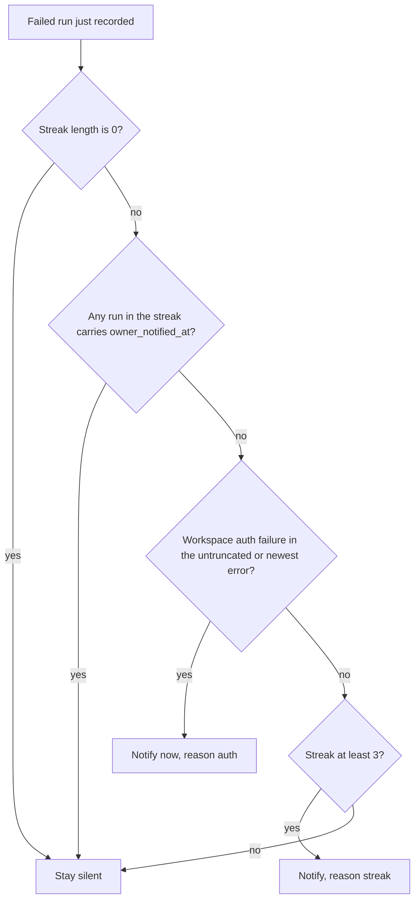
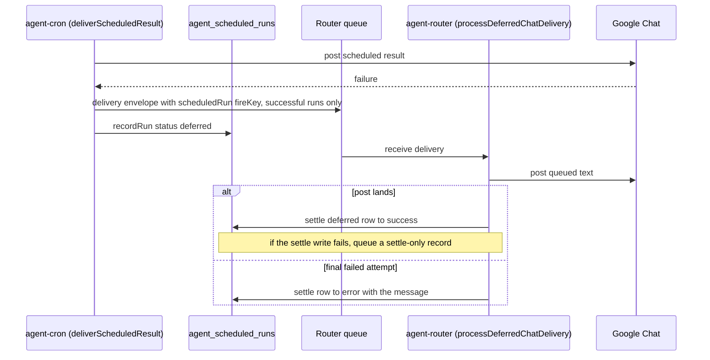

# Schedule Failure Streaks and Owner Notices

Before #1890, a scheduled job that failed every run was visible only to the agent through `psd-schedules runs` and to admins on the agent admin page. One teacher's daily recap failed every weekday for over a month on an expired Google authorization before anyone noticed. The platform now does three things about this: it records run outcomes truthfully, counts each schedule's current failure streak, and sends the owner one Chat DM per streak. This page covers that path. Schedule definitions, validation, and the read-back fields are in [Agent Schedules](agent-schedules.md).

## When to consult this page

Read this page before changing a run status, the streak query, the notice thresholds or wording, deferred delivery, or the promoted-run failure path. The same counts appear in three places (SQL, the list response, and the skill), so a change in one usually needs the others.

## Run outcomes

Every fire writes one `agent_scheduled_runs` row (see [Data Models](../data-models/overview.md)). The `status` values and what they mean for the streak:

| Status | Meaning | Decides a streak? |
|---|---|---|
| `success` | The run ran and its answer reached the owner. | Yes, ends a streak |
| `error` | The run failed, or it produced an answer that could not be delivered and was not queued. | Yes, extends a streak |
| `deferred` | The agent answered, but the Chat post failed and was queued for the durable retry. The owner has nothing in hand yet. | Yes, extends a streak |
| `skipped` | A coalesced fire that never ran. | No |
| `promoted` | Handed to the background job runner, whose own row carries the outcome. | No |

`deferred` is deliberately not `success`. The router rewrites it to `success` or `error` once the queued post finishes (see [Deferred delivery and settlement](#deferred-delivery-and-settlement)). A failed run whose error message is queued stays `error`, because a `deferred` row would be settled as `success` once that error text reached the owner.

## Measuring a streak

A streak is the run of failed rows after a schedule's newest success, read newest first by `created_at DESC, id DESC`. Two rules keep the number honest:

- **Measured in runs, not elapsed time.** `FAILURE_STREAK_RUN_LIMIT` is 500 runs per schedule. Validation allows `rate(100 days)` as well as a five-minute rate, so a time window would make a long-interval schedule's streak permanently 1. A streak at the limit is a floor, and the API reports it as `consecutiveFailuresCapped`, so readers say "at least N".
- **Bounded reads.** The partial index `idx_agent_scheduled_runs_streak` (migration 188) covers only `success`, `error`, and `deferred` rows in the readers' order. Both readers inline the status list as literals, because the planner can match a partial index only against literal predicates.

There are two readers over the same definition, and both are smoke-tested against real PostgreSQL:

| Reader | Used for | Symbol |
|---|---|---|
| Cron, one schedule | The owner notice, which also needs the stamp and the newest error text | `FAILURE_STREAK_SQL` and `readFailureStreak` in `infra/lambdas/agent-cron/run-telemetry.ts` |
| Service, every schedule of an owner | The `failing` marker on `list` | `consecutiveFailuresBySchedule` in `lib/agent-schedules/run-reader.ts` |

The service reads both through `Promise.all` in the list enrichment path of `lib/agent-schedules/service.ts`. If either query fails, both run-health fields degrade together to zero and `false`, with `runEnrichmentAvailable` false. Reporting a last-run error beside a zeroed streak would contradict itself.

### What the agent sees

`list` adds three fields to each schedule (see the [read-back table](agent-schedules.md#read-back-of-the-stored-meaning)):

- `consecutiveFailures`: the streak length, a floor when capped.
- `consecutiveFailuresCapped`: true when the streak reached `FAILURE_STREAK_RUN_LIMIT`.
- `failing`: true at `FAILING_SCHEDULE_THRESHOLD` (3) consecutive failures.

The skill renders `failing` through `failingMarker()` in `infra/agent-image/skills/psd-schedules/list.js`. It renders the server's verdict and never recomputes the threshold, so the skill cannot disagree with the server.

## Owner notice

The notice is one Chat DM to the schedule's owner, sent when their standing job has become visibly broken. The decision is `decideScheduleFailureNotice` in `infra/lambdas/agent-cron/schedule-failure-notice.ts`, and it runs only right after a failed run has been written, so the streak already includes that run.



*Caption: the auth branch fires on the first failure, because nothing recovers until the owner reconnects; the streak branch waits for the threshold.*

Rules and the reason each exists:

- **One message per streak.** The suppression is a recorded fact, not an inference. The run that carried the message is stamped `owner_notified_at` (migration 188), and any stamped run in the current streak silences the rule. A length-based rule would skip exactly the schedules that were already failing when this shipped, and it would count a failed send as the message.
- **A success ends the streak.** After one, the next three failures speak again.
- **Auth failures speak at once.** `isWorkspaceAuthFailure` matches Google's `invalid_grant`, the `token-revoked` status, and the Workspace broker's own prose. Generic signatures such as `needs-auth` count only when the same text names Google or Workspace. Canva, Plaud, and other integrations emit `needs-auth` too, and the auth fix is a Google consent link, so those alone would send the wrong link.
- **Classify the full text.** Classification reads the untruncated error because the stored copy is capped at 500 characters and could cut off the signature.

The message is built by `buildScheduleFailureNoticeText`. An auth notice carries a Google reconnect link when one could be minted, and otherwise asks the owner to reply. A streak notice says the schedule "has not reached you" for N runs, because a `deferred` run may still land. It names the last reason and asks the owner to have the agent check the schedule. Its text uses single-asterisk bold because it is composed in the Lambda and never passes through the Markdown-to-Chat converter.

### Consent link

For an auth failure, `mintOwnerConsentLink` POSTs `kind: user_account` to `/api/agent/consent-link` on the web tier. The request is signed with the scheduled invocation context and the per-request proof headers from `createAgentRequestProof`, and the owner comes from the schedule record, not from the request. The call has a five-second timeout. It returns `null` on any failure, including a missing `APP_BASE_URL` or internal key, a non-OK response, and a URL whose origin is not the app's own `https` origin. The owner still gets the DM with the reply-to-ask fallback. The consent-link route is the same one used by [Credential Entry](credential-entry.md), with a different `kind`.

### Stamping and failure handling

`markOwnerNotified` runs only after Chat has accepted the message. Stamping first would silence a streak whose message never arrived, and stamping after risks at most one repeat. Every error inside the notifier is caught and logged, so a courtesy DM can never mark a successful run as failed. The stamp targets the exact occurrence by `fire_key`, or the schedule's newest run when no key exists.

### Where the notice is raised

`notifyOwnerIfScheduleFailing` in `infra/lambdas/agent-cron/index.ts` is called from three direct-path sites:

- `recordScheduledCompletion`, for an `error` result.
- `recordScheduledDeferral`, for a `deferred` run.
- The both-failed branch of `deliverScheduledResultWithDependencies`, where the primary post failed and the durable enqueue also failed.

Promoted runs have no direct context. `monitorStoppedJob` in `infra/lambdas/agent-cron/job-monitor.ts` calls `tellOwnerIfPossible` after it writes the terminal row, and it takes the owner's DM space and workspace prefix from the job payload. `scheduledJobNoticeTarget` validates the space name against `spaces/<id>` and skips any payload marked `isDM: false`. A reconciliation message carries the same two fields, and an older message without them still records the run and skips only the notice.

Guard failures before execution notify only when the owner missed the run. `OWNER_MISSED_GUARD_PHASES` is an allowlist: `fire-config`, `fire-acquire`, `fire-begin`, `lock-config`, `lock-acquire`, and `lock-contention`. Duplicate invocations (`fire-in-progress`, `fire-executing`, `fire-completed`) and `lock-renew` are excluded, because another invocation may still deliver or the turn was already running. `fire-completion` never reaches this path, because it fires after delivery.

## Deferred delivery and settlement

A scheduled post that Google Chat rejects is not lost. The cron queues the same message for the router's durable delivery, and the run row is left `deferred` until the router finishes. The cron does not record `success`, because the owner has nothing yet.



*Caption: the post is retried with the message, but the status change is a separate write, so a failed write retries the status and never reposts the text.*

Mechanics, all in the two files named:

- **Cron side.** `deliverScheduledResultWithDependencies` in `infra/lambdas/agent-cron/index.ts` attaches `scheduledRun: { fireKey }` to the envelope only for a successful answer. `buildScheduledChatDeliveryEnvelope` omits the key when no fire identity exists, and the row then stays `deferred`, which is still truthful.
- **Router side.** `parseDeferredScheduledRun` accepts only `fireKey`, bounded to 192 characters to match `agent_scheduled_runs.fire_key`. A malformed reference is dropped, so the reply still goes out. `processDeferredChatDelivery` posts the text, then `resolveDeferredScheduledRun` updates the row. The update is scoped to `status = 'deferred'`, which makes a duplicate receive harmless.
- **Settlement record.** If the row cannot be updated after the post landed, the router queues a settle-only record. Its kind is `agent-scheduled-run-settlement-v1`, with no message text and a 15-second delay. A separate kind is required because an older router would drop an unknown flag on a delivery envelope and post the text again. Against an unknown kind, it fails closed.
- **Final failure.** On the last receive, `isFinalDeliveryAttempt` uses the same receive-count rule as the dead-letter redrive. The router then settles the row as `error` with the failure text, because the record would otherwise dead-letter and nothing would settle it.
- **Upsert guard.** `writeScheduledRun` in `infra/lambdas/agent-cron/run-telemetry.ts` uses `ON CONFLICT (fire_key)` and refuses to overwrite a settled `success` or `error` row with a late `deferred` write.

Deployment order matters for this envelope. `infra/lib/agent-platform-stack.ts` makes the cron Lambda depend on the router Lambda, so a new cron cannot emit a `scheduledRun` field that an old router would reject as malformed.

## Invariants

- A run is `deferred`, never `success`, while its Chat post is only queued.
- A settlement never reposts. A throw after a successful post would post the text again, so the settle path catches errors and falls back to a settlement record.
- Settlement is idempotent and scoped to `deferred` rows. A repair by the job supervisor, or a duplicate SQS receive, updates nothing.
- The notice never changes the run's status or the Lambda's return value. It is logged on failure.
- The stamp is written only after Chat accepts the notice.
- `failing` on `list` and the owner notice use the same threshold, `FAILING_SCHEDULE_THRESHOLD` and `NOTICE_THRESHOLD`, both 3. They are separate constants because the Lambda bundles its own dependencies. `tests/unit/agent-schedule-failing-threshold.test.ts` keeps them equal.

## Change guidance

- **Changing a status or a streak rule.** Update `STREAK_DECIDING_STATUSES` and `FAILED_STATUSES` in `run-telemetry.ts`, and the matching `STREAK_DECIDING_STATUSES` in `run-reader.ts`. Both readers and the partial index in migration 188 must agree, so change the migration with them. Run the streak smoke test against PostgreSQL. Unit tests check only the SQL text.
- **Changing notice wording or thresholds.** Edit `schedule-failure-notice.ts`, and keep `FAILING_SCHEDULE_THRESHOLD` equal to `NOTICE_THRESHOLD`.
- **Changing the router settlement.** The envelope and its strict parsers are in `infra/lambdas/agent-router/index.ts`. Keep the delivery envelope's key allowlist, `DEFERRED_CHAT_ENVELOPE_KEYS`, in step with what the cron sends, and mind the deploy order above.
- **Non-goals.** This path does not retry schedules, change a schedule's configuration, or decide whether a run should happen. The owner is told, and the owner or the agent decides what to change.

## Tests and validation

| Behavior | Test location |
|---|---|
| Notice decision: threshold, stamp suppression, auth-first, untruncated classification, unreadable stamp suppresses | `infra/lambdas/agent-cron/schedule-failure-notice.test.ts` (`decideScheduleFailureNotice`) |
| Notice text: consent link, saturated streak as floor, long-diagnostic truncation | `infra/lambdas/agent-cron/schedule-failure-notice.test.ts` (`buildScheduleFailureNoticeText`) |
| Streak query shape, bound by runs, owner scoping, stamp targeting | `infra/lambdas/agent-cron/failure-streak-query.test.ts` |
| Deferred versus success recording, fire-key envelope, owner DM on the third failure, unstamped retry on send failure | `infra/lambdas/agent-cron/deferred-delivery-run.test.ts` |
| Promoted failures reach the notice; DM target validated; guard-phase allowlist | `infra/lambdas/agent-cron/promoted-failure-notice.test.ts` |
| Router reads the reference, settles `deferred` rows, re-queues settlement, final attempt settles as error | `infra/lambdas/agent-router/index.test.ts` (`deferred scheduled-run resolution`, `deferred scheduled-run settlement durability`, `scheduled-run settlement record`) |
| Real-PostgreSQL streak aggregate and stamp write | `tests/smoke/agent-schedule-failure-streak.smoke.ts` |
| `failing` count in the service read path, real PostgreSQL | `tests/smoke/agent-schedule-failing-marker.smoke.ts` |
| Migration 188 is registered, indexed as specified, and matches the Drizzle model | `tests/unit/agent-schedule-owner-notified-migration.test.ts` |

Focused checks:

```bash
cd infra/lambdas/agent-cron && bun test schedule-failure-notice.test.ts failure-streak-query.test.ts deferred-delivery-run.test.ts promoted-failure-notice.test.ts
cd infra/lambdas/agent-router && bun test index.test.ts
bunx jest --silent agent-schedule-failing-threshold agent-schedule-owner-notified-migration
```

The two smoke tests need a local PostgreSQL `DATABASE_URL`. Run them with `bun run test:smoke:schedule-failure-streak` and `bun run test:smoke:schedule-failing-marker`. They are conditional. Run them when the streak SQL, the stamp SQL, or the migration changes, because unit tests cannot catch a wrong bound or a stamp that matches no row. CI runs both as steps in `.github/workflows/ci.yml`.

## Related

- [Agent Schedules](agent-schedules.md) defines the schedules, their validation, the read-back fields, and the duplicate refusal that runs before any of this.
- [Agent Platform Overview](overview.md#scheduled-run-silent-reply-1853) covers the silent-reply path, which sits in front of the delivery branch described here.
- [Infrastructure Overview](../infrastructure/overview.md#agent-cron) covers the `agent-cron` and `agent-router` Lambdas, their environment, and the deploy ordering.
- Historical rationale: `docs/learnings/database/2026-10-14-streak-suppression-must-aggregate-sql-not-page-rows.md` (why the stamp is evaluated over the whole streak), `docs/learnings/logic/2026-10-14-owner-notification-must-stamp-not-infer-and-use-gte-threshold.md` (why suppression is recorded rather than inferred), and `docs/learnings/logic/2026-10-14-track-side-effect-success-separately-from-recording-it.md` (why `deferred` is not `success`).
