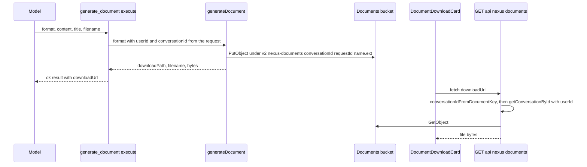

# Nexus Generated Documents

Nexus chat can produce a real file. Asked for a Word document, spreadsheet, deck, or PDF, the model calls the `generate_document` tool. The tool stores the file under the conversation and returns a download path. The chat renders that path as a download card. Before #1898, the model could only paste text the user had to copy, which lost all formatting.

## Why It Is Built This Way

The generator already existed. `generateDocument()` in `lib/ai/document-generation-service.ts` was reachable only through the agent-platform `documents.create` tool. `createDocumentCreateTool()` in `lib/tools/document-create-tool.ts` binds the chat surface to that same generator, so there is one rendering implementation.

The chat binding differs from the agent binding in three deliberate ways:

- **No presigned URL.** A presigned S3 URL is a bearer credential, expires after an hour, and cannot be re-authorized. A conversation-scoped file is therefore served by an authenticated route that checks ownership on every request.
- **Identity from the request.** `userId` and `conversationId` are passed in from the authenticated request. The model cannot write into another conversation's prefix.
- **Tool failures are data.** `execute` returns `{ ok: false, error }` instead of throwing, so the turn continues and the model can explain the failure.

## Flow

Caption: a `generate_document` call, from model request to the card's download.

## Key Components

| Component | Responsibility |
|-----------|----------------|
| `DOCUMENT_CREATE_TOOL_NAME` (`generate_document`) in `lib/tools/document-create-contract.ts` | The wire name and the argument and result shapes. This module is browser-safe, so the download card can import it without pulling in the S3 client. |
| `createDocumentCreateTool({ userId, conversationId })` | Builds the AI SDK tool. Validates the format against `DOCUMENT_FORMATS` and rejects empty content. |
| `generateDocument()` | Renders the file and writes it to S3. Conversation-scoped files use the key `v2/nexus-documents/{conversationId}/{requestId}/{name}.{ext}`, and the response carries `downloadPath` rather than a presigned URL. |
| `isConversationScopedDocumentKey()`, `conversationIdFromDocumentKey()` | Parse a key back into its conversation id. The download route derives ownership from the key alone. |
| `GET` in `app/api/nexus/documents/[...key]/route.ts` | Validates the key shape, then calls `getConversationById(conversationId, userId)`. A non-owner gets 404, not 403, so a probe cannot confirm that a file exists. The route streams the object and enforces a 50 MB cap. |
| `DocumentDownloadUI` in `app/(protected)/nexus/_components/tools/document-download-ui.tsx` | Renders the card. `safeDownloadHref()` accepts only app-relative paths under `/api/nexus/documents/`, with no `//` and no backslash. |
| `DIRECT_RENDER_TOOL_NAMES` in `lib/tools/direct-render-tools.ts` | Lists `generate_document` with the chart and decision tools. The download card is therefore not wrapped in the collapsed "Tool Actions" group, and the stream does not add an answer-less notice after it. |

Supported formats are the `DOCUMENT_FORMATS` list in `lib/agents/agent-tools/descriptors.ts`: `pdf`, `docx`, `xlsx`, `pptx`, `md`, `html`, `txt`, and `csv`. Markdown is rendered into Word and PowerPoint (`lib/ai/markdown-blocks.ts`, `lib/ai/document-docx-builder.ts`). Spreadsheets and CSV take CSV rows. PDF takes plain text.

## Attachment and Permissions

- The tool is attached by `attachNexusBuiltInTools` in `app/api/nexus/chat/route.ts`, from the `documentCreateAllowed` flag. The route computes that flag with `skillPinAllowsDocumentCreate()`, so a bound skill's `allowed-tools` pin can exclude the tool. An empty pin allows it.
- The tool is always on rather than behind a toggle. Every role that can reach the chat route already holds `chat:write`.
- Built-in tools are assigned last, so a connector or workspace tool with the same name cannot replace the server-built one.

## Invariants

- A conversation-scoped document is never delivered through a presigned S3 URL, and every download re-checks conversation ownership.
- `userId` and `conversationId` come from the authenticated request, never from model input. `generateDocument` also rejects a `conversationId` that is not a UUID, because the download route later uses it as a database lookup key.
- Tool failures are returned as data. The message `The file could not be created: ...` lets the model explain what happened.
- A `generate_document` result is the answer. The stream does not follow it with an answer-less notice, and the persistence path does not add one, as described in [architecture/streaming.md](../architecture/streaming.md#answer-less-turns-and-error-notices-1899).

## Change Guidance

- **Adding a format**: update `DOCUMENT_FORMATS`, the renderer in `lib/ai/document-generation-service.ts`, and the `DOCUMENT_CREATE_SCHEMA` enum. The tool description in `document-create-tool.ts` also tells the model which formats need markdown and which need CSV, so update it too. Then run the format tests.
- **Changing the key layout**: `isConversationScopedDocumentKey()` and the route's key validation must match the writer. A key the route cannot parse is refused, so the file is stored but never served.
- **Changing the download path**: `NEXUS_DOCUMENT_DOWNLOAD_PREFIX` is shared by the tool result, the card's `safeDownloadHref`, and the route. Change them together.
- **Retention**: the retention sweep in `infra/lambdas/nexus-conversation-retention/sweep.ts` deletes the `v2/nexus-documents/{conversationId}/` prefix together with the conversation. Keep that prefix in step with the writer. `retention-policy.test.ts` covers it.

**Focused tests**:
- `tests/unit/lib/tools/document-create-tool.test.ts` — argument validation, skill pin, error results
- `tests/unit/lib/ai/document-generation-service.test.ts` and `document-generation-pptx.test.ts` — rendering and key layout
- `tests/unit/nexus-document-download-route.test.ts` — ownership check, 404 for non-owners, size cap
- `tests/unit/nexus-document-download-card.test.tsx` — link safety and card states

**Minimal validation**: `bunx jest --silent tests/unit/lib/tools/document-create-tool.test.ts tests/unit/nexus-document-download-route.test.ts`. The smoke test `bun run test:smoke:nexus-document-markdown` exercises the Markdown path end to end, and it is conditional: run it when rendering or the key format changes.

**Scope boundary**: the agent-platform binding of the same generator (`lib/agents/agent-tools/document-generate.ts`, `documents.create`) returns a presigned URL and has its own surface. Changing that binding does not change the chat path, though both call `generateDocument()`, so renderer changes affect both.

## See Also

- [Core Application Features](overview.md#nexus-chat) — the Nexus Chat section that hosts this tool
- [architecture/streaming.md](../architecture/streaming.md) — why a download card suppresses the empty-turn notice
