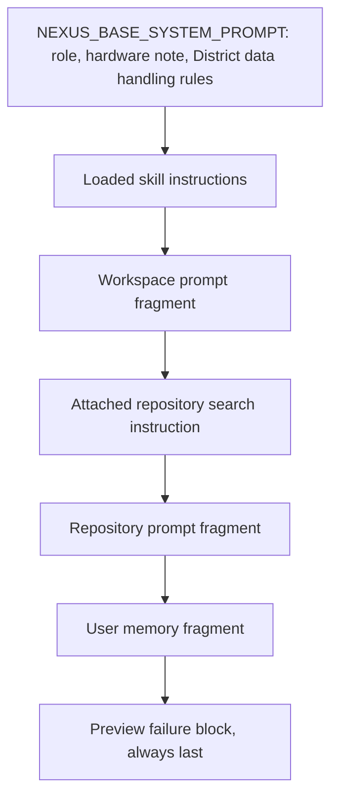
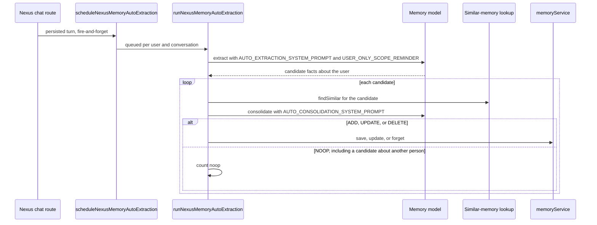

# Nexus Data-Handling Rules and User-Only Memory Scope

Nexus has two prompt-side controls that protect district data: a data-handling block that every chat turn's system prompt starts with, and a user-only scope for automatic memory extraction and recall. Both live in prompt text, not in write-time filters. Writing memories is never refused on PII content; the policy and its rationale are canonical in [K-12 Content Safety](../../docs/features/k12-content-safety.md) (PII Privacy Boundary), and the detect-only PII gates are summarized in [Architecture Overview](../architecture/overview.md#pii-detection-gates).

**When to consult**: changing the Nexus system prompt, the memory extraction or consolidation prompts, the memory recall suffix, or the model used for memory extraction (`MEMORY_EXTRACTION_MODEL_ID`). Change the prompt text and its tests together, and run the live eval when behavior may change (see [Change Guidance](#change-guidance)).

## System Prompt Assembly

`NEXUS_BASE_SYSTEM_PROMPT` in `lib/nexus/system-prompt.ts` embeds `NEXUS_DATA_HANDLING_PROMPT`, so the five data-handling rules are the first thing in every Nexus system prompt. `buildNexusSystemPrompt` only appends: each optional fragment is added after the base text in its own `---` section. The chat route in `app/api/nexus/chat/route.ts` calls it once per turn with the skill, workspace, attachment, repository, and memory fragments.



*Caption: order of sections in the prompt built by `buildNexusSystemPrompt`. Only the base text and the preview block have a fixed position; the data-handling block cannot be displaced by any fragment.*

### The Five Data-Handling Rules

`NEXUS_DATA_HANDLING_PROMPT` is the canonical text; the rules below summarize it.

| Rule | Behavior the model must follow |
|------|-------------------------------|
| Approved use | Nexus is the district's own platform for student and staff data. Asked whether such data may be shared with it, the model says yes and never discourages the use. |
| No general sharing | It never suggests making a Google file or Drive folder "anyone with the link", public, or otherwise general-access, including so it can read the file. |
| Unreadable file | When it cannot open a linked Google file, it asks the user to attach the file or paste its contents. |
| No consumer tools | It never suggests moving district, student, or staff data to a personal or consumer AI tool or account. |
| Keep people separate | Writing about a student uses only facts given in this conversation, and no detail about one student is carried into writing about another. |

The first rule is intentionally affirmative. The block exists because of ordinary chats that needed no special context: sharing advice to set a document to "anyone with the link", sending a student CSV to a consumer tool, and telling staff Nexus is not a district system. Do not rewrite the first rule as a warning; the model's refusals to use student data were the failure it prevents.

## User-Only Memory Scope

Automatic memory runs unattended after every persisted Nexus turn, so its prompts are the only control. The flow has two halves: extraction and consolidation on write, and a recall suffix on read.



*Caption: automatic extraction in `lib/nexus/memory/auto-extraction.ts`. The write path always calls the save service; the scope only changes what the model returns.*

- **Extraction prompt**: `AUTO_EXTRACTION_SYSTEM_PROMPT` asks for profile, preference, and context facts about the user only. It forbids any candidate that names or describes a student, parent, colleague, or other person, and it forbids recording one task from the exchange such as a letter for a named student. A good and a bad example are included in the prompt.
- **Repeated reminder**: `USER_ONLY_SCOPE_REMINDER` is appended to the extraction user prompt and to the extraction tool description. It exists because the default extraction model (Nova Lite) followed the system-prompt rule alone inconsistently. Keep the three copies identical; they are one constant.
- **Consolidation**: `AUTO_CONSOLIDATION_SYSTEM_PROMPT` returns `NOOP` when a candidate names or describes anyone other than the user. A `NOOP` is counted and skipped, not an error.
- **Recall**: `MEMORY_FRAGMENT_SUFFIX` in `lib/nexus/memory/memory-fragment.ts` is appended by `buildUserMemoryFragment`. It tells the chat model that recalled memories describe the user only, and that facts about other people come only from the current conversation. This covers legacy rows saved before the extraction prompt was narrowed.
- **Import is out of scope**: memory import is the user pasting their own export and approving each candidate by hand, so it does not apply this scope (the code comment in `auto-extraction.ts` records this).

### Extraction Outcomes

`runNexusMemoryAutoExtraction` returns counts, and a `skippedReason` when it does not extract:

- Availability says memory is off: the run returns with that reason before any model call.
- A user message shorter than `MIN_AUTO_EXTRACTION_USER_CHARS` returns `short-message` before the model is loaded.
- An UPDATE or DELETE decision whose `memoryId` is not among the similar-memory neighbors is counted as `noop`.
- An exception on one candidate is logged and counted as `noop`; later candidates still run.
- A rejected extraction is logged by the scheduler and never surfaced to the chat turn (see the scheduling tests below).

The write path is not gated on content. The unit test "never blocks a memory write on its content" pins this: a candidate containing another person's name is still saved.

## Behavior Matrix and Focused Tests

Unit tests pin the prompt text and the wiring; they cannot show what a model does with it. Use the narrowest suite for the invariant you touch.

| Invariant | Narrowest test |
|-----------|----------------|
| The data-handling block is in a bare chat and in a chat with every optional fragment | `tests/unit/lib/nexus/nexus-data-handling-prompts.test.ts`, "Nexus data-handling system prompt (#2034 finding 4)" |
| The block precedes any loaded skill, so a skill cannot displace it | same file, "comes before any loaded skill, so a skill cannot displace it" |
| Each of the five rules is pinned by one assertion | same file: "answers 'can I put student data here' affirmatively", "forbids suggesting anyone-with-the-link or general access", "asks for an attachment or paste when a Google file cannot be read", "forbids sending district data to a consumer AI tool", "keeps one student's facts out of writing about another" |
| Extraction asks for user-only facts, and the reminder reaches the model in both the user prompt and the tool description | same file, "Nexus memory scope (#2034 finding 5)": "asks the extractor for facts about the user only", "sends that prompt to the extraction model" |
| Consolidation returns NOOP for a candidate about someone else | same file: "has consolidation drop a candidate about someone other than the user" |
| Recall tells the chat model memories describe the user only | same file: "tells the chat model recalled memories describe the user only" |
| Memory writes are never blocked on content | same file: "never blocks a memory write on its content: the scope lives in the prompt only" |
| Preview-failure block stays last after memory fragments; empty fragments are no-ops | `tests/unit/lib/nexus/memory-context.test.ts`, "puts the turn's preview failures LAST" and "adds no preview-failure section" |
| Memory fragment bounds and quoted JSON entries | `tests/unit/lib/nexus/memory-context.test.ts`, "bounds prompt injection while preserving complete quoted JSON entries" |
| Scheduler and gates: short messages skip before the model loads, exchanges are bounded, a rejected extraction is not surfaced, and jobs for one owner conversation run in order | `tests/unit/lib/nexus/auto-extraction.test.ts`, suites "Nexus automatic memory gates" and "Nexus automatic memory scheduling" |
| ADD, UPDATE, DELETE, and NOOP apply through owner-scoped service methods, and one failed candidate does not stop later writes | `tests/unit/lib/nexus/auto-extraction.test.ts`, suite "Nexus automatic memory consolidation" |
| Extraction onFinish turns a fact-bearing exchange into an auto row through the safety check | `tests/integration/nexus-memory-auto-extraction.test.ts`, "Nexus automatic memory onFinish integration" |

**Focused check (quiet, default)**:

```sh
bunx jest --silent tests/unit/lib/nexus/nexus-data-handling-prompts.test.ts tests/unit/lib/nexus/memory-context.test.ts tests/unit/lib/nexus/auto-extraction.test.ts
```

Add `bun run typecheck` when you change exported signatures. `scripts/eval/nexus-privacy-eval.ts` imports `buildNexusSystemPrompt` and `runExtractionModel` from these modules, so a rename there must be followed through in the eval script.

### Live Eval (conditional, paid, not in CI)

`bun run eval:nexus:privacy` runs `scripts/eval/nexus-privacy-eval.ts` against live Bedrock models with the exact prompt text the route and extractor send. It grades five rule cases with an LLM judge, and memory cases built from two fictional students (no student marker may appear in an extraction from one letter conversation, nor reach a separate conversation writing the other student's letter). Run it only when prompt wording or the extraction model changes, because unit tests cannot show model compliance. Environment variables are `NEXUS_EVAL_CHAT_MODEL_ID`, `NEXUS_EVAL_MEMORY_MODEL_ID`, `NEXUS_EVAL_RUNS`, and `AWS_REGION`. `--without-rules` builds a baseline with the data-handling block removed; the script throws before any model call if that block is not found, so a baseline cannot silently run with the rules on.

The commit that introduced the eval recorded these results, which are useful as a baseline for later comparisons: Sonnet 4.6 passed 27 of 27 across three runs with rules; the no-rules baseline failed both student-data cases. Models change, so re-run instead of trusting these numbers.

## Change Guidance

- **Add or edit a data-handling rule**: change `NEXUS_DATA_HANDLING_PROMPT` only. It flows into `NEXUS_BASE_SYSTEM_PROMPT` and then into every turn, so no consumer change is needed. Update the matching assertion in `nexus-data-handling-prompts.test.ts`, the rules section of `docs/features/k12-content-safety.md`, and add or adjust an eval case. Do not reword the affirmative approved-use rule into a warning.
- **Change what memory extraction keeps**: edit `AUTO_EXTRACTION_SYSTEM_PROMPT` and `USER_ONLY_SCOPE_REMINDER` together, and keep the reminder in the extraction user prompt and tool description. Re-run the eval, because the default extraction model needed the reminder beside the data.
- **Change recall**: edit `MEMORY_FRAGMENT_SUFFIX`. It is appended to every recall fragment, so it also affects turns with no student context.
- **Non-goal**: adding a write-time refusal or redaction for memory content. The standing rule is that memory writes proceed on PII detection, which is telemetry only (see `docs/features/k12-content-safety.md`). Escalate before changing that rule.
- **Escalate** when a change needs a new prompt section, changes the position of the preview block, or alters the `skippedReason` values, since the chat route and the preview-failure contract depend on the order described above (see [Preview Failure Delivery](overview.md#preview-failure-delivery-1839) in the App Features Overview).

## Related Pages

- [App Features Overview](overview.md) covers the Nexus chat route, the preview-failure block, and other fragments that share this prompt.
- [Architecture Overview](../architecture/overview.md#pii-detection-gates) describes the detect-only PII gates that the write path still uses.
ll uses.
