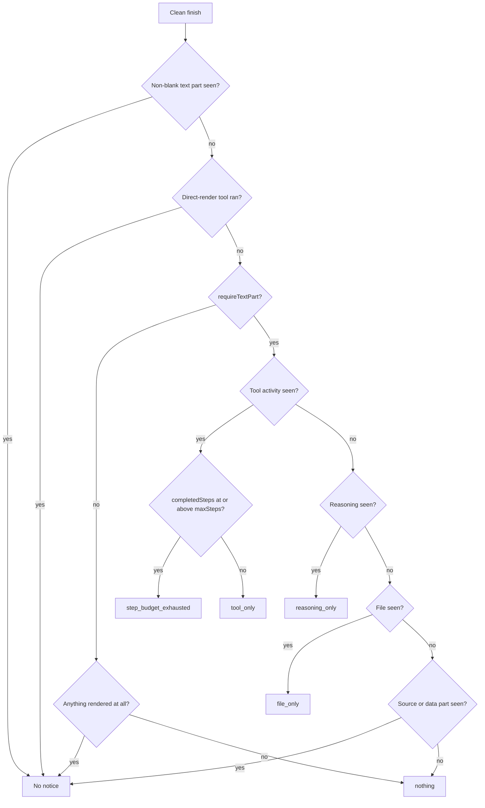
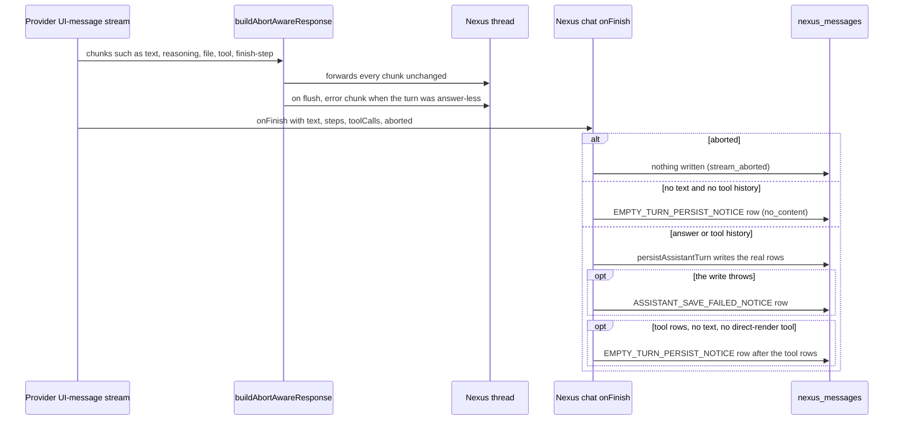
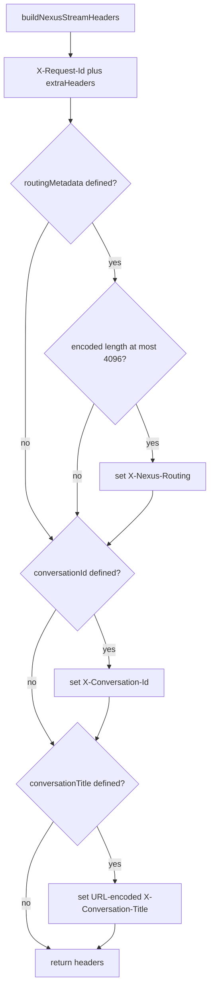

# Streaming Architecture

AI Studio uses Server-Sent Events (SSE) for real-time streaming responses from AI models. The streaming layer includes reliability mechanisms to handle long-running turns that would otherwise timeout.

## The Silent Stream Problem

**Issue**: #1698 (FS#164150)

The Application Load Balancer (ALB) in front of ECS closes connections after 300 seconds with no bytes in either direction (`infra/lib/constructs/ecs-service.ts`, `idleTimeout`). Reasoning-tier models (GPT-5, Claude) emit a `start` chunk immediately and can then go completely silent for the entire think/tool phase.

### Why This Matters

- **GPT-5 per-step budget**: 300 seconds (`lib/streaming/provider-adapters/openai-adapter.ts`, `maxTimeoutMs`)
- **ALB timeout**: 300 seconds
- **Result**: Socket dies at or before the app-level abort fires
- **Symptom**: Terminal `error` chunk enqueued into a stream nobody is reading — turn stops with no answer and no error

### Why Raising ALB Timeout Doesn't Fix

Raising the ALB timeout would not fix this because:
1. Any intermediary proxy can cut a silent stream (common proxies use 60s timeouts)
2. Requires CDK deployment for infrastructure changes
3. Emitting a byte removes the idle constraint entirely

## SSE Keep-Alive Implementation

### Solution: Invisible Comment Frames

The standard SSE no-op frame `: keep-alive\n\n` is used for keep-alive because:
- `eventsource-parser` routes `:`-prefixed lines to `onComment` handler
- AI SDK does not supply `onComment`, so frames are discarded before reaching `processUIMessageStream`
- Parsed chunk sequence is identical to unwrapped stream
- A `data-*` chunk would NOT work — `classifyChunkVisibility` (`lib/streaming/empty-turn-notice.ts`) buckets them as rendered output, which suppresses the empty-turn notice

### Keep-Alive Parameters

| Parameter | Value | Rationale |
|-----------|-------|-----------|
| `SSE_KEEP_ALIVE_INTERVAL_MS` | 15,000 (15s) | Well under 300s ALB timeout and 60s proxy timeouts; single dropped frame leaves buffer |
| `SSE_MAX_LIFETIME_MS` | 2,400,000 (40min) | Above longest route budget (nexus/chat: 30min); backstop for missing deadlines |
| Frame format | `: keep-alive\n\n` | Standard SSE comment; discarded by parser |

### Implementation: `withSseKeepAlive()`

**Location**: `lib/streaming/sse-keep-alive.ts`

```typescript
export function withSseKeepAlive(
  source: ReadableStream<Uint8Array>,
  options?: SseKeepAliveOptions
): ReadableStream<Uint8Array>
```

**Key behaviors**:
- Timer skipped when real bytes sent within interval — byte-identical to unwrapped stream
- Backpressure preserved — source only read when consumer has room (`desiredSize > 0`)
- Timers always released on end-of-stream, error, and consumer cancel
- Stream after `maxLifetimeMs` is errored (not cleanly closed) so client sees failure

**Call sites**:
- `lib/streaming/provider-adapters/base-adapter.ts` — All provider responses
- `app/api/compare/route.ts` — Model comparison
- `app/api/compare-models/route.ts` — Model comparison

### Response Helper: `withSseKeepAliveResponse()`

Applies keep-alive to a Response's body while preserving status and headers:

```typescript
export function withSseKeepAliveResponse(
  response: Response,
  options?: SseKeepAliveOptions
): Response
```

## Deferred Response for Prompt Chains

### Problem: No Body to Keep-Alive

`withSseKeepAlive` can only fill gaps in a body that already exists. Prompt-chain assistants run every prompt except the last to completion before building the streaming Response for the final one:

- **Execution**: `executePromptChain` in `app/api/assistant-architect/execute/route.ts`
- **Service**: `lib/api/assistant-execution-service.ts`
- **Issue**: Slow earlier prompt leaves socket with no bytes at all — not even headers

### Solution: `deferUIMessageStreamResponse()`

**Location**: `lib/streaming/deferred-ui-message-stream.ts`

```typescript
export async function deferUIMessageStreamResponse(
  pending: Promise<Response>,
  options: DeferUIMessageStreamOptions
): Promise<Response>
```

**Behavior**:
1. Wait grace period (default: 15s) for real Response
2. If Response arrives in time → return exactly what caller would have gotten
3. If timeout → commit to 200 SSE response immediately
4. Fill wait with keep-alive comments
5. Stream real body once it exists
6. If work fails after commit → single UI-message `error` chunk with user-facing message

**Call sites**:
- `app/api/assistant-architect/execute/route.ts` — Prompt chain execution
- `lib/api/assistant-execution-service.ts` — Execution service

### Error Handling After Commit

When a failure arrives after response was committed:
- Status code can no longer be sent (already committed 200)
- Error Response mapped to user-facing message via `onLateError` callback
- Single `error` UI-message chunk enqueued: `{ type: 'error', errorText: string }`
- Error Response also used for logging/compensation side effects

## Provider Adapter Integration

### StreamDeadline

The `StreamDeadline` interface (from `lib/streaming/provider-adapters/base-adapter.ts`) provides per-step timeout budgeting for AI streams:

```typescript
export interface StreamDeadline {
  /** Abort signal for streamText; undefined when no budget is configured. */
  readonly signal?: AbortSignal;
  /** Push the per-step clock forward. Call at each step boundary. */
  extend(): void;
  /**
   * Push the clock forward on observed stream progress (one chunk).
   * Throttled internally, safe to call per token.
   */
  touch(): void;
  /** True once THIS deadline aborted the run (vs. caller-initiated abort). */
  timedOut(): boolean;
  /** Release the timer. Safe to call more than once. */
  dispose(): void;
}
```

**Why both `extend()` and `touch()`** (#1791):

Step boundaries alone (`extend()`) are not enough when ONE step is long. An `update_workspace_artifact` call that streams a 50-60 KB dashboard is a **single step** — a 180s step budget can abort a run that was producing output the whole time, saving nothing.

- `extend()` — Called at step boundaries (model reaches a tool call, finishes a reasoning segment)
- `touch()` — Called on each chunk (`onChunk` callback), turning the per-step budget into an **idle timeout**

**Chunk-driven clock extension**:
- Active output pushes the deadline forward (throttled to at most one timer re-arm per second)
- Silence still aborts after the full budget
- Absolute ceiling (`hardStopAt`) remains — a wedged stream that emits forever is still bounded

**Call sites**:
- `base-adapter.ts` — `streamText` call gets `onChunk: () => deadline.touch()`
- `openai-adapter.ts` — Responses-API path also passes `onChunk`

### Base Provider Adapter

All provider responses are wrapped with keep-alive at the provider adapter layer:

**Location**: `lib/streaming/provider-adapters/base-adapter.ts`

Both the base and the OpenAI Responses-API adapter build their response through `buildResponseFactory()`, which resolves the empty-turn policy once per run (`requireTextPart: config.source === 'nexus'`, plus the run's `maxSteps`) and hands it to `buildAbortAwareResponse()`. That method wraps the provider's UI-message stream, counts what the user will actually see, and appends a terminal `error` chunk when the run was aborted or ended with nothing to read (see [Answer-less Turns and Error Notices](#answer-less-turns-and-error-notices-1899)).

```typescript
// Keep socket warm through silent reasoning/tool stretch
return withSseKeepAliveResponse(
  createUIMessageStreamResponse({
    stream,
    headers: options?.headers,
  })
);
```

This means:
- All AI provider calls (OpenAI, Claude, Gemini, Bedrock) automatically get keep-alive
- No per-route configuration needed
- Consistent behavior across Nexus Chat, Model Compare, and Assistant execution

## Answer-less Turns and Error Notices (#1899)

A cleanly finished turn can still leave the user with nothing to read. Three paths in the stream layer make sure the thread always says what happened, and the Nexus route keeps that explanation after a reload.

**Why the old check failed**: `isVisibleChunkType` used to count `reasoning-*` and `file` chunks as visible output. The Nexus Thread (`DEFAULT_ASSISTANT_MESSAGE_CONTENT_COMPONENTS` in `components/assistant-ui/thread.tsx`) registers no Reasoning or File renderer, so those parts draw nothing. A model that thought and then wrote no text produced a blank bubble with no notice. Tool-only turns were also silent, and a turn can reach that state because an ordinary Nexus turn gets three steps (`WEB_FETCH_MAX_STEPS` in `lib/nexus/chat-step-budget.ts`).

### Classifying the Turn

`lib/streaming/empty-turn-notice.ts` holds the pure rules, with no AI SDK or React imports:

- `classifyChunkVisibility(type)` buckets each UI-message chunk as `text`, `reasoning`, `file`, `tool`, `other` (`source-*` and `data-*`), or `none`.
- `classifyEmptyTurn(observation)` returns one `EmptyTurnKind`, or `null` when there is nothing to say.
- `emptyTurnNotice(kind)` returns the user-facing sentence. The sentence is rendered verbatim by `MessagePrimitive.Error`.



Caption: decision order for the notice shape in `classifyEmptyTurn`. The `requireTextPart` branch is the Nexus rule. The non-Nexus branch only classifies a run that emitted nothing at all.

**Policy rules**:
- Any text part suppresses the notice. Whitespace-only text does not count, which matches `incompleteTurnReason`.
- A direct-render tool suppresses it. `generate_document`, `show_chart`, `search_graph_nodes`, `propose_decision` and `commit_decision` are listed in `lib/tools/direct-render-tools.ts` (`DIRECT_RENDER_TOOL_NAMES`, `isDirectRenderTool`). The chart or download card is the answer, and a notice under it would contradict it. The `generate_document` download card is described in [generated-documents.md](../app-features/generated-documents.md). The same list drives tool-group rendering in `app/(protected)/nexus/_components/tools/tool-group.tsx`.
- `requireTextPart` is set only for `source: 'nexus'`. `buildResponseFactory` derives it from the original `config.source`, not the enhanced config. Assistant Architect execution and the programmatic `/api/v1/assistants` path share this code and keep the pre-#1899 rule, where only a run that emitted nothing at all is called empty. An injected `error` chunk would make an AI SDK client throw for those callers when the run ended on a structured tool call.
- `enhanceStreamConfig()` in `base-adapter.ts` must copy `source` as well as `maxSteps`. Dropping `source` silently reverts every Nexus run to the non-Nexus rule.

### Stream Errors Are Sanitized

`toUIMessageStream()` is called with `onError: sanitizeStreamErrorMessage`. Without it, the AI SDK default `An error occurred.` reaches the browser. `lib/streaming/stream-error-message.ts` classifies the error with an ordered rule table (`classifyStreamError`: timeout, rate limit, content blocked, context too long, unavailable, or unknown) and returns one of six fixed strings from `STREAM_ERROR_MESSAGES`. The classifier reads the error, and the reply never quotes it, because provider messages can carry request ids, model ARNs, or prompt fragments. The handler logs the kind.

Ordering matters: a `504 gateway timeout` must classify as a timeout, not as an outage, so the timeout rule comes first and the broad 5xx rule comes last.

### Persistence Keeps the Prompt Answered

The user message is saved before streaming starts, so a reply that is never written leaves the prompt looking unanswered after a reload. `app/api/nexus/chat/route.ts` (`createOnFinishCallback`) and `app/api/nexus/chat/chat-helpers.ts` implement this:



Caption: what `onFinish` writes for each outcome. The live notice and the persisted notice are separate; the live one is specific, the persisted one states the shared fact.

- `incompleteTurnReason()` returns `stream_aborted` (nothing written, because an aborted run may hold a tool call without its result), or `no_content` when there is no text and no tool history. A turn with tool calls is never `no_content`, so its tool rows are kept.
- `turnNeedsEmptyNotice()` decides whether tool rows need a trailing notice row. It applies only to text-free turns with no direct-render tool.
- `persistAssistantTurn()` keeps the one-row versus per-step split (#977). If the write throws, it logs and writes `ASSISTANT_SAVE_FAILED_NOTICE` instead. That fallback fails safely: it carries no tool calls and no token usage, and if the second insert also fails there is nothing more to do but log.
- Notice rows carry `metadata.emptyTurn` or `metadata.assistantSaveFailed`. They contain only plain text, because a tool_use block whose tool_result was never stored throws `AI_MissingToolResultsError` on the next load.
- The deep-research path has the same rule. `persistDeepResearchFailure` stores the sanitized `Research failed` text, so a failed research run does not reload with no reply.

### Change Guidance for Answer-less Turns

- To add a part type, decide what the thread renders for it. A chunk with no registered renderer is not visible output. Then add it to `classifyChunkVisibility` and to the tests.
- To add a direct-render tool, add it to `DIRECT_RENDER_TOOL_NAMES` only. The stream notice, the tool-group rendering, and the persistence check all read that one list.
- Change the copy in `EMPTY_TURN_NOTICES` and `STREAM_ERROR_MESSAGES` together with the matching tests, because the tests assert specific phrases.
- Keep the step budget and its notice in step. `tests/unit/lib/nexus/chat-step-budget.test.ts` checks that every budget `resolveMaxSteps` can return maps to `step_budget_exhausted`.

**Focused tests**:
- `lib/streaming/__tests__/empty-turn-notice.test.ts` — chunk buckets, each `classifyEmptyTurn` branch, the narrower non-Nexus rule, notice wording
- `lib/streaming/__tests__/stream-deadline.test.ts` — `describe('buildAbortAwareResponse — answer-less turns (#1899)')`, `enhanceStreamConfig preserves the calling surface`, and the `onError` replacement test
- `lib/streaming/__tests__/stream-error-message.test.ts` — error classification order, the "never echo provider text" guarantee
- `app/api/nexus/chat/__tests__/incomplete-turn.test.ts` — `incompleteTurnReason` keeps a single tool-call step; `turnNeedsEmptyNotice`
- `app/api/nexus/chat/__tests__/assistant-turn-persistence.test.ts` — the fallback notice row and the guarded second write
- `tests/e2e/nexus-empty-turn-notice.functional.spec.ts` — browser proof that the notice renders beside the turn's output (mocked network, not a live provider)

**Minimal validation**: `bunx jest --silent lib/streaming/__tests__/empty-turn-notice.test.ts lib/streaming/__tests__/stream-error-message.test.ts lib/streaming/__tests__/stream-deadline.test.ts` covers the stream layer. The persistence check is `bunx jest --silent app/api/nexus/chat/__tests__/incomplete-turn.test.ts app/api/nexus/chat/__tests__/assistant-turn-persistence.test.ts`. The Playwright spec is conditional: run it only when the Thread rendering or notice markup changes, because it needs the full app stack.

**Scope boundary**: the notice is a stream-layer fact. Changes to provider adapter selection, the keep-alive timer, or deferred responses do not need this section's checks unless they touch `buildAbortAwareResponse`.

### Streaming Service

**Location**: `lib/streaming/nexus/nexus-streaming-service.ts`

The Nexus streaming service orchestrates:
- Multi-provider requests
- Response caching
- Cost optimization
- Telemetry tracking

All responses flow through the provider adapter layer and receive keep-alive.

## Nexus Stream Response Headers (#1947)

The Nexus chat route answers with a UI-message stream through three paths, and each sets its own call-site headers on top of a shared core:

- **Standard streaming**: `buildStreamingResponseHeaders()` in `app/api/nexus/chat/route.ts` adds `X-Unified-Streaming` and `X-Supports-Reasoning`.
- **Deep Research**: `createDeepResearchResponse()` in `app/api/nexus/chat/route.ts` adds `X-Deep-Research`.
- **Image generation**: `createImageStreamResponse()` in `app/api/nexus/chat/image-generation-handler.ts` adds `X-Image-Generated`.

All three call `buildNexusStreamHeaders()` in `app/api/nexus/chat/stream-headers.ts`. Callers pass the conversation and routing facts, and the builder owns the header shape:

| Header | Set when |
|--------|----------|
| `X-Request-Id` | Always |
| Call-site `extraHeaders` | Always, spread after `X-Request-Id` |
| `X-Nexus-Routing` | `routingMetadata` is not `undefined` and its URL-encoded JSON is at most `MAX_NEXUS_ROUTING_HEADER_LENGTH` (4096) characters |
| `X-Conversation-Id` | `conversationId` is not `undefined` |
| `X-Conversation-Title` | `conversationTitle` is not `undefined`; the value is URL-encoded |



Caption: the builder omits a header by passing `undefined`; only the routing value is also size-checked.

**Callers decide what counts as a new conversation.** The title is passed only for a new conversation: the standard path uses `!conversationIdValue && conversationId` and falls back to `"New Conversation"`, while the deep-research and image paths use their `isNewConversation` flag. An existing conversation still gets `X-Conversation-Id` where the call site sends it, but no title.

**Why the cap is shared.** Before #1947, the standard and image paths dropped an oversized `X-Nexus-Routing`, but the deep-research path wrote it unconditionally. An oversized header can make the response fail before the stream reaches the browser, so the cap now applies to every Nexus stream response. Dropping the routing header never drops the other headers.

**Change guidance**:
- To add a Nexus stream response, call `buildNexusStreamHeaders` with `extraHeaders` for call-site flags. Do not write `X-Nexus-Routing` by hand, or the cap is bypassed.
- To change the cap, change `MAX_NEXUS_ROUTING_HEADER_LENGTH` and keep the exact-cap test in sync.
- The image path's routing check changed from a truthiness check to an `undefined` check. Only a `null` or falsy `routingMetadata` would behave differently, and the current callers never pass one.

**Focused test**: `app/api/nexus/chat/__tests__/stream-headers.test.ts` covers the new-conversation title, the existing-conversation omission, the oversized-routing drop, the exact-cap keep (`keeps X-Nexus-Routing at exactly the cap length`), the image-generation headers, and the streaming headers without conversation fields.

**Minimal validation**: `bunx jest --silent app/api/nexus/chat/__tests__/stream-headers.test.ts`. Run the route-level checks only when the route's header call sites change, using the `incomplete-turn` and `assistant-turn-persistence` suites listed above.

## Change Guidance

### When to Modify Keep-Alive

**Adjust interval** when:
- New intermediary proxy with stricter timeout discovered
- Profile shows excessive keep-alive traffic in normal operation

**Adjust lifetime ceiling** when:
- Route `maxDuration` increases beyond 30 minutes
- New long-running feature (e.g., extended research agents)

### Adding New Streaming Routes

New routes that stream AI responses should:

1. **Use provider adapters** (automatic keep-alive)
2. **For deferred scenarios** (no body initially), use `deferUIMessageStreamResponse`
3. **Set route `maxDuration`** to match expected execution time
4. **Handle abort gracefully** — `buildAbortAwareResponse` appends a terminal error chunk for an abort or an answer-less turn (see [Answer-less Turns and Error Notices](#answer-less-turns-and-error-notices-1899)); pass `source` through config so the right rule applies

### Testing Long-Running Streams

**Unit tests** (fast, controlled):
- `lib/streaming/__tests__/sse-keepalive.test.ts` — Timer behavior, backpressure, lifetime ceiling
- `lib/streaming/__tests__/deferred-ui-message-stream.test.ts` — Grace period, late errors

**E2E tests** (real browser stack):
- `tests/e2e/nexus-chat-slow-stream-visible-error.functional.spec.ts` — Client-side error visibility
- `tests/e2e/assistant-architect-slow-chain-visible-error.functional.spec.ts` — Prompt chain deferred response

**E2E note**: Uses mocked network responses (not real multi-minute delays). Tests wire format and client behavior.

### Silent Failure Pattern

**From**: `docs/guides/silent-failure-patterns.md`

```typescript
// WRONG — data-* counted as rendered output, suppresses the empty-turn notice
controller.enqueue({ type: 'data-keepalive' })

// CORRECT — SSE comment frame, below transport, discarded by parser
controller.enqueue(new TextEncoder().encode(': keep-alive\n\n'))
```

**Review rule**: Any new long-lived SSE/WebSocket response must emit something well inside 300s. Always release timers on end-of-stream, error, AND consumer cancel.

## Related Infrastructure

- **ALB Configuration**: `infra/lib/constructs/ecs-service.ts` — `idleTimeout: cdk.Duration.seconds(300)`
- **Route Max Durations**:
  - Nexus Chat: 1800s (30min)
  - Assistant Architect: 900s (15min)
- **WebSocket Constraints**: `lib/voice/constants.ts` — Same ALB timeout applies to WebSocket path

## See Also

- **[architecture/overview.md](overview.md)** — Layered architecture, infrastructure layer
- **[app-features/overview.md](../app-features/overview.md)** — Nexus Chat, Assistant Architect features
- **[api-integration/overview.md](../api-integration/overview.md)** — REST API endpoints using streaming
- `/lib/streaming/README.md` — Developer reference for streaming service
- `/docs/guides/silent-failure-patterns.md` — SSE transport pitfalls
 streaming service
- `/docs/guides/silent-failure-patterns.md` — SSE transport pitfalls
