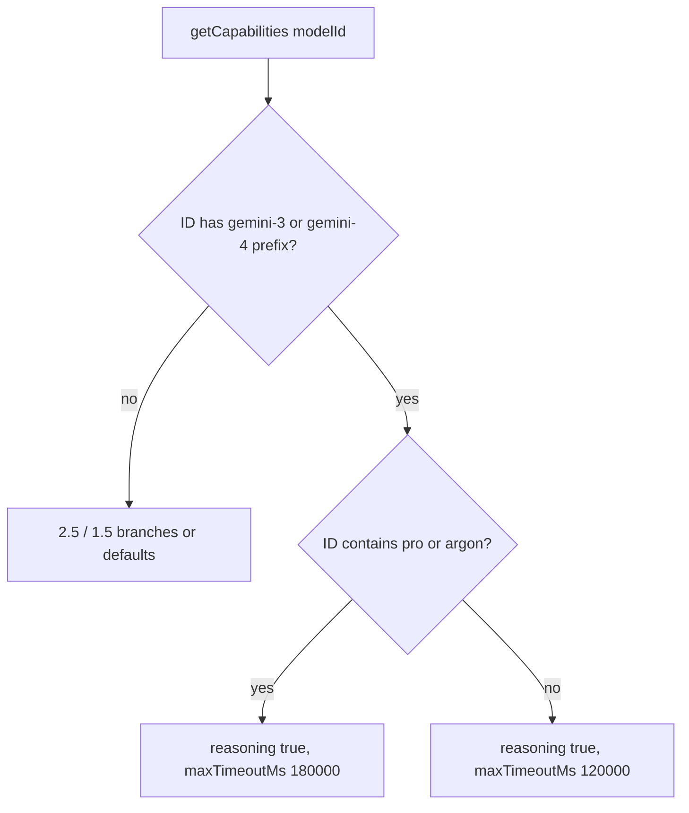
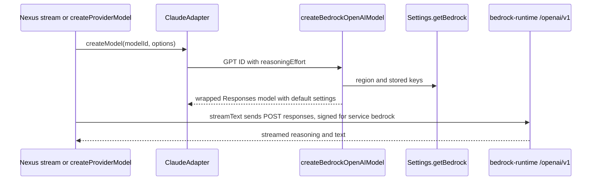
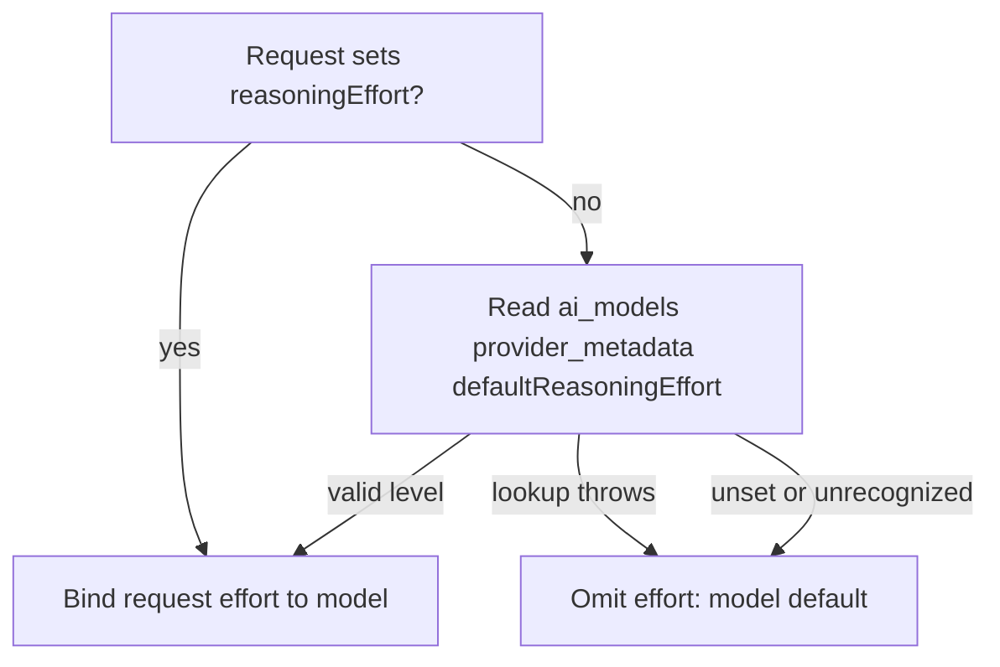
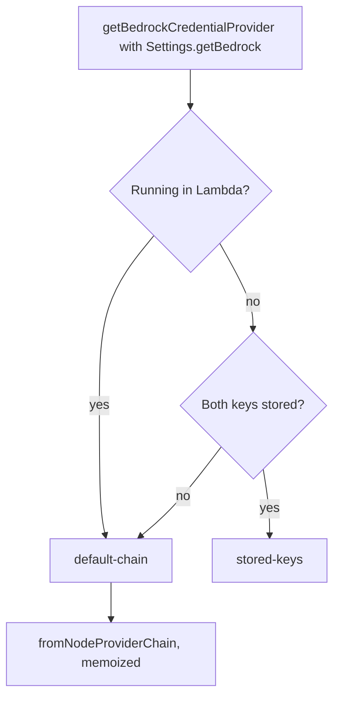
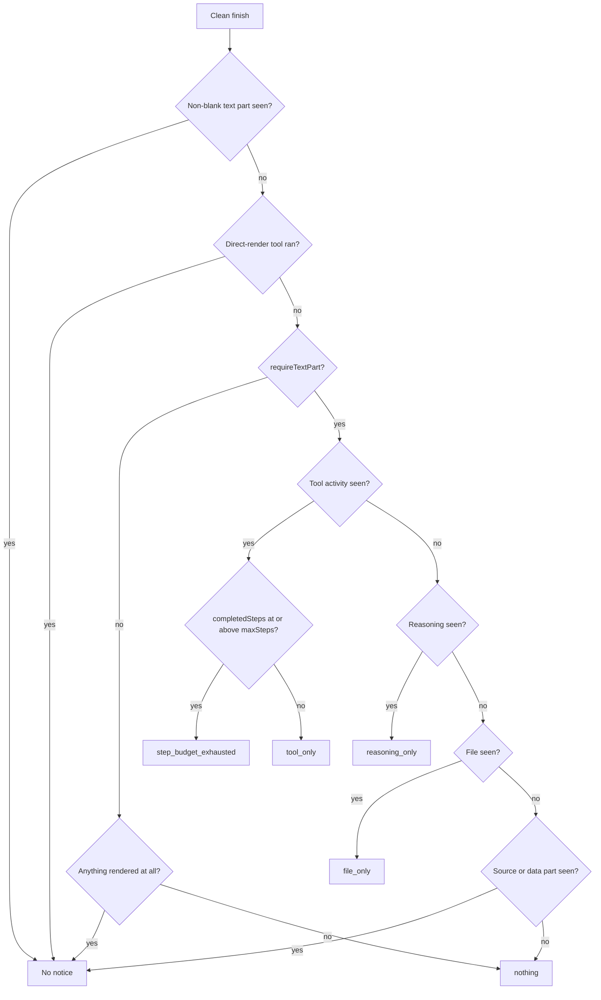
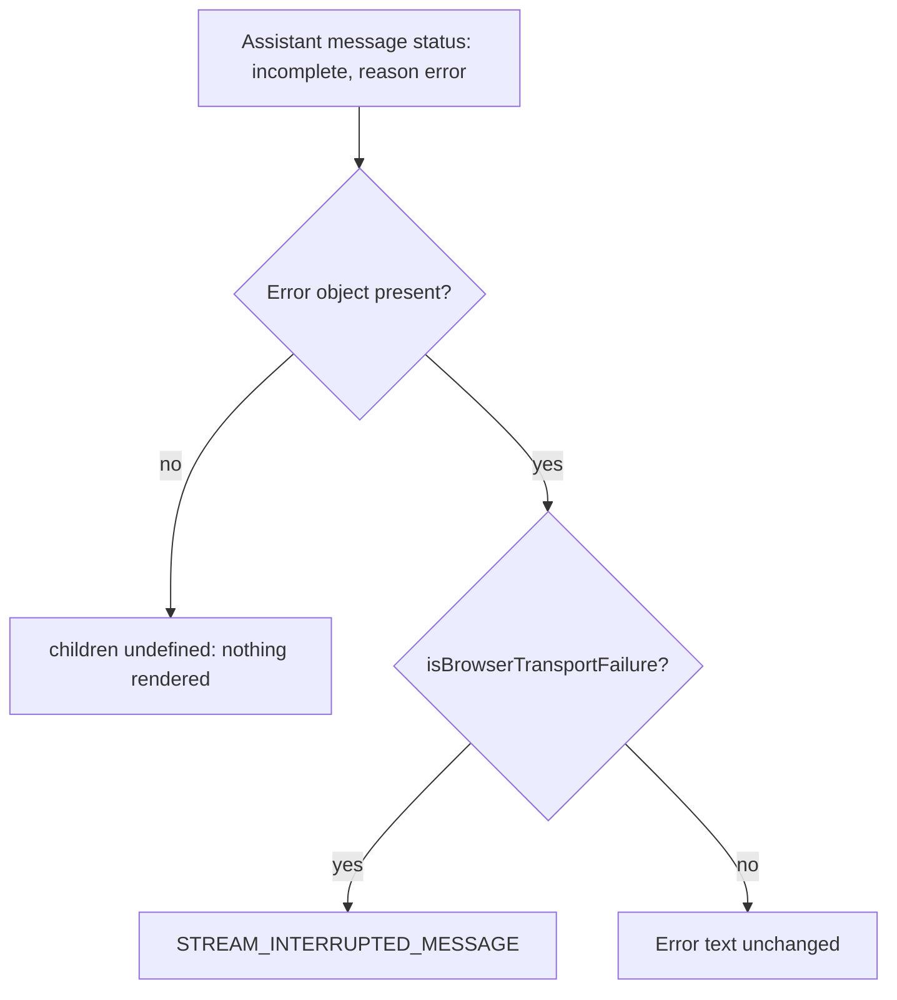
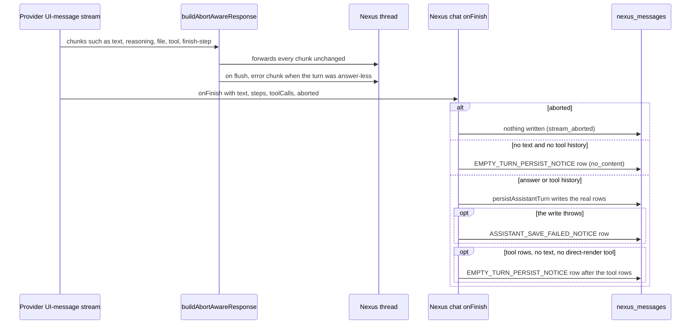
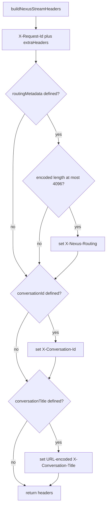
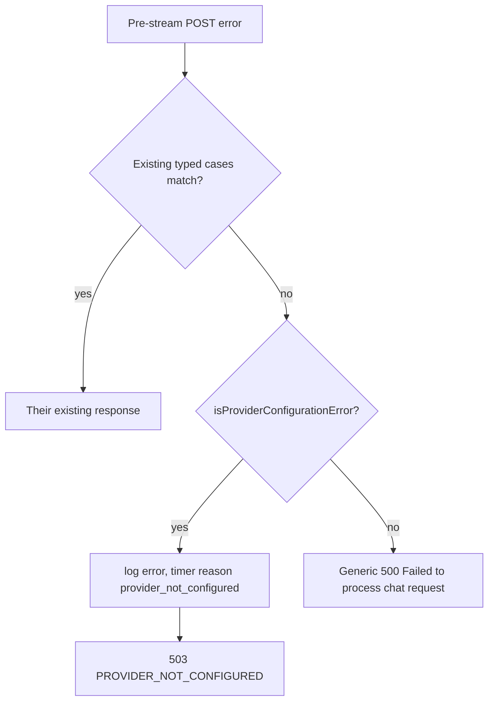

# Streaming Architecture

AI Studio uses Server-Sent Events (SSE) for real-time streaming responses from AI models. The streaming layer includes reliability mechanisms to handle long-running turns that would otherwise timeout.

## The Silent Stream Problem

**Issue**: #1698 (FS#164150)

The Application Load Balancer (ALB) in front of ECS closes connections after 300 seconds with no bytes in either direction (`infra/lib/constructs/ecs-service.ts`, `idleTimeout`). Reasoning-tier models (GPT-5, Claude) emit a `start` chunk immediately and can then go completely silent for the entire think/tool phase.

### Why This Matters

- **GPT-5 per-step budget**: 300 seconds (`lib/streaming/provider-adapters/openai-adapter.ts`, `maxTimeoutMs`)
- **ALB timeout**: 300 seconds
- **Result**: Socket dies at or before the app-level abort fires
- **Symptom**: Terminal `error` chunk enqueued into a stream nobody is reading — turn stops with no answer and no error

### Why Raising ALB Timeout Doesn't Fix

Raising the ALB timeout would not fix this because:
1. Any intermediary proxy can cut a silent stream (common proxies use 60s timeouts)
2. Requires CDK deployment for infrastructure changes
3. Emitting a byte removes the idle constraint entirely

## SSE Keep-Alive Implementation

### Solution: Invisible Comment Frames

The standard SSE no-op frame `: keep-alive\n\n` is used for keep-alive because:
- `eventsource-parser` routes `:`-prefixed lines to `onComment` handler
- AI SDK does not supply `onComment`, so frames are discarded before reaching `processUIMessageStream`
- Parsed chunk sequence is identical to unwrapped stream
- A `data-*` chunk would NOT work — `classifyChunkVisibility` (`lib/streaming/empty-turn-notice.ts`) buckets them as rendered output, which suppresses the empty-turn notice

### Keep-Alive Parameters

| Parameter | Value | Rationale |
|-----------|-------|-----------|
| `SSE_KEEP_ALIVE_INTERVAL_MS` | 15,000 (15s) | Well under 300s ALB timeout and 60s proxy timeouts; single dropped frame leaves buffer |
| `SSE_MAX_LIFETIME_MS` | 2,400,000 (40min) | Above longest route budget (nexus/chat: 30min); backstop for missing deadlines |
| Frame format | `: keep-alive\n\n` | Standard SSE comment; discarded by parser |

### Implementation: `withSseKeepAlive()`

**Location**: `lib/streaming/sse-keep-alive.ts`

```typescript
export function withSseKeepAlive(
  source: ReadableStream<Uint8Array>,
  options?: SseKeepAliveOptions
): ReadableStream<Uint8Array>
```

**Key behaviors**:
- Timer skipped when real bytes sent within interval — byte-identical to unwrapped stream
- Backpressure preserved — source only read when consumer has room (`desiredSize > 0`)
- Timers always released on end-of-stream, error, and consumer cancel
- Stream after `maxLifetimeMs` is errored (not cleanly closed) so client sees failure

**Call sites**:
- `lib/streaming/provider-adapters/base-adapter.ts` — All provider responses
- `app/api/compare/route.ts` — Model comparison
- `app/api/compare-models/route.ts` — Model comparison

### Response Helper: `withSseKeepAliveResponse()`

Applies keep-alive to a Response's body while preserving status and headers:

```typescript
export function withSseKeepAliveResponse(
  response: Response,
  options?: SseKeepAliveOptions
): Response
```

## Deferred Response for Prompt Chains

### Problem: No Body to Keep-Alive

`withSseKeepAlive` can only fill gaps in a body that already exists. Prompt-chain assistants run every prompt except the last to completion before building the streaming Response for the final one:

- **Execution**: `executePromptChain` in `app/api/assistant-architect/execute/route.ts`
- **Service**: `lib/api/assistant-execution-service.ts`
- **Issue**: Slow earlier prompt leaves socket with no bytes at all — not even headers

### Solution: `deferUIMessageStreamResponse()`

**Location**: `lib/streaming/deferred-ui-message-stream.ts`

```typescript
export async function deferUIMessageStreamResponse(
  pending: Promise<Response>,
  options: DeferUIMessageStreamOptions
): Promise<Response>
```

**Behavior**:
1. Wait grace period (default: 15s) for real Response
2. If Response arrives in time → return exactly what caller would have gotten
3. If timeout → commit to 200 SSE response immediately
4. Fill wait with keep-alive comments
5. Stream real body once it exists
6. If work fails after commit → single UI-message `error` chunk with user-facing message

**Call sites**:
- `app/api/assistant-architect/execute/route.ts` — Prompt chain execution
- `lib/api/assistant-execution-service.ts` — Execution service

### Error Handling After Commit

When a failure arrives after response was committed:
- Status code can no longer be sent (already committed 200)
- Error Response mapped to user-facing message via `onLateError` callback
- Single `error` UI-message chunk enqueued: `{ type: 'error', errorText: string }`
- Error Response also used for logging/compensation side effects

## Provider Adapter Integration

### StreamDeadline

The `StreamDeadline` interface (from `lib/streaming/provider-adapters/base-adapter.ts`) provides per-step timeout budgeting for AI streams:

```typescript
export interface StreamDeadline {
  /** Abort signal for streamText; undefined when no budget is configured. */
  readonly signal?: AbortSignal;
  /** Push the per-step clock forward. Call at each step boundary. */
  extend(): void;
  /**
   * Push the clock forward on observed stream progress (one chunk).
   * Throttled internally, safe to call per token.
   */
  touch(): void;
  /** True once THIS deadline aborted the run (vs. caller-initiated abort). */
  timedOut(): boolean;
  /** Release the timer. Safe to call more than once. */
  dispose(): void;
}
```

**Why both `extend()` and `touch()`** (#1791):

Step boundaries alone (`extend()`) are not enough when ONE step is long. An `update_workspace_artifact` call that streams a 50-60 KB dashboard is a **single step** — a 180s step budget can abort a run that was producing output the whole time, saving nothing.

- `extend()` — Called at step boundaries (model reaches a tool call, finishes a reasoning segment)
- `touch()` — Called on each chunk (`onChunk` callback), turning the per-step budget into an **idle timeout**

**Chunk-driven clock extension**:
- Active output pushes the deadline forward (throttled to at most one timer re-arm per second)
- Silence still aborts after the full budget
- Absolute ceiling (`hardStopAt`) remains — a wedged stream that emits forever is still bounded

**Call sites**:
- `base-adapter.ts` — `streamText` call gets `onChunk: () => deadline.touch()`
- `openai-adapter.ts` — Responses-API path also passes `onChunk`

### Base Provider Adapter

All provider responses are wrapped with keep-alive at the provider adapter layer:

**Location**: `lib/streaming/provider-adapters/base-adapter.ts`

Both the base and the OpenAI Responses-API adapter build their response through `buildResponseFactory()`, which resolves the empty-turn policy once per run (`requireTextPart: config.source === 'nexus'`, plus the run's `maxSteps`) and hands it to `buildAbortAwareResponse()`. That method wraps the provider's UI-message stream, counts what the user will actually see, and appends a terminal `error` chunk when the run was aborted or ended with nothing to read (see [Answer-less Turns and Error Notices](#answer-less-turns-and-error-notices-1899)).

```typescript
// Keep socket warm through silent reasoning/tool stretch
return withSseKeepAliveResponse(
  createUIMessageStreamResponse({
    stream,
    headers: options?.headers,
  })
);
```

This means:
- All AI provider calls (OpenAI, Claude, Gemini, Bedrock) automatically get keep-alive
- No per-route configuration needed
- Consistent behavior across Nexus Chat, Model Compare, and Assistant execution

## Gemini Model Capabilities (#1967)

`GeminiAdapter.getCapabilities()` in `lib/streaming/provider-adapters/gemini-adapter.ts` maps a model ID to the capability row the stream uses: reasoning flag, `maxTimeoutMs` (the per-step budget that `StreamDeadline` enforces), and cost fields. A model that matches no row gets the defaults, so a new generation must be matched explicitly.

- The first branch covers `gemini-3*` and `gemini-4*`, with and without the `models/` prefix. Before #1967 it matched only 3.x, so `gemini-4-argon` fell through to the defaults: no reasoning flag and a 120s budget.
- Inside that branch, the flagship budget applies to IDs matching `*pro*` or `*argon*`. Those rows report reasoning and a 180s budget. The rest of the 3.x/4.x family (for example Flash) gets 120s.
- The 2.5 and 1.5 branches follow and are unchanged.



**Invariants for future changes**
- Add a new Gemini generation to the first branch's pattern list. Otherwise it inherits the defaults, which the source comment ties to a 30s abort that cut off long Nexus answers.
- The flagship match is a substring test on the model ID. Adding a flagship name means adding a pattern to that single `isPro` list.
- The budget feeds `StreamDeadline`, so changing `maxTimeoutMs` changes when a silent stream is aborted. Re-check the keep-alive rules in [SSE Keep-Alive Implementation](#sse-keep-alive-implementation).

**Focused tests**: `lib/streaming/__tests__/model-capability-coverage.test.ts`. The `PRODUCTION_MODELS` table lists the production IDs, including `gemini-3.8-flash` and `gemini-4-argon`. The test `treats Gemini 4 Argon as a flagship reasoning model with the Pro budget` asserts reasoning and 180000 ms.

**Minimal validation**: `bunx jest --silent lib/streaming/__tests__/model-capability-coverage.test.ts`. Add `bun run typecheck` when the capability type changes.

**Scope boundary**: this table sets the budget and reasoning flag only. Which model a turn uses is decided by the router in [Automatic Model Routing](../app-features/overview.md#automatic-model-routing), which reads tier from `inferModelTier()`, not from this table.

## Amazon Bedrock Adapter and OpenAI GPT Models

**Location**: `lib/streaming/provider-adapters/index.ts` registers `ClaudeAdapter` for the `amazon-bedrock` provider (`getProviderAdapter`). The class name reflects the original Claude and Nova path. It also owns Bedrock-hosted OpenAI GPT models (IDs such as `us.openai.gpt-5.5`), which bypass Converse and go to the OpenAI Responses API on `bedrock-runtime`.

**Why a separate path**: Converse rejects `document` blocks for these models (Responses accepts `input_file`). The AI SDK's Bedrock provider maps reasoning effort only for bare `openai.` IDs, but runtime accepts only `us.`-style inference-profile IDs for these models. `bedrock-mantle` also serves the Responses API, but it is not used because AWS expects it to be retired. The implementation reuses `@ai-sdk/openai`'s Responses model with a SigV4-signing `fetch`, because no AI SDK release supports `bedrock-runtime`'s `/openai/v1` natively.

### Routing Decisions

| Decision | Symbol | Rule |
|----------|--------|------|
| Model match | `isBedrockOpenAIModel` (`lib/ai/bedrock-openai-model-id.ts`, re-exported by `lib/ai/bedrock-openai.ts`) | `openai.gpt-` IDs, excluding `gpt-oss`. Free of server imports so the admin model form can use it |
| Model construction | `ClaudeAdapter.createModel` | GPT IDs call `createBedrockOpenAIModel(modelId, { reasoningEffort })` with the request's effort as passed. There is no `medium` fallback; the effort is resolved inside the builder (see [Reasoning Effort Resolution](#reasoning-effort-resolution)) |
| Factory path | `createBedrockModel` (`lib/ai/provider-factory.ts`) | `createProviderModel('amazon-bedrock', ...)` delegates GPT IDs to the same builder |
| Capabilities | `ClaudeAdapter.getCapabilities` | `bedrockOpenAICapabilities()`: reasoning yes, `standard` response mode only, no background mode, no provider-native tools, 300000 ms timeout |
| Support | `ClaudeAdapter.supportsModel` | GPT IDs are supported in addition to the Claude patterns |



Caption: `createModel` builds the GPT model with its effort bound, and the stream then runs through the shared `streamWithEnhancements` path.

### Request Defaults and Why They Exist

`bedrockOpenAIDefaults()` wraps the model with `defaultSettingsMiddleware`. Every caller gets these defaults unless it passes its own provider options:

- **`reasoningEffort`** is bound to the model because `BaseProviderAdapter.streamWithEnhancements` calls `streamText()` without forwarding `providerOptions`, and `enhanceStreamConfig()` does not carry them either. An effort placed in `getProviderOptions()` would be silently dropped. Forwarding options in the base path was deliberately not changed, because that would alter direct OpenAI and Converse requests. When no effort is resolved, nothing is sent and the model uses its own default.
- **`forceReasoning: true`** is needed because the OpenAI provider detects reasoning models by ID prefix (`gpt-5`, `o3`). The `us.openai.gpt-*` IDs match none of them, so without this flag the provider drops the effort, sends the system prompt with the `system` role instead of `developer`, and forwards sampling parameters that reasoning models reject.
- **`store: false`** makes each request self-contained. Prior reasoning is replayed inline, because a `us.` profile can route each request to any member Region, and a stored item is not guaranteed to resolve there.

### Reasoning Effort Resolution

A Bedrock GPT request's effort comes from one of three sources, checked in this order by `createBedrockOpenAIModel`:

1. The request's own `reasoningEffort`. The Nexus route accepts `none`, `minimal`, `low`, `medium`, or `high`, and only sends an effort when the user or caller set one.
2. The admin default stored on the model row at `ai_models.provider_metadata.defaultReasoningEffort`, read by `getModelDefaultReasoningEffort`. Only `none`, `low`, `medium`, and `high` are honored (`MODEL_REASONING_EFFORTS` in `lib/db/types/jsonb/index.ts`). `minimal` is never offered, because Bedrock's GPT models reject it. An unrecognized stored value is ignored.
3. Nothing. The `reasoning` field is omitted and the model applies its own default.



Caption: the lookup fails open with a warning, so a database problem never blocks a turn. The builder's debug log records the resolved level, or `model-default` when none applies.

Authentication for this path uses the shared helper described in [Credential Resolution for Bedrock Clients](#credential-resolution-for-bedrock-clients). `createBedrockOpenAIModel` passes that helper's `credentialProvider` into a SigV4-signing `fetch` (`aws4fetch`, service `bedrock`). The `fetch` strips the placeholder Bearer header and sets `retries: 0`, so the AI SDK alone owns retries. The placeholder value is not a credential.

### Credential Resolution for Bedrock Clients

**Location**: `getBedrockCredentialProvider` in `lib/ai/bedrock-credentials.ts`. Every Bedrock client in the app calls it: the Converse builder `createBedrockModel` in `lib/ai/provider-factory.ts`, the Claude and Nova adapter `ClaudeAdapter.createModel`, the Bedrock-hosted GPT builder `createBedrockOpenAIModel`, and the Bedrock embedding client in `getEmbeddingModelClient` (`lib/ai-helpers.ts`).

**Why it exists**: When a Bedrock client gets no `credentialProvider`, the AI SDK's Bedrock provider reads only the `AWS_ACCESS_KEY_ID`, `AWS_SECRET_ACCESS_KEY`, and `AWS_SESSION_TOKEN` env vars. Lambda sets those. ECS Fargate does not: it serves the task role from the container credential endpoint. Before this helper, ECS only worked because stored `BEDROCK_ACCESS_KEY_ID` and `BEDROCK_SECRET_ACCESS_KEY` settings supplied the keys, so all AI SDK Bedrock traffic signed as that stored IAM identity. The helper now passes the task role explicitly when no keys are stored.



Caption: stored keys win only outside Lambda and only when both keys are set. Every other case uses the default AWS provider chain.

**Rules**:
- The result is `{ source, credentialProvider }`. `source` is `stored-keys` or `default-chain`. Debug logs record it as `credentialSource`.
- A single stored key does not count as configured, so the chain is used.
- The chain is module-memoized. The SDK caches and refreshes its credentials before expiry, and the AI SDK calls `credentialProvider` per request.
- `AWS_BEARER_TOKEN_BEDROCK` still takes precedence inside the AI SDK.
- Removing stored keys does not move a running environment. The settings cache keeps the last value, so running tasks keep the old keys until a new ECS deployment. Prod and dev still store keys, so their signing identity is unchanged.

**Invariants for future changes**:
- Pass `credentialProvider` to every Bedrock client. Do not set `accessKeyId` or `secretAccessKey` on the client options.
- Stored keys are never used in Lambda.
- The `fromNodeProviderChain` import lives only in `lib/ai/bedrock-credentials.ts`, so there is one memoized chain.

**Focused tests**: `lib/ai/__tests__/bedrock-credentials.test.ts`. The describe block `getBedrockCredentialProvider` covers stored keys outside Lambda, the default chain with no keys, the default chain with one key, and Lambda ignoring stored keys. The block `Converse clients sign with the resolved credentials` checks the SigV4 `Credential=` in the outgoing `Authorization` header for the provider factory (default chain and stored keys) and for `ClaudeAdapter`. The block `Bedrock embeddings sign with the resolved credentials` covers `generateEmbedding`. The tests mock `fromNodeProviderChain` and `fetch`, so they need no AWS access.

**Minimal validation**: `bunx jest --silent lib/ai/__tests__/bedrock-credentials.test.ts`. When `createBedrockOpenAIModel` changes, also run `bunx jest --silent lib/ai/__tests__/bedrock-openai.test.ts`. Add `bun run typecheck` when signatures change.

**Scope boundary**: the helper decides the signing identity only. Permissions come from the ECS task role; see [IAM Least Privilege](../infrastructure/overview.md#iam-least-privilege).

### Routing Consequences

- `inferModelFamily` returns `openai` for `us.openai.*` rows, so the Nexus ChatGPT family can select them. The tier comes from the model name (`luna` maps to light, `sol` to high).
- `modelSupportsProviderNativeTool` returns false for web search and code interpreter on `amazon-bedrock`. Turns that need those tools route to another provider, because bedrock-runtime offers neither.
- Image generation stays on the direct `openai` provider and is unaffected.
- To add a model, add an `ai_models` row with a `us.openai.gpt-*` inference-profile ID. No code change is needed. The model import guide is at `docs/guides/ai-model-import-guide.md`; bare `openai.*` IDs are rejected by runtime.
- The default effort is set per row in Admin → Models → Edit. The **Default Reasoning Effort** field (`DefaultReasoningEffortField` in `app/(protected)/admin/models/_components/model-detail-sections.tsx`) appears only for `amazon-bedrock` rows whose ID matches `isBedrockOpenAIModel`. Choosing **Model default** removes the key, and other `provider_metadata` keys are preserved. The value is stored in the `ai_models` row described in [Data Models](../data-models/overview.md). The JSON import route does not carry `providerMetadata`, so the setting is applied in the form after import.

### Change Guidance for Bedrock GPT Models

- Change model matching only in `BEDROCK_OPENAI_MODEL_PATTERN` in `lib/ai/bedrock-openai-model-id.ts`. The `isBedrockOpenAIModel` callers in `provider-factory.ts`, `claude-adapter.ts`, and the admin form follow it. Keep that module free of server imports.
- Do not reintroduce a Bedrock-GPT branch in `ClaudeAdapter.getProviderOptions`. The earlier version was removed because the streaming path discarded it.
- Do not add a `medium` fallback to `ClaudeAdapter.createModel` or the Nexus route. Those fallbacks were removed in #1963, so the admin default and the model's own default can take effect. Widening the effort set means changing `ModelReasoningEffort`, the Nexus route schema, and `StreamRequest` options together.
- The direct OpenAI adapter (`lib/streaming/provider-adapters/openai-adapter.ts`) still defaults to `medium`. That path is separate and was not changed; do not treat it as the Bedrock default.
- Claude and Nova requests use the unchanged Converse path. A change to `createBedrockOpenAIModel` should not alter them.
- An IAM change for these models lives in the ECS task role. See [IAM Least Privilege](../infrastructure/overview.md#iam-least-privilege).

**Focused tests**: `lib/ai/__tests__/bedrock-openai.test.ts` (describe blocks `isBedrockOpenAIModel`, `createBedrockOpenAIModel`, `ClaudeAdapter for Bedrock-hosted GPT models`, and `model router treatment of Bedrock-hosted GPT models`). The request-level tests check the URL, the SigV4 header, `store: false`, effort on the wire, the `developer` role, and the configured region. The effort-resolution tests in the `ClaudeAdapter for Bedrock-hosted GPT models` block cover these behaviors:

- Neither the request nor the row sets an effort: no `reasoning` field is sent (test name starts "sends no effort when neither the request nor the model row sets one"). The row lookup is called with the model ID.
- The row default applies when the request sets none ("streams with the model row's admin default when the request sets none").
- The request's effort overrides the row default ("lets the request's effort override the model row's default").
- A throwing row lookup falls back to the model default ("falls back to the model default when the row lookup fails").
- An unrecognized stored value such as `minimal` is ignored ("ignores an unrecognised stored default").

`lib/streaming/__tests__/model-capability-coverage.test.ts` covers the GPT-5.5 and GPT-6 Sol capability rows.

**Minimal validation**: `bunx jest --silent lib/ai/__tests__/bedrock-openai.test.ts`. Add `bun run typecheck` when signatures or types change.

**Conditional checks**:
- `tests/e2e/nexus-bedrock-openai.functional.spec.ts` runs a live two-turn Nexus conversation against Bedrock. It is gated by `PLAYWRIGHT_AUTH_ENABLED` and `E2E_RUN_EXTERNAL=1`, and skips unless `NEXUS_ROUTER_MODE` is `off`. Run it only for changes that need live provider proof, because it calls the external service. No unit test verifies the ECS `project/default` grant, and the change itself was not synthesized in that commit (`cdk synth` is the only available check).
- `tests/e2e/admin-model-default-reasoning-effort.functional.spec.ts` drives the admin form against a database. It is skipped unless `PLAYWRIGHT_AUTH_ENABLED` is `true` (it needs the authenticated dev server). It sets None on a Bedrock GPT row, checks that the value persists in `provider_metadata`, checks that unrelated metadata survives, and checks that "Model default" removes the key. It also checks that a Claude row shows no such field. It calls no model. Run it when the admin field or its persistence changes.

**Known limits** (from the commit's live checks): reasoning summaries come back empty from Bedrock, and Bedrock rejects `https://` image URLs for these models (only `data:` and `s3://` work). Nexus sends data URLs, and the client shrinks each inline photo before it is sent (see [Image Downscaling](../app-features/overview.md#image-downscaling-and-the-proxied-body-limit-1850)).

## Answer-less Turns and Error Notices (#1899)

A cleanly finished turn can still leave the user with nothing to read. Three paths in the stream layer make sure the thread always says what happened, and the Nexus route keeps that explanation after a reload.

**Why the old check failed**: `isVisibleChunkType` used to count `reasoning-*` and `file` chunks as visible output. The Nexus Thread (`DEFAULT_ASSISTANT_MESSAGE_CONTENT_COMPONENTS` in `components/assistant-ui/thread.tsx`) registers no Reasoning or File renderer, so those parts draw nothing. A model that thought and then wrote no text produced a blank bubble with no notice. Tool-only turns were also silent, and a turn can reach that state because an ordinary Nexus turn gets three steps (`WEB_FETCH_MAX_STEPS` in `lib/nexus/chat-step-budget.ts`).

### Classifying the Turn

`lib/streaming/empty-turn-notice.ts` holds the pure rules, with no AI SDK or React imports:

- `classifyChunkVisibility(type)` buckets each UI-message chunk as `text`, `reasoning`, `file`, `tool`, `other` (`source-*` and `data-*`), or `none`.
- `classifyEmptyTurn(observation)` returns one `EmptyTurnKind`, or `null` when there is nothing to say.
- `emptyTurnNotice(kind)` returns the user-facing sentence. The sentence is rendered verbatim by `MessagePrimitive.Error`.



Caption: decision order for the notice shape in `classifyEmptyTurn`. The `requireTextPart` branch is the Nexus rule. The non-Nexus branch only classifies a run that emitted nothing at all.

**Policy rules**:
- Any text part suppresses the notice. Whitespace-only text does not count, which matches `incompleteTurnReason`.
- A direct-render tool suppresses it. `generate_document`, `show_chart`, `search_graph_nodes`, `propose_decision` and `commit_decision` are listed in `lib/tools/direct-render-tools.ts` (`DIRECT_RENDER_TOOL_NAMES`, `isDirectRenderTool`). The chart or download card is the answer, and a notice under it would contradict it. The `generate_document` download card is described in [generated-documents.md](../app-features/generated-documents.md). The same list drives tool-group rendering in `app/(protected)/nexus/_components/tools/tool-group.tsx`.
- `requireTextPart` is set only for `source: 'nexus'`. `buildResponseFactory` derives it from the original `config.source`, not the enhanced config. Assistant Architect execution and the programmatic `/api/v1/assistants` path share this code and keep the pre-#1899 rule, where only a run that emitted nothing at all is called empty. An injected `error` chunk would make an AI SDK client throw for those callers when the run ended on a structured tool call.
- `enhanceStreamConfig()` in `base-adapter.ts` must copy `source` as well as `maxSteps`. Dropping `source` silently reverts every Nexus run to the non-Nexus rule.

### Stream Errors Are Sanitized

`toUIMessageStream()` is called with `onError: sanitizeStreamErrorMessage`. Without it, the AI SDK default `An error occurred.` reaches the browser. `lib/streaming/stream-error-message.ts` classifies the error with an ordered rule table (`classifyStreamError`: timeout, rate limit, content blocked, context too long, unavailable, or unknown) and returns one of six fixed strings from `STREAM_ERROR_MESSAGES`. The classifier reads the error, and the reply never quotes it, because provider messages can carry request ids, model ARNs, or prompt fragments. The handler logs the kind.

Ordering matters: a `504 gateway timeout` must classify as a timeout, not as an outage, so the timeout rule comes first and the broad 5xx rule comes last.

### Browser Transport Failures Are Rewritten (#1966)

The server cannot sanitize a failure that happens in the browser. When the connection is cut after the 200 has started streaming (an ALB idle timeout, a proxy truncating a chunked body, a dropped network), the `fetch` body reader rejects with the browser's own network-stack text. Firefox showed "Error in input stream" on the first prompt of a chat, and that text never passed through `sanitizeStreamErrorMessage`.

`lib/streaming/client-stream-error.ts` is the client-side guard, and `MessageError` in `components/assistant-ui/thread.tsx` is its only caller:

- `MessageError` reads the message status with `useMessage()`. It takes the error only when `status.type` is `incomplete` and `reason` is `error`, then passes `toDisplayableChatError(error)` as the children of `ErrorPrimitive.Message`. The root carries `data-testid="assistant-message-error"`.
- `isBrowserTransportFailure(error)` lower-cases the text, strips an optional `TypeError: ` or `net::` prefix, and matches at the start of the message. The signatures cover Firefox, Chrome/Edge, Safari, and the HTTP/2 and chunked-encoding codes. The bare text `terminated` (undici) matches exactly only.
- A match returns `STREAM_INTERRUPTED_MESSAGE`. Any other text passes through unchanged, including server-sanitized messages and client messages such as "Session expired".



Caption: how `MessageError` chooses the text shown in the error box. Only browser transport failures are replaced.

**Why anchored matching**: substring matching let "Upload failed" match "load failed" and let any app-authored sentence containing "network error" be replaced. Those messages are now kept, which the `client-stream-error` tests assert.

**Boundary**: this guard covers only the browser's read of the body. Provider errors still come through the server path above, and the root cause of a given stream cut is outside this code. The retry path is the existing Refresh action in the error box.

**Change guidance**:
- To add a browser message, add its lower-cased opening to `TRANSPORT_FAILURE_SIGNATURES`. Add a generic bare phrase to `EXACT_TRANSPORT_FAILURES` only, never as a prefix.
- Do not put server message text in these lists. Server text is already fixed by `STREAM_ERROR_MESSAGES`.
- If the copy in `STREAM_INTERRUPTED_MESSAGE` changes, update the e2e assertion that compares against the same constant.

**Focused tests**:
- `lib/streaming/__tests__/client-stream-error.test.ts` — `toDisplayableChatError (#1966)`: each browser transport text is replaced; all six `STREAM_ERROR_MESSAGES` pass through; app-authored text passes through, including "terminated" inside a sentence; app-authored text that contains a transport phrase mid-message is kept; the raw "input stream" text is never returned.
- `tests/e2e/nexus-chat-stream-error-handling.functional.spec.ts` — browser proof. An init script makes the chat `fetch` return a 200 SSE body that errors with `TypeError("Error in input stream")`. The spec asserts the error box shows exactly `STREAM_INTERRUPTED_MESSAGE`, the raw text is absent, streaming stops, and the Refresh action is present.

**Minimal validation**: `bunx jest --silent lib/streaming/__tests__/client-stream-error.test.ts`.

**Conditional check**: `bun run test:e2e:local tests/e2e/nexus-chat-stream-error-handling.functional.spec.ts` (script: `scripts/test/e2e-local.sh`, which forwards extra arguments to Playwright). Run it only when `MessageError` markup or the error path changes, because it starts the full app stack with Postgres in Docker. Plain `page.route` cannot reproduce this failure; the spec injects the failure in the page.

### Persistence Keeps the Prompt Answered

The user message is saved before streaming starts, so a reply that is never written leaves the prompt looking unanswered after a reload. `app/api/nexus/chat/route.ts` (`createOnFinishCallback`) and `app/api/nexus/chat/chat-helpers.ts` implement this:



Caption: what `onFinish` writes for each outcome. The live notice and the persisted notice are separate; the live one is specific, the persisted one states the shared fact.

- `incompleteTurnReason()` returns `stream_aborted` (nothing written, because an aborted run may hold a tool call without its result), or `no_content` when there is no text and no tool history. A turn with tool calls is never `no_content`, so its tool rows are kept.
- `turnNeedsEmptyNotice()` decides whether tool rows need a trailing notice row. It applies only to text-free turns with no direct-render tool.
- `persistAssistantTurn()` keeps the one-row versus per-step split (#977). If the write throws, it logs and writes `ASSISTANT_SAVE_FAILED_NOTICE` instead. That fallback fails safely: it carries no tool calls and no token usage, and if the second insert also fails there is nothing more to do but log.
- Notice rows carry `metadata.emptyTurn` or `metadata.assistantSaveFailed`. They contain only plain text, because a tool_use block whose tool_result was never stored throws `AI_MissingToolResultsError` on the next load.
- The deep-research path has the same rule. `persistDeepResearchFailure` stores the sanitized `Research failed` text, so a failed research run does not reload with no reply.

### Change Guidance for Answer-less Turns

- To add a part type, decide what the thread renders for it. A chunk with no registered renderer is not visible output. Then add it to `classifyChunkVisibility` and to the tests.
- To add a direct-render tool, add it to `DIRECT_RENDER_TOOL_NAMES` only. The stream notice, the tool-group rendering, and the persistence check all read that one list.
- Change the copy in `EMPTY_TURN_NOTICES` and `STREAM_ERROR_MESSAGES` together with the matching tests, because the tests assert specific phrases.
- Keep the step budget and its notice in step. `tests/unit/lib/nexus/chat-step-budget.test.ts` checks that every budget `resolveMaxSteps` can return maps to `step_budget_exhausted`.

**Focused tests**:
- `lib/streaming/__tests__/empty-turn-notice.test.ts` — chunk buckets, each `classifyEmptyTurn` branch, the narrower non-Nexus rule, notice wording
- `lib/streaming/__tests__/stream-deadline.test.ts` — `describe('buildAbortAwareResponse — answer-less turns (#1899)')`, `enhanceStreamConfig preserves the calling surface`, and the `onError` replacement test
- `lib/streaming/__tests__/stream-error-message.test.ts` — error classification order, the "never echo provider text" guarantee
- `app/api/nexus/chat/__tests__/incomplete-turn.test.ts` — `incompleteTurnReason` keeps a single tool-call step; `turnNeedsEmptyNotice`
- `app/api/nexus/chat/__tests__/assistant-turn-persistence.test.ts` — the fallback notice row and the guarded second write
- `tests/e2e/nexus-empty-turn-notice.functional.spec.ts` — browser proof that the notice renders beside the turn's output (mocked network, not a live provider)

**Minimal validation**: `bunx jest --silent lib/streaming/__tests__/empty-turn-notice.test.ts lib/streaming/__tests__/stream-error-message.test.ts lib/streaming/__tests__/stream-deadline.test.ts` covers the stream layer. The persistence check is `bunx jest --silent app/api/nexus/chat/__tests__/incomplete-turn.test.ts app/api/nexus/chat/__tests__/assistant-turn-persistence.test.ts`. The Playwright spec is conditional: run it only when the Thread rendering or notice markup changes, because it needs the full app stack.

**Scope boundary**: the notice is a stream-layer fact. Changes to provider adapter selection, the keep-alive timer, or deferred responses do not need this section's checks unless they touch `buildAbortAwareResponse`.

### Streaming Service

**Location**: `lib/streaming/nexus/nexus-streaming-service.ts`

The Nexus streaming service orchestrates:
- Multi-provider requests
- Response caching
- Cost optimization
- Telemetry tracking

All responses flow through the provider adapter layer and receive keep-alive.

## Nexus Stream Response Headers (#1947)

The Nexus chat route answers with a UI-message stream through three paths, and each sets its own call-site headers on top of a shared core:

- **Standard streaming**: `buildStreamingResponseHeaders()` in `app/api/nexus/chat/route.ts` adds `X-Unified-Streaming` and `X-Supports-Reasoning`.
- **Deep Research**: `createDeepResearchResponse()` in `app/api/nexus/chat/route.ts` adds `X-Deep-Research`.
- **Image generation**: `createImageStreamResponse()` in `app/api/nexus/chat/image-generation-handler.ts` adds `X-Image-Generated`.
- **Explained no-image reply**: when a model answers an image request in text, `createNoImageResponse()` in the same file streams that text with `imageGenerated: false`, so `X-Image-Generated` is absent. The turn is still a successful stream; see [Explained Refusals](../app-features/overview.md#explained-refusals-are-replies-not-failures-1900) for when this path is taken.

All three call `buildNexusStreamHeaders()` in `app/api/nexus/chat/stream-headers.ts`. Callers pass the conversation and routing facts, and the builder owns the header shape:

| Header | Set when |
|--------|----------|
| `X-Request-Id` | Always |
| Call-site `extraHeaders` | Always, spread after `X-Request-Id` |
| `X-Nexus-Routing` | `routingMetadata` is not `undefined` and its URL-encoded JSON is at most `MAX_NEXUS_ROUTING_HEADER_LENGTH` (4096) characters |
| `X-Conversation-Id` | `conversationId` is not `undefined` |
| `X-Conversation-Title` | `conversationTitle` is not `undefined`; the value is URL-encoded |



Caption: the builder omits a header by passing `undefined`; only the routing value is also size-checked.

**Callers decide what counts as a new conversation.** The title is passed only for a new conversation: the standard path uses `!conversationIdValue && conversationId` and falls back to `"New Conversation"`, while the deep-research and image paths use their `isNewConversation` flag. An existing conversation still gets `X-Conversation-Id` where the call site sends it, but no title.

**Why the cap is shared.** Before #1947, the standard and image paths dropped an oversized `X-Nexus-Routing`, but the deep-research path wrote it unconditionally. An oversized header can make the response fail before the stream reaches the browser, so the cap now applies to every Nexus stream response. Dropping the routing header never drops the other headers.

**Change guidance**:
- To add a Nexus stream response, call `buildNexusStreamHeaders` with `extraHeaders` for call-site flags. Do not write `X-Nexus-Routing` by hand, or the cap is bypassed.
- To change the cap, change `MAX_NEXUS_ROUTING_HEADER_LENGTH` and keep the exact-cap test in sync.
- The image path's routing check changed from a truthiness check to an `undefined` check. Only a `null` or falsy `routingMetadata` would behave differently, and the current callers never pass one.

**Focused test**: `app/api/nexus/chat/__tests__/stream-headers.test.ts` covers the new-conversation title, the existing-conversation omission, the oversized-routing drop, the exact-cap keep (`keeps X-Nexus-Routing at exactly the cap length`), the image-generation headers, and the streaming headers without conversation fields.

**Minimal validation**: `bunx jest --silent app/api/nexus/chat/__tests__/stream-headers.test.ts`. Run the route-level checks only when the route's header call sites change, using the `incomplete-turn` and `assistant-turn-persistence` suites listed above.

## Pre-stream Provider Configuration Errors (#1849)

When a model's provider credentials are missing or invalid, the failure happens before any stream opens. Provider adapters and the provider factory throw `ErrorFactories.sysConfigurationError(...)`, which carries code `SYS_CONFIGURATION_ERROR`. An explicitly selected model keeps that error instead of being rerouted. Before #1849, `buildChatErrorResponse` in `app/api/nexus/chat/route.ts` had no case for it, so every turn showed the generic 500 "Failed to process chat request", which users read as "An Error Occurred".

This is a different path from the mid-stream rules above. [Stream Errors Are Sanitized](#stream-errors-are-sanitized) covers errors after the stream has started; this section covers the pre-stream POST error that the route turns into a JSON response.

`app/api/nexus/chat/configuration-error-response.ts` owns the mapping:

- `isProviderConfigurationError(error)` matches an `Error` whose `code` is `ErrorCode.SYS_CONFIGURATION_ERROR`. It is provider-agnostic and matches on the code, not on the message text.
- `providerConfigurationErrorResponse(requestId)` returns HTTP 503 with `{ error, code: "PROVIDER_NOT_CONFIGURED", requestId }` and an `X-Request-Id` header. `error` is `PROVIDER_NOT_CONFIGURED_MESSAGE`: the model's provider is not set up, so the user should switch to Standard mode or another model family and tell an administrator.



Caption: the provider-configuration check runs after the typed cases in `buildChatErrorResponse` and before the generic 500 fallthrough.

**Invariants**:
- Only `SYS_CONFIGURATION_ERROR` maps to 503. Other errors still reach the generic 500.
- The technical message is logged, never returned. It names the missing credential, which is operator detail. The response body contains no credential text.
- The check runs after the existing typed cases and before the generic branch. A source-contract test pins this ordering.

**Client half**: `nexusErrorTitle` in `app/(protected)/nexus/page.tsx` titles a `PROVIDER_NOT_CONFIGURED` response "Model unavailable", the same title as a 404. The existing error handler shows the server's `error` string as the toast description, so the actionable copy comes from the server, not the client.

**Change guidance**:
- To map another failure class to a user-facing response, add its own predicate and branch in `buildChatErrorResponse`. Do not widen `isProviderConfigurationError`, because the code is the single key for this contract.
- Change `PROVIDER_NOT_CONFIGURED_MESSAGE` and the toast title together. The e2e spec asserts the message text and the toast title.
- The `PROVIDER_NOT_CONFIGURED` code is a client-visible value. Keep it in sync with the `code` check in `nexusErrorTitle`.

**Focused tests** (`app/api/nexus/chat/__tests__/configuration-error-response.test.ts`):
- "recognises the error the provider adapters throw for a missing key" uses the real `ErrorFactories.sysConfigurationError`.
- "does not claim unrelated errors" checks the negative case.
- "returns a 503 with an actionable message and no credential detail" checks status, code, and that the body has no "api key" text.
- "is checked in buildChatErrorResponse before the generic 500 fallthrough" is the source-contract test for ordering.
- `tests/e2e/nexus-chatgpt-provider-error.functional.spec.ts`, "an unconfigured provider shows an actionable message, not the generic failure", serves the 503 body through `page.route` and checks the "Model unavailable" toast. The spec mocks the network because the router excludes unconfigured providers from routed selection, so a live turn cannot reach this error. The second test, "Advanced ChatGPT answers on the Bedrock-hosted GPT model", is skipped unless `E2E_RUN_EXTERNAL=1`.

**Minimal validation**: `bunx jest --silent app/api/nexus/chat/__tests__/configuration-error-response.test.ts`. The Playwright spec is conditional: run it when the toast title, the 503 body, or the message text changes, because it needs the authenticated app stack.

**Scope boundary**: the mapping only covers the POST response. The provider adapters and the provider factory still own the decision to throw `SYS_CONFIGURATION_ERROR`, and changing that is covered by the provider pages above, not by this check.

## Change Guidance

### When to Modify Keep-Alive

**Adjust interval** when:
- New intermediary proxy with stricter timeout discovered
- Profile shows excessive keep-alive traffic in normal operation

**Adjust lifetime ceiling** when:
- Route `maxDuration` increases beyond 30 minutes
- New long-running feature (e.g., extended research agents)

### Adding New Streaming Routes

New routes that stream AI responses should:

1. **Use provider adapters** (automatic keep-alive)
2. **For deferred scenarios** (no body initially), use `deferUIMessageStreamResponse`
3. **Set route `maxDuration`** to match expected execution time
4. **Handle abort gracefully** — `buildAbortAwareResponse` appends a terminal error chunk for an abort or an answer-less turn (see [Answer-less Turns and Error Notices](#answer-less-turns-and-error-notices-1899)); pass `source` through config so the right rule applies

### Testing Long-Running Streams

**Unit tests** (fast, controlled):
- `lib/streaming/__tests__/sse-keepalive.test.ts` — Timer behavior, backpressure, lifetime ceiling
- `lib/streaming/__tests__/deferred-ui-message-stream.test.ts` — Grace period, late errors

**E2E tests** (real browser stack):
- `tests/e2e/nexus-chat-slow-stream-visible-error.functional.spec.ts` — Client-side error visibility
- `tests/e2e/assistant-architect-slow-chain-visible-error.functional.spec.ts` — Prompt chain deferred response

**E2E note**: Uses mocked network responses (not real multi-minute delays). Tests wire format and client behavior.

### Silent Failure Pattern

**From**: `docs/guides/silent-failure-patterns.md`

```typescript
// WRONG — data-* counted as rendered output, suppresses the empty-turn notice
controller.enqueue({ type: 'data-keepalive' })

// CORRECT — SSE comment frame, below transport, discarded by parser
controller.enqueue(new TextEncoder().encode(': keep-alive\n\n'))
```

**Review rule**: Any new long-lived SSE/WebSocket response must emit something well inside 300s. Always release timers on end-of-stream, error, AND consumer cancel.

## Related Infrastructure

- **ALB Configuration**: `infra/lib/constructs/ecs-service.ts` — `idleTimeout: cdk.Duration.seconds(300)`
- **Route Max Durations**:
  - Nexus Chat: 1800s (30min)
  - Assistant Architect: 900s (15min)
- **WebSocket Constraints**: `lib/voice/constants.ts` — Same ALB timeout applies to WebSocket path

## See Also

- **[architecture/overview.md](overview.md)** — Layered architecture, infrastructure layer
- **[app-features/overview.md](../app-features/overview.md)** — Nexus Chat, Assistant Architect features
- **[api-integration/overview.md](../api-integration/overview.md)** — REST API endpoints using streaming
- `/lib/streaming/README.md` — Developer reference for streaming service
- `/docs/guides/silent-failure-patterns.md` — SSE transport pitfalls
 streaming service
- `/docs/guides/silent-failure-patterns.md` — SSE transport pitfalls
ransport pitfalls
port pitfalls
ransport pitfalls
falls
ransport pitfalls
lls
port pitfalls
ransport pitfalls
falls
ransport pitfalls
port pitfalls
falls
ransport pitfalls
atterns.md` — SSE transport pitfalls
ransport pitfalls
port pitfalls
ransport pitfalls
falls
ransport pitfalls
lls
port pitfalls
ransport pitfalls
falls
ransport pitfalls
port pitfalls
falls
ransport pitfalls
