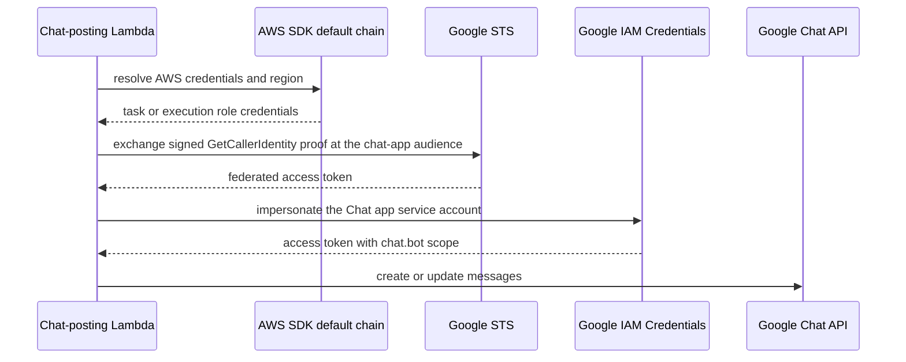

# Keyless Google Auth (Workload Identity Federation)

Before #1989, the Google Chat app and the group-sync Lambda each read a Google service-account JSON key from AWS Secrets Manager (`psd-agent-google-sa-{env}`, and a `GOOGLE_DIRECTORY_SA_SECRET_ARN` setting). Both now authenticate with workload identity federation: the Lambda's AWS role is exchanged for a short-lived Google token. No key is stored in Secrets Manager, and the group-sync settings no longer carry a key ARN.

The Google side (the `chat-app` and `directory-reader` providers in the `aws-agent-broker` pool, and the trust on each service account) lives in the separate `psd401/psd-gcp-infra` repository. This repository holds the AWS side: the audience, the service-account email, and the role names that the Google side must trust.

## Two Paths, One Pattern

| Consumer | Helper | Google identity | Scope | Configured by |
|---|---|---|---|---|
| Chat posting: router, cron, triage poll and digest Lambdas, and the job-runner task | `createGoogleChatWifAuth()` (copied into each Lambda) | Chat app service account for the environment | `https://www.googleapis.com/auth/chat.bot` | `googleChatAuthEnvironment()` in `infra/lib/agent-platform-stack.ts` |
| Directory membership reads: `group-sync` Lambda | `createDirectoryAuth()` in `infra/lambdas/group-sync/directory-auth.ts` | Shared `directory-groups-reader` service account (no key, no domain-wide delegation) | `https://www.googleapis.com/auth/cloud-identity.groups.readonly` | `GOOGLE_DIRECTORY_WIF_AUDIENCE` and `GOOGLE_DIRECTORY_SERVICE_ACCOUNT_EMAIL` in `infra/lib/processing-stack.ts` |

The two helpers differ in one place that matters for maintenance. The Chat helper supplies AWS credentials itself from the AWS SDK default chain (`defaultProvider()`), because google-auth-library's built-in AWS source reads only `AWS_ACCESS_KEY_*` variables or EC2 instance metadata and fails on the ECS Fargate job runner. The directory helper uses google-auth-library's built-in AWS source (`credential_source.environment_id: "aws1"`), which reads the Lambda runtime's environment credentials. Changing either one to match the other changes which runtimes can authenticate.

## Chat Auth Flow

*Caption: `google-auth-library` signs and exchanges the proof. The Lambda code only supplies the AWS credentials and the URLs.*

### Mirrored Helper

`createGoogleChatWifAuth()` builds a `chatPkg.auth.AwsClient` from `GOOGLE_CHAT_WIF_AUDIENCE` and `GOOGLE_CHAT_SERVICE_ACCOUNT_EMAIL`. It throws when the client is built, on first use, if either variable or the AWS region is missing, so a misconfigured Lambda fails before it sends a message. The canonical file is `infra/lambdas/shared/google-chat-wif.ts`. The Lambda build contexts are isolated, so the same file is copied byte-for-byte into `agent-router`, `agent-cron`, `agent-triage-poll`, and `agent-triage-digest`.

**Extension rule:** edit only the shared file, then copy it to the four Lambda directories. `tests/unit/google-chat-wif-mirrors.test.ts` compares each copy to the canonical file and also checks that each `package.json` pins `@googleapis/chat` `^47.0.0`.

### Environment Wiring

`agent-platform-stack.ts` holds the audience (the `chat-app` provider in project `1022506104054`) and a per-environment service-account map. The helper `googleChatAuthEnvironment()` returns the two variables for each Chat-posting compute unit. Staging has no entry: the function throws during synthesis, because `infra/bin/infra.ts` instantiates no staging stack and no staging Chat app exists.

The stack comment lists the roles the Google provider trusts by exact name: `psd-agent-router-execution-role-{env}`, `psd-agent-cron-execution-role-{env}`, `psd-agent-triage-worker-execution-role-{env}`, `psd-agent-triage-digest-execution-role-{env}`, and `psd-agent-job-runner-task-role-{env}`. A role rename in CDK must be matched in `psd-gcp-infra` first, or Chat posts fail closed. `infra/test/agent-google-chat-wif.test.ts` asserts that no Chat key secret or `GOOGLE_CREDENTIALS_SECRET_ARN` reference remains, that the job-runner task carries the WIF configuration, and that the job-runner role has its trusted name.

## Directory Auth and Group Sync

`infra/lambdas/group-sync/index.ts` calls `createDirectoryAuth()` and passes the client to `createDirectoryClient`. The sync is gated by two settings. Its runtime keys are read from the settings table by `resolveConfig` in `infra/lambdas/group-sync/config.ts`:

- `GROUP_SYNC_ENABLED` must be exactly `true` for scheduled runs. Manual runs ignore it, so an admin can sync while the hourly schedule is paused.
- `GOOGLE_DIRECTORY_CUSTOMER_ID` is required for any run. Without it the handler returns `skipped` with reason `not-configured`.

The keys `GOOGLE_DIRECTORY_SA_SECRET_ARN` and `GOOGLE_DIRECTORY_DWD_SUBJECT` were removed from both `lib/groups/settings.ts` and the Lambda. The `group-sync` execution role is named `psd-group-sync-{env}-execution-role-{env}`, which the directory-reader provider trusts. `infra/test/unit/processing-stack-group-sync-wif.test.ts` pins that name and the two WIF variables for `dev` and `prod`. The Admin → Groups membership model that consumes these rows is described in [Data Models](../data-models/overview.md).

## Operational Checks

- `bunx jest --silent tests/unit/google-chat-wif-mirrors.test.ts` detects drift between the four Chat helper copies.
- `cd infra/lambdas/agent-router && bun test google-chat-wif.test.ts` checks the router copy: client construction, the `chat.bot` scope, signing with injected credentials, and the `AWS_DEFAULT_REGION` fallback.
- `bun run test:lambda:group-sync` runs the group-sync suite. CI runs it as a separate step, because the root Jest configuration ignores `infra/`.
- `cd infra && bunx jest --silent test/agent-google-chat-wif.test.ts` checks the CDK wiring for the Chat path.

Scope boundary: these checks cannot prove that Google accepts the token. A real exchange needs the `psd-gcp-infra` trust in place, so a deploy that changes a role name or audience needs a manual Chat post in the target environment.

## Related Pages

- [Infrastructure Overview](overview.md) describes the Lambda inventory and the Secrets Manager paths that remain.
- [Agent Platform](../agent-platform/overview.md) describes the Chat router and cron behavior that depends on these clients.
- [Schedule Failure Streaks and Owner Notices](../agent-platform/schedule-failure-notices.md) describes the Chat messages the cron sends with this client.
